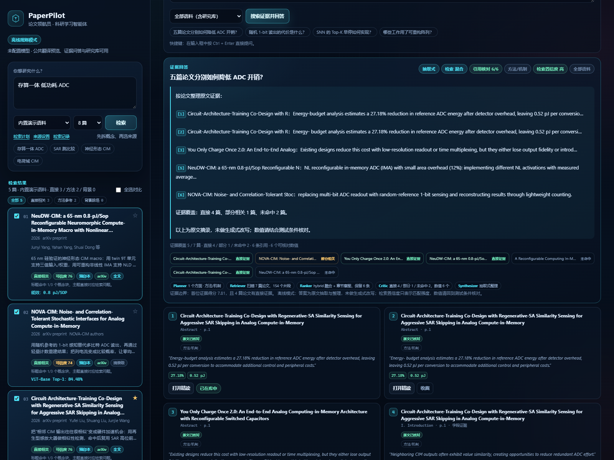
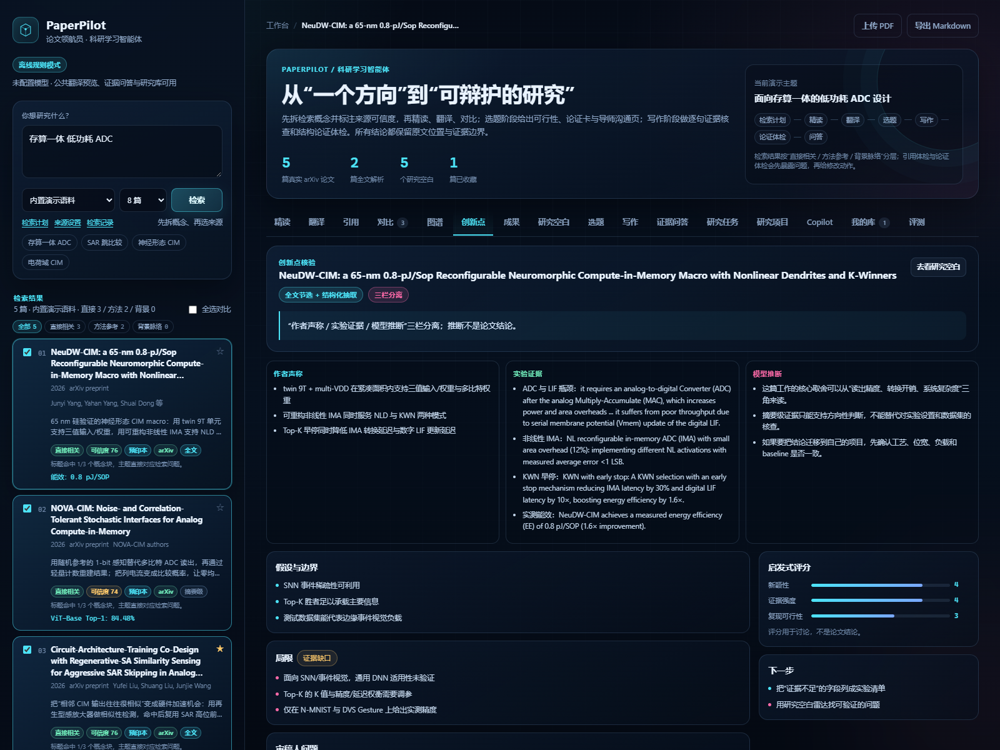
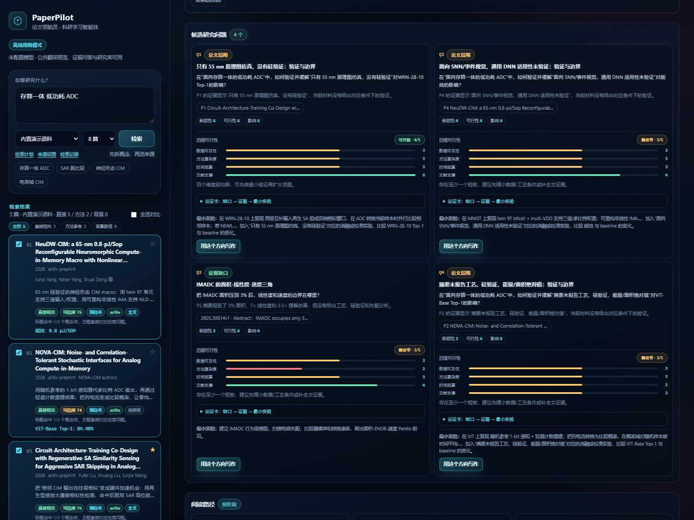
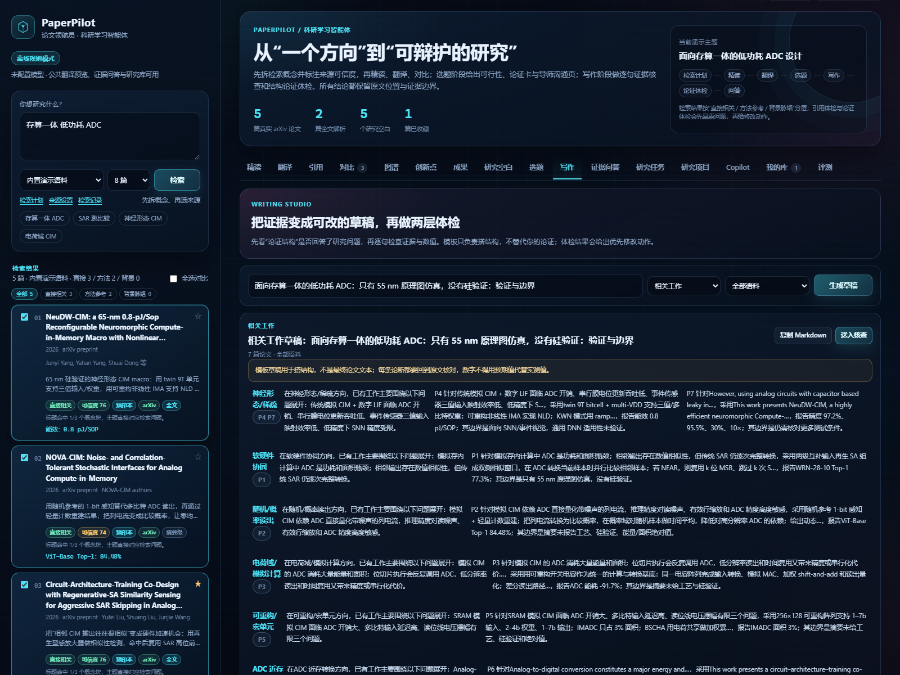

# PaperPilot · 论文领航员

> 从一个研究方向，到可配置来源、证据阅读、可辩护选题与论证体检的科研学习智能体。


更新记录见 [`../CHANGELOG.md`](../CHANGELOG.md)。

> **8.3.0 一键演示**：首屏右侧新增「一键跑完一次完整研究」——用内置演示语料新建项目、3 篇论文入池、跑完检索 → 精读 → 对比 → 选题 → 写作 → 核查 → 简报，然后自动打开项目（离线 1.4 秒、模型预算 0、15 个动作 / 21 条证据 / 16 个草稿块）。另加「看示例产出」与「接入我的模型」两个入口；README 与展示页改为作品说明式。**723/723 测试**、104/104 验收、47/47 一致性、41/41 回归；浏览器 0 console error、1600px 与 390px 溢出 0。
>
> **8.2.0 边界不再骗人**：本地安装曾因 CORS 通配与标识符未校验，让任意网页用简单 GET 读到本机保存的 API key；现在标识符统一净化（`^[A-Za-z0-9][A-Za-z0-9._-]{0,119}$`）、CORS 默认同源，自建镜像不再把上传数据与密钥打进镜像。聚合检索在在线源全败时不再静默换成演示语料，逐源交代状态与原因；写死的假性能基准已删除。读过的论文能进项目引用池并被引用；草稿正文在切标签、重挂载与服务端改写时不再被静默丢弃。部署到 ModelScope 的代码与发布包现在逐文件一致（推送前清除包外文件，推送后校验远端树）。**722/722 测试**、104/104 验收、47/47 一致性、41/41 回归。
>
> **8.1.4 验证工具在中文 Windows 控制台上可靠**：`acceptance.py` 过去在 GBK 区域编码下跑到第 82 条就因运行时文本里的 `•` 抛 `UnicodeEncodeError` 退出（rc=1，看起来像构建失败）。现在 28 个会打印运行时文本的脚本都以第一条语句声明安全输出（保留控制台原编码、只替换无法显示的字符，落盘仍为 UTF-8），一致性审计新增第 44 项 `G1`（第一次打印前必须声明）与第 45 项 `H1`（写到标准输出的 JSON 必须显式 UTF-8，档案 CLI 的 `--json` 曾按控制台编码写进管道）两条结构不变量；跨进程订阅用例不再泄漏子进程管道。**677/677 测试**（`-W error::ResourceWarning` 下同样全绿）、94/94 验收（强制 GBK 控制台实测 rc=0）、45/45 一致性、13/13 助手评测。
>
> **8.1.3 模型治理补齐出口**：在线问答与整段翻译改走统一网关（`purpose=ask`/`translation_full`），审计、预算与失败降级一致，整段翻译失败返回 400 而非 500；对比降级结果不再写入缓存；预算拦截在非 JSON 路径也留审计；缓存命中不再被预算挡住；长补全超时阈值降到 800 tokens，低于默认 60 秒的用户超时不再被抬升。**671/671 测试**、94/94 验收、43/43 一致性、13/13 助手评测。
>
> **8.1.2 运行预算账实一致**：Agent 动作内嵌套的精读与翻译模型调用统一计入该运行的 `max_llm_calls`，用尽后按原路径降级；缓存命中只记审计、不重复扣费；模型返回空负载时精读回退规则结果，不再抛 `KeyError` 让整轮 `read` 失败。**671/671 测试**、94/94 验收、42/42 一致性、13/13 助手评测；真实模型实测校验“预算与审计逐条一致且包含嵌套精读”。
>
> **8.1.1 自审加固**：模型字段在所有读取路径统一清洗，旧缓存不再绕过；JSON 仅在校验成功后缓存；Copilot 比较可引用运行账本，低相关度离线回退；引用编号前后端一致；`citations` 明确省略/null/对象三态；GitHub/ModelScope 部署复用交付白名单。**647/647 测试**、94/94 验收、42/42 一致性、24/24 离线 PDF、12/12 真实模型 PDF；浏览器矩阵 0 console error、0 溢出。
>
> **8.1.0 学生写作链路**：项目 Copilot 的“比较”问题进入在线回答并保留引用接地；不足两轮运行时离线比较回退证据问答；`PUT /api/projects/{id}/draft` 支持同次写入 `citations`；真实模型返回结构化字段时，精读与相关工作草稿只保留纯文本。**635/635 测试**、94/94 验收、42/42 一致性、24/24 离线 PDF、12/12 真实模型 PDF；完整流程实测“2 篇 PDF → Agent → Copilot → 选题 → 初稿 → 三种导出 → 档案”。
>
> **4.2.0 Agent 运行质量**：用真实 RAG 论文跑通 auto / checkpoint / step / budget / controls 五种运行，修复非硬件语料套用 ADC 方法簇、Agent 来源/目标未跟随检索、方法/局限误抽、证据重复与单一来源超时失败；`innovate / gaps / transform` 对非 ADC 论文改用中性表述。当时 **350 条测试**、41/41 回归、13/13 Copilot 专项通过。详见 [`docs/真机能力报告.md`](docs/真机能力报告.md)。
>
> **4.1.0 性能与修补**：图谱缓存键覆盖 `tldr`、完整摘要、前 3 节正文、结果与局限，且不再因主题输入变化而重建（5 篇 / 87 边实测：首次 2.44 ms，命中 0.59 ms）；新增 320 条关系总上限、聚焦重置与再次点击取消聚焦、图谱接口边界校验（scope 枚举、ID 长度/数量、topic 长度、未知/重复 ID）、任务键大小写去重；所有响应增加安全头，并用 CSP `frame-ancestors` 兼容 ModelScope 嵌入。当时 **343 条测试**、41/41 回归、13/13 Copilot 专项通过。
>
> **4.0.0 概念图谱**：主导航新增“图谱”工作区，把论文、概念/方法、数据/任务、指标、局限五类节点与讨论/评估/报告/局限/共现关系画成可交互 SVG；点击节点回到来源论文与原文摘句，支持类型筛选与 Markdown/JSON 导出。对比 2.0 的逐对可比性判定与结构化共识、主导航 Copilot、引用接地、统一模型网关（审计/预算/缓存/结构化修复）与草稿语义核查继续保留。当时 **337 条测试**、41/41 回归、13/13 Copilot 专项通过。
>
> **2.0.0 研究工作区**：项目成为顶层实体，多轮研究运行共享一份项目记忆。运行结束自动把已核对证据、开放问题、人工决策与论文快照提升到项目，新一轮启动时按记忆播种；运行中可暂停、恢复、重新规划、切换自主程度、补充约束、改选论文与注入问题，进度通过 SSE 快照流实时推送（不支持时自动降级轮询），并可对比同项目 2–3 轮运行。写作侧新增带证据锚点的结构化草稿工作台、8 条核查规则、版本快照与 Markdown/LaTeX/BibTeX/JSON 导出，Agent 增加 `write` 动作形成检索—写作—核查闭环。

## 它解决什么问题

本科生进组、研究生开题、课程论文调研，常见的工作流是：搜索论文 → 读摘要 → 手工做对比 → 最后仍然不知道创新点在哪、怎么复现，读过的笔记也散落在各处。

PaperPilot 把这条链路做成一个可运行的 Agent：

- **研究项目**：一个项目下多轮运行共享项目记忆；运行结束自动提升已核对证据、开放问题、人工决策与论文快照，新一轮按记忆播种并记录 `seed_summary`；项目阶段、计数与归档可管理，v1.0 独立任务可归档进项目
- **实时干预**：运行中可暂停/恢复/重新规划/切换自主程度/补充约束/改选论文/注入问题，控制在当前动作边界生效并全程留痕；进度经 SSE 快照流推送，代理缓冲或不支持时自动降级为轮询
- **运行对比**：同项目 2–3 轮运行的动作、证据、已核对、已解决问题、开放问题、报告字符、动作序列与共有/独有证据并排对比
- **结构化草稿**：章节 + 段落块，段落级证据锚点与引用键，`revision` 乐观锁（冲突 409），版本快照与恢复，8 条核查规则分级定位，导出 Markdown/LaTeX/BibTeX/JSON
- **自适应研究任务**：Planner 根据证据是否足够决定下一步；可在检索/选题检查点改选论文、选择方向；证据不足会追问或扩展检索；预算耗尽会收束；支持暂停、恢复、停止与 Markdown 简报
- **证据账本与开放问题**：精读/追问的证据统一入账（论文、章节、页码、quote、核对状态）；缺口转成开放问题并驱动后续动作；人工决策与预算全程可审计
- **查找**：检索计划（概念块、中英同义词、缩写全称、各来源检索式与解释）、24 小时查询级缓存、五源在线检索；支持配置 Semantic Scholar/CORE/任意 JSON API（账号/token/字段映射、测试连接、密钥隔离）；结果按“直接相关 / 方法参考 / 背景脉络”分层，并标注来源类型、题录可信度与警示；多源并发聚合支持超时跳过与慢源冷却
- **混合检索**：在 BM25 候选集上加入术语/章节扩展重排；配置 embedding 后可融合向量通道；问答显示检索模式，引用的 quote 会回到证据块核对
- **查阅**：TL;DR、问题/方法、章节节选、关键指标、图表/数值抽取、审稿人问题与页码级证据链；支持一次上传 1–5 篇 PDF；可导出“研究问题—数据与方法—核心发现—局限—与我的选题关联”五栏精读笔记
- **翻译**：论文翻译工作台；摘要/章节/整篇翻译、中英对照、311 条内置术语 + 在线/本地扩展术语包、公式/引用/数字保护、缓存与双语 Markdown 导出；公共接口与模型双通道
- **引用**：基于 OpenCitations 的参考工作/被引工作网络，Crossref 补全题录；研究库提供引用体检：题录完整度、重复项、DOI 可选联网核验与修复动作
- **对比**：2–10 篇论文自动抽取字段，生成对比表、共识、分歧与可比性提醒
- **提炼**：作者声称 / 实验证据 / 模型推断三栏分离，附审稿人问题
- **转化**：复现计划、代码骨架、组会 Slides、课程案例与 Quiz
- **问答**：跨全部语料、研究库或勾选论文提问；支持问题拆解、章节意图、支持度矩阵、可核对数值与页码引用
- **选题**：研究方法簇、证据缺口、候选问题、三阶段阅读路径与最小实验计划；每个候选附四维可行性、论证卡，以及带选项的导师提问与追问预演
- **写作**：相关工作 / 论文提纲 / 摘要骨架，附引用键与参考文献；逐句主张—证据核查 + 结构层面的论证体检（问题、缺口、方法、证据、讨论、局限、结论）
- **研究库**：收藏、待读/在读/已读、标签、研究笔记、引用体检，以及 Markdown / JSON / BibTeX 导出与 JSON 导入
- **检索留痕**：自动记录查询、来源、结果数、分层与首批结果，可导出 Markdown/CSV 并清空，便于复现检索过程
- **空白**：研究空白雷达，附新颖性、可行性与最小验证实验

## 快速启动

### 方式一：Windows 一键启动

```bat
start.bat
```

或者：

```bash
cd paperpilot
pip install -r requirements.txt
python run.py
```

浏览器会自动打开 `http://127.0.0.1:8765`。

### 方式二：Docker

```bash
docker compose up --build
```

### 方式三：只跑后端

```bash
uvicorn app.main:app --host 127.0.0.1 --port 8765
```

## 运行模式

| 模式 | 触发条件 | 能力 |
|---|---|---|
| 离线规则模式 | 未配置任何 LLM key（默认） | 内置 5 篇真实 arXiv 论文元数据 + 2 篇全文解析；十三个工作区全部可用；自适应 Agent 走规则 Planner/Critic 与离线简报；上传 PDF 使用规则抽取；证据问答为抽取式；无密钥翻译走公共接口逐节翻译 |
| 在线增强模式 | 配置任意 OpenAI-compatible Chat Completions endpoint | 在上传 PDF 上做结构化抽取与整篇翻译；证据问答基于检索片段生成带引用的综合回答；研究简报润色；可选 embedding 重排 |

配置方式：

```bash
cp .env.example .env
# 填入 PAPERPILOT_LLM_API_KEY / BASE_URL / MODEL
```

> 发布包**不包含任何 API 密钥**。离线模式用于保证演示稳定，界面会明确标注当前模式与抽取层级；在线模式只需替换为自己可用的模型服务。

## 工作区

| 工作区 | 能做什么 |
|---|---|
| 精读 | TL;DR、问题/方法、创新点、全文节选、指标、审稿人问题、证据链、Agent 轨迹、五栏精读笔记导出 |
| 翻译 | 摘要/章节/整篇翻译；中英对照、311 条内置术语 + 在线/本地术语包、公式/引用/数字保护、缓存与双语 Markdown 导出 |
| 来源设置 | Semantic Scholar/CORE/通用 JSON 自定义来源；账号/token、字段映射、测试连接、启停与密钥隔离 |
| 检索留痕 | 查询、来源、结果数、分层与首批结果；导出 Markdown/CSV、清空 |
| 引用 | 参考工作 / 被引工作、Crossref 题录补全、收藏、原文/PDF 跳转、Markdown 导出 |
| 对比 | 2–10 篇论文字段对比、共识、分歧、“不可直接比较”提醒 |
| 创新点 | 作者声称 / 实验证据 / 模型推断三栏分离与启发式评分 |
| 成果 | 复现计划、代码骨架、组会提纲、Quiz、课程案例 |
| 研究空白 | 从证据缺口生成研究问题，附评分与最小实验 |
| 选题 | 方法簇与年份版图、证据缺口、候选问题、四维可行性、论证卡、阅读路径、实验计划、导师沟通页 |
| 写作 | 相关工作 / 论文提纲 / 摘要骨架、引用键与参考文献、逐句核查、结构论证体检 |
| 证据问答 | 问题拆解 + 章节意图 + 字段证据 + 支持度矩阵 + 数值抽取 + 页码引用；显示混合检索模式与引用原文核对 |
| 研究任务 | 自适应计划、动作时间线、检索/选题检查点、证据账本、开放问题、预算与人工决策、实时控制栏与 SSE 进度、Markdown 研究简报 |
| 研究项目 | 项目概览与阶段、多轮运行、项目记忆（证据/问题/决策/论文）、新一轮播种、运行归档与删除、2–3 轮运行对比 |
| 项目 Copilot | 围绕项目资产问答；8 类意图、证据/草稿/运行引用、无证据拒答、可执行建议（需确认）、对话导出与清空 |
| 草稿工作台 | 章节与段落块编辑、证据锚点与引用键、`revision` 冲突处理、版本快照与恢复、8 条核查规则、主张三档语义核查、跨论文矛盾复核、Markdown/LaTeX/BibTeX/JSON/DOCX/PDF 导出 |
| 稿件与订阅 | 稿件元数据、五种引用样式、投稿前检查、DOCX/PDF 导出；检索订阅、增量索引、跨进程执行锁 |
| 投稿与审稿 | 四套投稿档案、分级检查、投稿包 ZIP、双盲 DOCX/PDF（去作者/单位/基金/致谢）、ORCID/通讯作者/贡献与可用性声明、审稿视角、审稿意见映射、回复模板、RIS/EndNote 导入导出 |
| 我的库 | 收藏、阅读状态、标签、研究笔记、搜索、引用体检、Markdown/JSON/BibTeX 导出、JSON 导入 |
| 评测 | 41 条内置回归用例、Copilot 专项评测、内容质量评测与金标集工作台、最近一次结果 |

## 演示

- 产品演示视频（v0.8 基线）：3 分 8 秒，位于 [`../demo/交付/paperpilot_demo.mp4`](../demo/交付/paperpilot_demo.mp4)
- v1.0 自适应 Agent 截图：[启动](docs/screenshot-agent.png)、[检索检查点](docs/screenshot-agent-checkpoint.png)、[选题检查点](docs/screenshot-agent-topic.png)、[完成态](docs/screenshot-agent-completed.png)、[证据账本](docs/screenshot-agent-ledger.png)
- v3.0 研究 Copilot 截图：[项目 Copilot](docs/screenshot-assistant.png)、[引用卡片](docs/screenshot-assistant-citations.png)、[无证据拒答](docs/screenshot-assistant-insufficient.png)、[草稿语义核查](docs/screenshot-draft-semantic.png)
- v2.0 研究工作区截图：[项目列表](docs/screenshot-projects.png)、[项目概览](docs/screenshot-project-overview.png)、[实时运行与控制栏](docs/screenshot-agent-live.png)、[草稿工作台](docs/screenshot-draft-studio.png)、[草稿核查](docs/screenshot-draft-audit.png)、[运行对比](docs/screenshot-run-compare.png)
- 流程：目标 → 动态计划 → 检索/精读/追问/对比/选题/写作/核查 → 证据不足再规划 → 收束；原有检索计划、精读、翻译、对比、创新点、成果、研究空白、选题、写作与论证体检、证据问答、研究库、批量 PDF 解析、评测仍可用

手动演示路线：

v3.0 快速演示：打开“研究项目”，进入一个已有运行与草稿的项目；切到“Copilot”，问“项目进展如何？”看状态与引用，再问“有哪些证据支持 ADC 能耗降低的结论？”看证据引用与建议动作；问一个项目里没有的问题（如“量子纠错”）看“证据不足”拒答；切到“草稿”，点“语义核查”看每段的支持关系，再点“运行核查”看词法问题与分级定位。

v2.0 快速演示：打开“研究项目”，新建项目并填写研究问题；点“启动新一轮”跑完第一轮，回到概览查看自动提升的项目证据；再启动第二轮（勾选带入项目记忆），在运行详情页用控制栏暂停/恢复或补充约束；切到“运行”勾选两轮点“对比已选运行”；最后在“草稿”里给段落绑定证据、运行核查并导出 Markdown 与 BibTeX。

v1.0 快速演示：打开首页，点“研究任务”，用默认目标启动自适应任务；在检索检查点改选论文，在选题检查点选择方向；Agent 若发现证据不足会追问，最后下载带证据账本与未解决问题的研究简报。

原有工作区路线：

1. 点“检索计划”查看概念块、中英扩展、各来源检索式与策略
2. 点开一篇论文，看 TL;DR、问题/方法、全文节选、指标、审稿人问题与证据链；点“导出精读笔记”得到五栏笔记
3. 点“翻译”，进入翻译工作台；先翻摘要，再翻译整篇，查看中英对照、术语与质量校验，导出双语 Markdown；对带 DOI 的论文点“引用”，查看参考/被引网络
4. 勾选 3 篇论文 → “对比”，查看对比表、可比性提醒、共识与分歧
5. 点“创新点”，看作者声称 / 实验证据 / 模型推断三栏
6. 点“成果”，看复现计划、代码骨架、组会提纲、Quiz 与课程案例
7. 点“研究空白”，看 5 个带评分与最小实验的研究问题
8. 点“选题”，生成方法簇、四维可行性、论证卡、导师沟通页、三阶段阅读路径与实验计划
9. 点“写作”，生成相关工作/提纲，先做“论证体检”看结构与引用，再做“逐句核查”核对数值
10. 点“证据问答”，问“这些工作的创新点是什么？”，查看支持度矩阵、可核对数值、检索模式与引用核验
11. 点“我的库”，做“引用体检”，处理重复/缺题录项，按需核验 DOI；切换阅读状态、编辑标签与笔记，导出 Markdown/JSON/BibTeX
12. 点“评测”，查看 41 条回归用例与最近一次结果

深链：

- `/#translate`
- `/#citations`
- `/#compare`
- `/#innovate`
- `/#transform`
- `/#gaps`
- `/#ask`
- `/#agent`
- `/#library`
- `/#eval`

## 页面预览

| 证据问答 | 我的库 |
|---|---|
|  |  |

| 对比 | 创新点 |
|---|---|
|  |  |

| 论文翻译工作台 | 引用网络 |
|---|---|
|  |  |

| 分类术语表 | 选题工作台 |
|---|---|
|  |  |

| 自定义来源 | 术语库管理 |
|---|---|
|  |  |

| 自定义来源检索 | 检索留痕 |
|---|---|
|  |  |

| 检索计划 | 多源分层与题录可信度 |
|---|---|
|  |  |

| 选题论证卡 | 导师沟通页 |
|---|---|
|  |  |

| 引用体检 | 论证体检 |
|---|---|
|  |  |

| 写作与核查 | 成果转化 |
|---|---|
|  |  |

## 架构

```text
用户
  ↓
Orchestrator（意图识别 / 任务规划 / 人工确认）
  ├─ Scout       检索计划、概念扩展、多源并发、去重与分层
  ├─ Reader      PDF 解析、章节/页码、证据定位、五栏笔记
  ├─ Translator  术语一致的双语翻译
  ├─ Analyst     字段抽取、横向对比、创新点
  ├─ Critic      证据校验、可比性、研究空白、引用体检
  ├─ Planner     研究版图、候选问题、四维可行性、论证卡、导师沟通
  ├─ Builder     复现计划、代码骨架、教学材料
  ├─ Writer      相关工作/提纲/摘要骨架、逐句核查、论证体检
  └─ Librarian   研究库、笔记、问题拆解与证据检索
  ↓
工具层：arXiv / Crossref / Europe PMC / DOAJ / HAL / OpenCitations / PDF Parser / 章节-字段感知 Retriever / Markdown · JSON · BibTeX Export
  ↓
存储：本地 JSON（研究库与检索缓存）+ 上传 PDF
```

当前版本实现从查论文到初稿导出、研究档案的完整闭环：

- 真实 arXiv 检索与缓存回退
- PDF 上传、逐页解析、章节抽取、原文页预览、证据高亮、OCR 与作者/年份元数据提取
- 结构化字段 + 证据链 + 可比性提示
- 检索计划、证据分层、题录可信度与多源并发聚合
- 对比 / 创新点 / 转化 / 空白 / 选题 / 写作 / 证据问答 / 研究库 / 评测
- Crossref 摘要级检索、PDF 图表/数值/局限抽取、研究库 JSON/BibTeX 备份
- 三源扩展检索、OpenCitations 引用网络与研究库引用体检
- 选题四维可行性、论证卡、导师沟通页；写作结构论证体检
- 311 条分类术语表、翻译工作台
- OpenAI-compatible LLM 可选增强
- 项目 Copilot、结构化草稿内联引用、DOCX/PDF 等六种导出与可复现研究档案
- Docker / 本地 / Windows 一键启动

## 项目结构

```text
paperpilot/
├─ app/
│  ├─ main.py              FastAPI 路由与静态页面
│  ├─ demo_data.py         内置论文语料、研究空白、术语表
│  ├─ llm.py               OpenAI-compatible 客户端（可选）
│  ├─ schemas.py           请求模型
│  └─ services/
│     ├─ search.py        多源检索、缓存、并发聚合与慢源冷却
│     ├─ planner.py       检索计划、概念扩展、结果分层与题录可信度
│     ├─ pdf.py            PDF 逐页解析、章节切分、元数据提取
│     ├─ analysis.py       精读、对比、创新点、转化、空白、精读缓存
│     ├─ translation.py    论文翻译、双通道、占位保护、缓存与导出数据
│     ├─ discovery.py      Europe PMC / DOAJ / HAL 来源解析与缓存
│     ├─ citations.py      OpenCitations 引用网络与 Crossref 题录补全
│     ├─ argument.py       结构论证体检、章节映射与未支撑主张
│     ├─ custom_sources.py 自定义来源配置、密钥隔离、测试连接与字段映射
│     ├─ netguard.py       HTTPS/内网地址安全校验
│     ├─ glossary.py       311 条内置分类术语表
│     ├─ glossary_store.py 在线/本地术语包、合并检索与许可信息
│     ├─ history.py        检索留痕记录与 Markdown/CSV 导出

│     ├─ ask.py            问题拆解、章节/字段感知检索、支持度与数值
│     ├─ research.py       选题版图、论证卡、导师沟通、草稿生成、主张核查
│     ├─ agent_state.py    运行 schema v3、证据账本、事件与预算（单一存储锁）
│     ├─ agent_policy.py   Planner 规划与 Critic 观察（含 write 与草稿缺口）
│     ├─ agent_actions.py  动态动作执行器与研究简报拼装
│     ├─ agent_runs.py     单 worker、检查点、恢复、裁剪与项目联动
│     ├─ agent_controls.py 7 种运行中控制指令与待处理队列
│     ├─ agent_stream.py   SSE 紧凑快照流与订阅队列
│     ├─ agent_compare.py  同项目 2–3 轮运行对比
│     ├─ project_state.py  项目与项目记忆持久化、提升、播种与裁剪
│     ├─ project_service.py 项目生命周期、运行归属、阶段与对账
│     ├─ draft_state.py    章节/段落块草稿、版本快照与限额
│     ├─ draft_service.py  草稿保存（revision 乐观锁）、引用键、版本与导出
│     ├─ draft_audit.py    8 条草稿核查规则与分级
│     ├─ draft_export.py   Markdown/LaTeX/BibTeX/JSON 导出与安全文件名
│     └─ library.py        研究库持久化、引用体检、标签、笔记、备份
├─ prompts/                Agent 提示词
├─ data/
│  ├─ cache/               检索/翻译/引用/DOI 缓存
│  ├─ glossaries/          在线/本地术语包（不随包发布）
│  ├─ custom_sources.json  非敏感来源配置（不随包发布）
│  ├─ custom_sources.secrets.json  token/password（不随包发布）
│  ├─ search_history.json  检索留痕（不随包发布）
│  ├─ agent_runs.json / agent_runs/  运行账本与产物（不随包发布）
│  ├─ projects.json / projects/  项目、记忆与草稿（不随包发布）
│  ├─ demo_pdfs/           两篇开放获取论文 PDF
│  ├─ parsed/              逐页解析 JSON
│  ├─ eval_set.json        41 条回归用例
│  └─ eval_results.json    最近一次回归结果
├─ static/                 无构建依赖的单页前端（app.js / projects.js / assistant.js / draft.js / agent-live.js）
├─ scripts/
│  ├─ evaluate.py          回归评测
│  ├─ eval_agent.py        自适应 Agent 场景评测
│  ├─ eval_workspace.py    v2.0 工作区端到端评测
│  ├─ eval_assistant.py    v3.0 Copilot 与在线路径评测
│  ├─ mock_llm_server.py   本地 OpenAI-compatible mock 服务
│  ├─ browser_matrix.py    Chromium/Firefox/WebKit 冒烟
│  ├─ real_world_check.py  真实 PDF 与联网真机检查
│  ├─ capture_screenshots_v07.py  界面截图与下载验证
│  ├─ capture_screenshots_v08.py  自定义来源/术语库/留痕验证
│  ├─ capture_screenshots_v20.py  研究工作区截图
│  ├─ capture_screenshots_v30.py  Copilot/语义核查截图
│  └─ package_project.py   白名单打包与密钥自查
├─ docs/                   说明文档、演示脚本、评测方案、截图
├─ Dockerfile
├─ docker-compose.yml
├─ requirements.txt
├─ run.py
└─ start.bat
```

## 主要 API

| 方法 | 路径 | 作用 |
|---|---|---|
| POST | `/api/search` | 检索论文（demo / arxiv / crossref / europepmc / doaj / hal / auto / custom:id），返回分层与可信度 |
| POST | `/api/search/plan` | 检索计划：概念块、中英扩展、各来源检索式与策略 |
| GET/POST | `/api/sources/custom` | 自定义来源列表与保存（token 只返回掩码） |
| POST | `/api/sources/custom/{id}/test` | 测试自定义来源连接与字段映射 |
| POST | `/api/sources/custom/{id}/toggle` | 启停自定义来源 |
| POST | `/api/sources/custom/{id}/delete` | 删除自定义来源与密钥 |
| POST | `/api/read` | 分层精读与证据链 |
| GET | `/api/translation/{paper_id}` | 翻译工作台章节、术语与缓存状态 |
| POST | `/api/translation/section` | 翻译单节（public / llm / auto） |
| GET | `/api/citations/{paper_id}` | 参考工作、被引工作与 Crossref 题录 |
| GET | `/api/glossary?q=&category=` | 合并内置与扩展术语包后的术语检索 |
| GET | `/api/glossary/packs` | 术语包、内置包与在线预设 |
| POST | `/api/glossary/packs/import` | 导入 JSON/CSV/TSV/Markdown 本地术语包 |
| POST | `/api/glossary/packs/online` | 从预设或 HTTPS URL 下载术语包 |
| POST | `/api/glossary/packs/{id}/toggle` | 启停术语包 |
| POST | `/api/glossary/packs/{id}/delete` | 删除术语包 |
| POST | `/api/compare` | 多篇对比与可比性提醒 |
| POST | `/api/innovate` | 三栏创新点核验 |
| POST | `/api/transform` | 复现计划、代码骨架、教学材料 |
| POST | `/api/gaps` | 研究空白雷达 |
| POST | `/api/ask` | 证据问答（all / library / selected）；返回检索模式与引用核验 |
| POST | `/api/agent/runs` | 创建并启动自适应研究任务（auto/checkpoint/step + 四类预算） |
| GET | `/api/agent/runs` | 任务摘要列表 |
| GET | `/api/agent/runs/{id}` | 任务详情、步骤产物与事件 |
| POST | `/api/agent/runs/{id}/action` | approve / retry / skip / cancel / resume / stop |
| POST | `/api/agent/runs/{id}/control` | 运行中控制：pause / resume / replan / set_mode / add_constraint / add_papers / inject_question |
| GET | `/api/agent/runs/{id}/stream` | SSE 紧凑快照流（`stream_seq` 递增，15 秒心跳，终态后关闭） |
| GET/POST | `/api/projects` | 项目列表与创建 |
| GET | `/api/projects/{id}` | 项目详情、计数与草稿摘要 |
| POST | `/api/projects/{id}/archive\|restore\|delete` | 归档、恢复与删除（可选保留运行） |
| GET | `/api/projects/{id}/memory?kind=` | 项目记忆：证据 / 问题 / 决策 / 论文 |
| GET | `/api/projects/{id}/runs` · POST `/runs/{id}/attach\|detach` | 运行归属与手动绑定 |
| GET | `/api/projects/{id}/compare?run_ids=` | 2–3 轮运行的指标、动作序列与证据差异 |
| GET/PUT | `/api/projects/{id}/draft` | 读取与保存草稿（`revision` 乐观锁，冲突 409） |
| POST | `/api/projects/{id}/draft/citations` | 为论文生成引用键 |
| GET/POST | `/api/projects/{id}/draft/versions` · POST `/versions/{id}/restore` | 版本列表、创建与恢复 |
| POST | `/api/projects/{id}/draft/audit` | 运行 8 条核查规则并分级汇总 |
| GET | `/api/projects/{id}/draft/export?format=markdown\|latex\|bibtex\|json\|docx\|pdf` | 导出草稿 |
| GET | `/api/submission/profiles` · POST `/api/projects/{id}/submission/check` | 投稿档案与分级检查 |
| GET | `/api/projects/{id}/submission/package?profile=` | 投稿包 ZIP（盲审时可匿名，响应头标记 PDF/盲审） |
| POST | `/api/projects/{id}/reviewer/report` · GET `/reviewer/response-template` | 规则审稿视角与回复模板 |
| GET/POST | `/api/projects/{id}/draft/references/export\|import` | RIS / EndNote XML 导出与导入（revision 乐观锁） |
| GET | `/api/agent/runs/{id}/report` | 下载 Markdown 研究简报 |
| DELETE | `/api/agent/runs/{id}` | 删除任务与报告目录 |
| POST | `/api/topic` | 选题工作台：版图、四维可行性、论证卡、导师沟通、实验计划 |
| POST | `/api/draft` | 相关工作 / 提纲 / 摘要骨架 |
| POST | `/api/check` | 逐句主张—证据核查 |
| POST | `/api/argument` | 结构论证体检、章节映射与优先修改动作 |
| GET/POST | `/api/library` | 研究库列表与收藏 |
| GET | `/api/library/health?verify=false` | 引用体检：题录完整度、重复项、可选 DOI 核验 |
| GET | `/api/history?limit=50` | 检索留痕列表 |
| GET | `/api/history/export?format=markdown\|csv` | 导出检索留痕 |
| POST | `/api/history/clear` | 清空检索留痕 |
| POST | `/api/library/{id}/update` | 更新状态、标签、笔记（兼容仅允许 GET/POST 的托管网关） |
| POST | `/api/library/{id}/delete` | 移除收藏（同上） |
| GET | `/api/library/export?format=markdown\|json\|bibtex` | 导出研究库 |
| POST | `/api/library/import` | 导入 JSON 备份（合并） |
| POST | `/api/upload` | 上传并解析单篇 PDF（前端支持批量） |
| GET | `/api/eval` | 回归用例与结果 |

## 评测

```bash
python scripts/evaluate.py
```

当前内置回归集：**41/41 通过（100%）**。覆盖检索排序与 Crossref 解析、字段抽取、PDF 图表/数值/局限抽取、证据数量、对比告警、术语、转化内容、研究空白、选题工作台、写作草稿、逐句证据核查、问答支持度、无证据拒答、研究库备份导入。

另有 **671 条**专项单元/API/前端契约测试（翻译、术语、来源解析、引用网络、检索计划/分层、引用体检、选题论证卡、论证体检、精读缓存、自定义来源、术语包、检索留痕，v1.0 状态/迁移、Planner/Critic、动态动作、证据账本、三档 worker、API 与报告回退，v2.0 项目状态/生命周期/API、记忆提升与播种、运行控制、SSE、运行对比、草稿状态/服务/核查/导出、Agent 写作闭环与前端模块契约，以及 v5 的引用样式、稿件、DOCX/PDF 导出、主张三档、矛盾检测与复核、订阅并发、内容评测与金标集工作台，v5.2 跨进程锁、4×6 语料、多主题构造集与线上 PDF，v6.0 投稿档案/投稿包/盲审导出/审稿视角/RIS-EndNote 互操作，v6.1 ORCID/通讯作者/贡献声明、盲审去致谢与审稿意见映射，v7.0 研究档案，v7.1 本地 PDF 全链路，v7.2–v7.3 OCR，v7.4 原文页，v8.0 证据高亮，v8.1 内联引用、在线比较、离线证据回退与结构化字段清洗，v8.1.1 成功缓存、引用编号顺序、`citations` 三态语义、运行账本接地与字段清洗回归，v8.1.2 运行预算逐条记账、缓存不重复扣费与精读降级回归）**671/671 通过**：

```bash
python -m unittest discover -s tests -p 'test_*.py'
```

工作区端到端评测（项目 → 两轮运行 → 记忆播种 → 草稿写入 → 核查 → 六种导出 → 运行对比，无需联网）：

```bash
python scripts/eval_workspace.py
python scripts/eval_agent.py
```

它们是流程和技术链路测试，不是人工质量评测；人工评测方案见 [`docs/评测方案.md`](docs/评测方案.md)。本项目不再随包发布静态性能数字（毫秒级指标随机器与缓存状态漂移），请在目标机器上实测并记录本次运行结果；历史实测记录见 `docs/真机能力报告.md`。

## 关键设计

1. **证据优先**：每个结构化字段尽量附 `section + page + quote`；找不到写“未提及”。
2. **三栏分离**：作者声称 / 实验证据 / 模型推断不混写。
3. **抽取层级可见**：全文节选与摘要级在 UI 上明确标注。
4. **可比性守卫**：不同工艺、验证方式、数据集、测试条件的数字不直接排序。
5. **问答可核查**：问题拆解 + 章节/字段意图 + 支持度矩阵；每条答案附原文引用，离线不生成原文没有的结论。
6. **覆盖透明**：跨论文提问时显示命中/未命中的论文，不用低相关片段硬凑。
7. **选题从缺口来**：候选问题优先来自证据缺口与论文局限，附四维可行性、论证卡、最小实验与导师提问，不把 future work 直接当创新点。
8. **写作先结构后核查**：先做结构论证体检（问题/缺口/方法/证据/讨论/局限/结论），再做逐句证据与数值核查。
9. **研究可积累**：收藏、状态、标签、笔记持久化，可用 JSON 备份迁移、BibTeX 导出。
10. **翻译可核对**：公式、引用与 URL 使用占位符保护，数字自动比对；无密钥时标注公共接口额度，配模型后可完整翻译。
11. **引用可追踪**：OpenCitations 提供参考/被引关系，Crossref 补全题录；研究库引用体检标出缺失题录、重复项与 DOI 核验结果。
12. **离线可演示**：没有 API key 也能走完检索计划、阅读、翻译预览、问答、选题、写作与核查。
13. **检索可解释**：每条查询先拆概念块并给出各来源检索式；结果分层与可信度只作为筛选提示，不冒充质量裁决。
14. **慢源可降级**：多源并发聚合设置响应上限；超时来源会被跳过并短暂冷却，优先返回可用证据。
15. **能力保留**：导师沟通页先给带选项的问题与追问准备；论证体检先暴露缺口与修改动作，而不是替用户重写全文。
16. **来源可配置**：自定义 API 的地址、字段映射、认证与账号由用户控制；敏感 token 隔离存储，接口只回显掩码，SSRF 守卫只允许 HTTPS 公网地址。
17. **术语可扩展**：内置术语优先，在线/本地术语包补充新词；每个扩展包保留来源、许可与归属，支持启停与删除。
18. **检索可复现**：每次检索自动留痕查询、来源、结果数与分层，可导出 Markdown/CSV，便于复盘而不是只留下一个结果列表。
19. **任务可恢复**：研究任务按动作持久化，检索/选题检查点可人工确认与改选；重启后标记中断并可恢复，报告可单独下载。
20. **引用先核验**：每条引用 quote 回到对应证据块做原文匹配；核对失败标记为“待核对”，不把模型输出当作新证据。
21. **自适应而非固定流水线**：Planner 按证据覆盖、引用支持、饱和度和开放问题决定下一步；Critic 发现未支撑主张会触发追问或扩展检索，预算耗尽会收束。
22. **边界可见**：证据账本、开放问题、人工决策和预算写入界面与简报；未解决问题不会被隐藏，LLM 只做润色不替代证据。

## 数据与隐私

- 论文元数据来自 arXiv 公开 API。
- 两篇全文论文为 arXiv 开放获取版本，仅用于解析演示。
- 上传 PDF 仅保存在本地 `data/uploads/`，不对外分发。
- 无密钥翻译会把所选章节原文发送给公共翻译接口（MyMemory）；未公开论文请配置模型或避免使用公共翻译。
- Europe PMC / DOAJ / HAL 与 OpenCitations 的检索/引用数据受各自 API 可用性与覆盖范围影响；引用网络只支持 DOI 记录。
- 多源并发聚合的慢源冷却保存在进程内，重启后清空；超时来源不会写入错误结果。
- 自定义来源配置保存在当前实例的 `data/custom_sources.json`，token/password 保存在 `data/custom_sources.secrets.json`；两者都不进入发布包或公开仓库，API 只返回掩码。
- 在线/本地术语包保存在 `data/glossaries/`，不进入发布包；在线术语仍受原项目许可（例如 CC BY-NC-SA 4.0）和 API 可用性约束。
- 检索留痕保存在当前实例的 `data/search_history.json`，可导出或清空；不包含发布包。
- 引用体检的 DOI 核验只在用户点击“核验 DOI（联网）”时访问 Crossref，结果缓存 7 天；不上传研究库内容。
- 研究库保存在当前实例的 `data/library.json`，不包含在发布包或镜像中；它面向单机/演示使用，不是多用户数据库。
- 不绕过付费墙，不抓取非开放获取全文。

## 真机验证

2026-10-20 在本地安装并实测 5 篇真实开放获取 arXiv 论文（FlashAttention、LLM.int8、GPTQ、SmoothQuant、AWQ），并在 1600×1200 浏览器中完成 v0.7/v0.8 新流程：

- v0.8 自定义来源：用 Crossref 作为通用 JSON API 实测返回 3 条真实题录（约 2.1 秒），来源连接测试 0.8 ms（缓存）；Semantic Scholar 匿名请求在本机返回 429，配置 x-api-key 后可重试。
- v0.8 术语库：从 GitHub 下载机器之心 AI 术语库 **2442 条**，约 2.8 秒；与内置 311 条合并后 **2657 条**；本地 CSV 导入 2 条通过；许可与归属显示为 CC BY-NC-SA 4.0。
- v0.8 检索留痕：浏览器记录查询/来源/结果数/分层，Markdown 导出成功；来源设置、测试、自定义检索与术语库管理全程 **0 console error**。
- 真机自动检查 **10/10**：检索相关命中 4/4，PDF 结构 5/5，跨语言核心问题覆盖 5 篇。
- 检索计划本地生成 **0.06 ms**；演示检索 + 分层标注 **0.41 ms**；选题首次 **2.1 ms**、复跑 **1.2 ms**；论证体检 **4.2 ms**；引用体检无网 **0.33 ms**。
- 多源并发聚合：Crossref + Europe PMC 正常返回，arXiv 在本机出现连接超时；自动搜索在 **8.0 s** 上限内返回 8 条结果（直接相关 5 / 方法参考 3）；正常冷启动约 **0.9 s**，缓存/慢源冷却后复跑 **0.5–153 ms**。缓存命中时单查询约 2–3 ms。
- 浏览器实测：检索计划、分层筛选、引用体检（含 DOI 联网核验 1/1 通过）、选题四维可行性/论证卡/导师沟通页、论证体检、精读笔记与论证 Markdown 下载全部通过，**0 个前端 console error**。
- 引用网络：用 DOI `10.3390/computers13110278` 实测返回 11 条参考、19 条被引；研究库 DOI 核验缓存复跑 **0.2 ms**。
- 自适应 Agent（v2.0.0 复测 `scripts/eval_agent.py`）：auto 12 动作（含 2 次追问）/16 条证据/15,138 字符简报；checkpoint 11 动作/14 条证据/13,176 字符；`max_actions=2` 时 3 动作收束/3,742 字符。
- v2.0 工作区评测 `scripts/eval_workspace.py`：首轮 16 动作/16 条证据，次轮带入 14 条项目证据/11 动作，草稿写入 3 块，核查 13 条高危，两轮共有证据 15 条，0.61 秒完成。
- v2.0 浏览器：项目列表/概览/运行对比/草稿工作台/核查/实时控制栏 6 张截图重录，SSE 实时连接显示“控制在当前动作结束后生效”，**0 个 console error**，390px 项目页与草稿页横向溢出 0。
- v3.0 Copilot 评测 `scripts/eval_assistant.py`：13/13，覆盖 8 类意图、证据引用、无证据拒答、建议需确认、语义四态、mock 在线合法/越界回退/注入/预算降级。
- v3.0 浏览器：Copilot 提问与引用卡片、无证据拒答、语义核查、项目/运行/草稿页面共 10 张截图重录；**0 console error**，390px 项目页/助手页/草稿页横向溢出均为 0。
- v4.2 真实论文 Agent：auto / checkpoint / step / budget / controls 五种运行全部完成；每轮 11–14 动作、报告 8.9k–13.1k 字符；非 ADC 主题的 Agent、选题、草稿与成果页 0 次 ADC/CIM/存算术语；浏览器真实检索→全自动运行 0 console error、0 横向溢出。
- v4.1 图谱：3 篇论文 27 节点 / 96 边；聚焦 `CIM` 显示 3 条原文摘句与来源论文，重置聚焦/再次点击取消聚焦生效；1600px 与 390px 横向溢出 0，0 console error；首次构建 2.44 ms，缓存命中 0.59 ms。
- 浏览器：检索改选、选题确认、追问、报告下载；**0 console error**；390px 横向溢出 0；step 模式每次批准只执行一个动作。
- 回归测试 **41/41**，当前测试总量 **723/723**（含 v1.0 状态/规划/动作/worker/API、v2.0 项目/控制/SSE/对比/草稿/核查/导出，v3.0 Copilot/接地/网关/语义核查/前端契约，v4.x 概念图谱/缓存边界/安全头/真实论文 Agent 运行质量，v5–v8.0 稿件、档案、OCR、原文页与证据高亮，v8.1 内联引用、在线比较、离线证据回退与结构化字段清洗，v8.1.1 成功缓存、引用编号顺序、`citations` 三态语义、运行账本接地与字段清洗回归，v8.1.2 运行预算逐条记账与精读降级回归，v8.1.4 控制台编码与 JSON 出口，v8.2 标识符边界、CORS 边界、镜像内容、引用池、聚合检索来源状态、脏稿守卫、模型治理与部署树一致性回归，v8.3 一键演示编排与前端契约回归）。
- 复测脚本：`python scripts/real_world_check.py --pdf-dir <包含 5 篇 PDF 的目录>`；v0.8 截图与下载验证 `python scripts/capture_screenshots_v08.py`；v2.0 工作区截图 `python scripts/capture_screenshots_v20.py`；v3.0 截图 `python scripts/capture_screenshots_v30.py`；Copilot 评测 `python scripts/eval_assistant.py`；浏览器矩阵 `python scripts/browser_matrix.py`。

完整数据、优化项与边界见 [`docs/真机能力报告.md`](docs/真机能力报告.md)。

## 已知局限

- 离线模式的结构化字段为人工校订的演示语料，不等于对任意论文的自动抽取。
- 证据问答的候选召回仍是词法检索（BM25 + 章节/字段意图）；混合检索只在 BM25 候选集上重排，不引入候选集之外的新证据；embedding 默认关闭，需要模型 key 与 `PAPERPILOT_EMBEDDINGS=1`。
- 自适应 Planner/Critic 默认是规则策略，不是专家级研究判断；它能暴露开放问题与预算边界，但选题价值仍需人工确认。
- 离线问答是抽取式拼接，不做生成式综合；在线模式依赖所配置模型的质量。
- 检索分层、题录可信度与选题四维可行性都是规则/元数据启发式，只用于筛选与讨论，不是对论文质量或研究价值的最终裁决。
- 多源聚合设置 8 秒响应上限；超时来源会被跳过并冷却 180 秒，因此可能暂时少返回某个慢源的结果。
- 引用体检的 DOI 核验需要联网访问 Crossref，且只比较题名相似度；题录缺失项不会被自动编造。
- 写作草稿是模板结构，必须人工改写；主张核查基于词重合度与数值一致性，论证体检基于结构与引用标记，两者都不是事实真伪判定。
- 研究库、任务与项目/草稿状态是单实例 JSON 文件，未实现账号体系与实时同步；任务 worker 为单进程单线程，不适合多用户并发或分布式执行。
- SSE 快照流由当前进程推送，反向代理可能缓冲事件流导致进度延迟；前端在连接失败或长时间无事件时自动回退到 1.5 秒轮询。
- 项目记忆与草稿同样保存在实例本地，创空间实例替换后不保留；导出文件是唯一可持久带走的结果。
- 离线 `write` 动作产出的是绑定证据的待改写段落，措辞与论断仍需人工重写；核查规则只做证据锚点、引用与数值一致性检查，不做事实真伪判定。DOCX 与 PDF 是课程论文级导出，不做期刊模板；PDF 依赖服务器本机安装 XeLaTeX，未安装时该格式返回 503，公式按 LaTeX 源码保留。
- 人工金标集（4 主题 × 6 篇 / ≥200 条）**仍需人工签字**：语料已补到 4×6、候选池 225 条、多主题构造集 351 条，但 `label` 需要人填写；构造集的 1.000 不是人工质量结论。
- 订阅调度有线程锁 + 本地文件锁，可防同机多进程重复抓取；不提供 NFS/对象存储上的分布式锁语义。
- 对比结论与创新点评分用于讨论，不替代人工阅读和实验验证。
- 投稿档案是参考要求，不是期刊官方模板；审稿视角是规则自查，不是同行评审，也不代表编辑决定。投稿信/亮点/回复信是模板，发送前需人工核对。
- RIS/EndNote 导入只做字段级映射；复杂 EndNote 类型、附件与自定义字段不保证保留。
- ORCID 只校验格式与校验位，不向 ORCID 公共 API 验证归属；审稿意见映射是词法排序，只用于定位段落，不代表对意见的理解，回复内容仍需作者填写。

