# PaperPilot 真机能力报告

- 版本：8.1.4
- 日期：2026-10-25
- 运行方式：Windows 10 / Python 3.13.15 / PyMuPDF 1.28.2 / Playwright + Edge，本地安装、离线规则模式（未配置 LLM）
- 语料：5 篇开放获取 arXiv 论文，真实网络检索与真实 PDF 上传；v4.2 另用 arXiv / Crossref / Europe PMC 在线检索的真实 RAG 论文验证 Agent 全流程

## 结论

v8.1.4 当前以 **验证工具自身的可靠性**为主：中文 Windows（区域编码 GBK）下 `scripts/acceptance.py` 会在第 82 条因运行时文本里的 `•` 抛 `UnicodeEncodeError` 退出（rc=1），看起来像构建失败；现在 28 个会打印运行时文本的脚本都以第一条语句声明安全输出，强制 GBK 控制台实测 **94/94、rc=0**。同一类问题在数据出口上也存在：档案 CLI 的 `--json` 会把带中文标题的 JSON 按控制台编码写进管道，现已固定为 UTF-8。一致性审计因此新增第 44 项 `G1` 与第 45 项 `H1` 两条结构不变量；跨进程订阅用例的子进程管道泄漏也一并修掉，全量 **677/677** 测试在 `-W error::ResourceWarning` 下同样全绿。

v8.1.3 此前以 **模型调用治理覆盖全部出口**为主：`/api/ask` 与整段翻译改走统一网关后，真实端点上`purpose=ask`、`purpose=translation_full` 都出现在 `/api/llm/audit`（此前审计与预算完全看不见它们）；真实模型 PDF 审计从 12/12 扩到 **14/14**（14 次调用 0 失败、2 次缓存命中、平均 40.8 秒），`live_agent_check.py` **14/14** 且 `budget_used=4 == charged=4`（用途含 `compare`、`ask`、`agent_report`）；完整学生流程 9 个动作、`llm_calls 6` 与审计逐条一致、简报 `mode=llm` 9,217 字符。

v8.1.2 此前以 **模型调用账实一致**为主：真实端点跑完整学生流程时，两次精读（90.0s / 84.8s）、一次横向对比（51.0s）与一次研究简报（98.0s）全部计入该运行的 `max_llm_calls`（`llm_calls 4/6`），另外两次精读命中缓存、只记审计不扣费；`live_agent_check.py` 断言“运行预算 == 审计中成功且未缓存的条数”。全量测试 **671/671**，端到端验收 **94/94**，离线一致性 **42/42**，Copilot 专项 **13/13**，档案 **10/10**，离线 PDF **24/24**，OCR **6/6**，主回归 **41/41**。

v8.1.1 此前以 **学生完整写作链路与可信引用**为主：2 篇本地 PDF → Agent → Copilot → 选题 → 相关工作初稿 → 保存 → preflight → Markdown/DOCX/PDF → 研究档案。全量测试 **647/647**，主回归 **41/41**，Copilot 专项 **13/13**，端到端验收 **94/94**，离线一致性 **42/42**，档案 **10/10**，离线 PDF **24/24**，真实模型 PDF **12/12**，OCR **6/6**。真实端点完成 Agent 9 个动作、10,501 字符简报、Copilot 5 条有序引用与三种导出；ModelScope `/api/meta` 为 52 项特性。

历史 v4.2 曾以 Agent 真实运行质量为主：用在线检索的真实 RAG 论文跑通 auto / checkpoint / step / budget / controls 五种运行，修复非硬件语料套用 ADC 方法簇、Agent 来源/目标未跟随检索、方法/局限误抽、证据重复与单一来源超时失败；`innovate / gaps / transform` 对非 ADC 论文改用论文自身内容。当时全量测试 **350/350**，主回归 **41/41**，Copilot 专项 **13/13**，端到端验收 **56/56**。浏览器真实检索 → 3 篇勾选 → 全自动 Agent 完成，0 console error，1600px 与 390px 横向溢出均为 0。

## v6.3.2 真实模型路径审计（2026-10-23）

```bash
export PAPERPILOT_LLM_API_KEY=...       # 只经环境变量注入隔离实例
export PAPERPILOT_LLM_BASE_URL=...
export PAPERPILOT_LLM_MODEL=deepseek-v4.1-flash-1017
python scripts/live_audit_consistency.py
```

真实端点：阿里云百炼 OpenAI 兼容模式 · `deepseek-v4.1-flash-1017`。密钥未写入仓库、日志、证据文件或交接包。

| 检查 | 实测 |
|---|---|
| L1 实例在线 | `mode=online`、`llm_enabled=true` |
| L2 Agent 简报由模型撰写 | `status=completed`、`mode=llm`、**11,503 字符** |
| L3 图例与本次论文一一对应 | 3 篇论文，`[P1]–[P3]` 图例与参考文献编号一致 |
| L4 简报数字可回到运行状态 | 11 个数字全部命中证据/论文快照，0 编造 |
| L5 Copilot 模型回答与引用覆盖 | `mode=llm`、4 条引用、回答中 `[1]–[4]` 全部有落点 |
| L6 Copilot 数字来源 | 3 个数字全部来自所引原文或引用题录 |
| L7 语义核查由模型复核 | `mode=llm` |
| L8 原文引句不被判不支持 | `supported` |
| L9 编造数字不被判支持 | `insufficient` |
| L10 调用审计无降级 | 3 次调用全部成功（`agent_report / assistant / semantic_audit`） |

本次真实运行暴露并修复的问题：

| 现象 | 根因 | 修复 |
|---|---|---|
| 简报 `mode=offline`，审计记录 `schema` 降级 | 推理模型把 2600 token 全部用于隐藏推理，`finish_reason=length`、`content` 为空；同预算重试仍为空 | 识别“推理额度耗尽”，空回复重试上限提高到 16384；该模型随后生成 12,420 字符完整简报（`finish_reason=stop`） |
| 模型版简报有正文 `[Pn]`，但没有参考文献段 | 模型按提示保留了证据账本与动作轨迹，却省略了参考文献 | 图例与题录始终按运行论文顺序重建；离线题录的作者/会议/年份/DOI 格式保持不变 |
| Copilot 回答 4 个片段编号，却只返回 2 条引用 | “证据边界”在引用列表计算之后才拼接，边界里的 `[1][2][5]` 没有进入 `citations` | 先拼接边界再统一解析编号；越界编号仍触发原有回退 |

全量门禁：**590/590** 测试、**90/90** 验收、**42/42** 离线一致性审计、`evaluate.py` **41/41**、`eval_content --strict` 退出码 0。

**边界**：只测了一个供应商与一个模型；数字回查只证明“能在运行状态里找到”，不替代人工核读；推理型模型生成完整简报约 80 秒，首次尝试仍会消耗 2600 token 的推理额度。


## v5.0 发布验证（2026-10-22）

| 门禁 | 结果 |
|---|---|
| 全量测试 | **461/461** |
| 主回归 / Copilot 专项 | 41/41、13/13 |
| 端到端验收 | 65/65（`scripts/acceptance.py`，已入库） |
| 内容质量（构造探针 32 条） | 支持精度 1.000、支持召回 1.000、过度严格率 0.000、数值一致率 1.000、准确率 0.969；矛盾召回 1.000、误报 0.000 |
| 浏览器（Edge） | 稿件面板：保存元数据、GB/T 7714 引用预览、投稿前检查、DOCX 下载 38 KB 且可回读；跟踪面板：创建并执行 demo 订阅（新增 5 篇）；**0 console error、0 失败请求**；1600px 与 390px 横向溢出 0 |

截图（`paperpilot/docs/`）：`screenshot-manuscript.png`、`screenshot-manuscript-mobile.png`、`screenshot-tracking.png`。

### v5.0.0 三端部署（2026-10-22）

| 端 | 标识 | 线上验证 |
|---|---|---|
| GitHub `main` | 约 278 文件 / 约 93 MB（**以仓库 main HEAD 为准**；本文件也在库内，写死 commit 会被本次提交作废） | 逐文件核对，v5 模块与测试均在库 |
| GitHub `gh-pages` | 以 `gh-pages` HEAD 为准 | 页面约 7.1 MB，含 `PaperPilot 5.0.0` 与"稿件设置/订阅跟踪"卡片 |
| Cloudflare Pages | 部署 `56ac0612` | 与 GitHub Pages 内容一致 |
| ModelScope 创空间 | git `8bbbd530068808edeb501e85d7c3773b234fbf0c`，实例 Running | 见下 |

线上真机（ModelScope API 专用地址）实测：

- `/api/health` → `5.0.0`、`offline`；`/api/meta` → `5.0.0`，`features` **38** 项，含 `manuscript / docx / citation_styles / preflight / subscriptions / incremental_index / llm_summary`。
- 创建项目 → `PUT /manuscript`（GB/T 7714）→ **DOCX 导出 200、38,001 字节、`PK` 头**（说明 `python-docx` 已进入镜像）；`POST /draft/preflight` 200、`blocking=false`、2 条提示；`GET /api/subscriptions` 200、调度默认关闭；`GET /api/llm/audit` 200、汇总 12 个字段。
- 更新镜像后实例曾短暂返回 412 `function is pending state`（约 1 分钟），随后恢复；部署脚本的轮询不覆盖这段冷启动，验收时需重试。

未完成项（对外表述时必须保留）：PDF 导出、人工标注金标集（≥200 条）、真实模型在线复核实测。

## v5.1 发布验证（2026-10-22）

| 门禁 | 结果 |
|---|---|
| 全量测试 | **494/494** |
| 主回归 / Copilot 专项 | 41/41、13/13 |
| 端到端验收 | **69/69**（新增 PDF、离线复核不改写、特性位、调度运行列表） |
| 内容质量 | 构造集 32 条 + 同领域硬负例 37 条：支持精度 1.000、支持召回 1.000、过度严格率 0.000、数值一致率 1.000、准确率 1.000 |
| PDF 导出 | 本机 TeX Live 2026 实际编译：验收下载 **82,670 字节**、`%PDF` 头；浏览器面板下载 43,317 字节 |
| 浏览器（Edge） | 稿件抽屉下载 DOCX 38,805 字节与 PDF；草稿工具栏「矛盾复核」在无 key 下提示“未配置模型，已跳过复核”；**0 console error、0 失败请求**；1600px 与 390px 横向溢出 0 |

本机工具链：`C:\texlive\2026\bin\windows\xelatex`。无 TeX 的部署环境会返回 503 与安装提示；
`tests/test_pdf_export.py` 同时覆盖 503、422 与真实 `%PDF` 三条路径。

截图（`paperpilot/docs/`）：`screenshot-draft-v51.png` 为新增；`screenshot-manuscript.png`、
`screenshot-manuscript-mobile.png`、`screenshot-tracking.png` 已随 5.1.0 重拍。

### v5.1 边界

- **人工金标集仍未完成**：`golden_workbench.py` 已能抽取候选、校验、合并双标注并输出分歧日志；
  当前离线语料生成 `cim-adc` 5 篇 / 36 条、`llm-inference-quantization` 4 篇 / 32 条，
  `rag-pipelines` 与 `recommender-systems` 为 0，需要标注者用 `--papers` 或 `data/parsed/` 补齐。
- **真机模型路径未用真实 key 运行**：`eval_real_llm.py --check` 在无 key 时退出 2，不写报告。
- **订阅并发锁只覆盖单进程**：不提供跨进程或分布式互斥。
- 三端部署标识与线上验证记录写入交接包 `cs/VERIFICATION.md`，仓库内不重复写会发生变化的 commit/deployment id。

## v5.2 发布验证（2026-10-22）

| 门禁 | 结果 |
|---|---|
| 全量测试 | **502/502** |
| 主回归 / Copilot 专项 | 41/41、13/13 |
| 端到端验收 | **71/71**（新增语料 4×6、候选池 ≥200 且标签为空） |
| 内容质量 | 构造集 32 + 硬负例 37 + 多主题 351 = **420 条**，六项指标 1.000（构造集，不是人工结论） |
| 金标语料 | `corpus/` 4 主题 × 6 篇真实摘要（Crossref + Europe PMC）；候选池 **225 条**，`label` 全为空 |
| 跨进程锁 | 子进程持锁时父进程返回 `busy` 且不检索；陈旧锁 30 分钟回收；token 不匹配不删他人锁 |
| 本机 PDF | 仍为 82 KB 级 `%PDF`；无 TeX 时 503 路径不变 |
| 浏览器 QA | 0 console error、0 失败请求、390px 溢出 0（界面无 v5.2 改动，沿用 5.1 截图） |

### v5.2 线上 PDF

ModelScope 镜像新增 XeLaTeX/ctex/Noto CJK 层（fontset=ubuntu）（`modelscope_space/Dockerfile`）。部署后的线上验证：

- `/api/health` → `5.2.0`；`/api/meta` → 42 项特性位（含 `cross_process_lock`）。
- 创建项目并保存草稿 → `format=pdf` 返回 **200、16,112 字节、`%PDF-`**，耗时 **6.8 秒**；
  PyMuPDF 回读 1 页、`存内计算` 与标题均可提取（Noto CJK 生效）；`format=docx` 仍为 200、`PK`。
- 镜像踩坑：Debian trixie 无 `fonts-fandol`（改用 `fonts-noto-cjk` + `fontset=ubuntu`）；
  缺 `texlive-fonts-recommended` 时 `hyperref` 触发生成 `pzdr` 失败（`I can't find file 'pzdr'`），补装后通过。
- 首次 PDF 请求包含两次 XeLaTeX 编译；线上实测 6.8 秒，验收超时放宽到 180 秒。

> 以上线上数值在部署完成后写入 `cs/VERIFICATION.md`；仓库内不写会随提交变化的 commit id。

## v6.0 发布验证（2026-10-22）

| 门禁 | 结果 |
|---|---|
| 全量测试 | **523/523** |
| 主回归 / Copilot 专项 | 41/41、13/13 |
| 端到端验收 | **78/78**（新增投稿档案/检查/投稿信/审稿/投稿包/RIS 闭环/特性位） |
| 投稿包 | 10 文件 ZIP，含 `manuscript.docx`、`manuscript.pdf`、投稿信、亮点、标题页、清单、RIS/BibTeX、回复模板 |
| 盲审 | 双盲档案的 DOCX 不含作者/单位/基金；标题页单独保留作者 |
| 审稿视角 | 规则报告（优点/主要/次要问题/待回答问题/推荐等级），只读，附 disclaimer |
| 浏览器（Edge） | 投稿抽屉 4 档案、检查、ZIP 10 文件含 PDF、审稿视角、导入 1 条；**0 console error、0 失败请求、390px 溢出 0** |
| 线上 ModelScope | `/api/health` 6.0.0、`/api/meta` 45 项；PDF 200（25,224 字节）、DOCX 200（38,307 字节）；`/submission/package` 200、62,754 字节、1.5 秒、10 文件含 PDF；`/reviewer/report` → `minor_revision`；RIS 导出 200 |

截图：`docs/screenshot-submission.png`、`screenshot-submission-mobile.png`、`screenshot-draft-v60.png`。

### v6.0 边界

- 投稿档案是参考要求，不是期刊官方模板；审稿视角不是同行评审，推荐等级不代表编辑决定。
- 投稿信/亮点/回复信是模板/规则摘要，发送前需人工核对。
- 人工金标签字与真实 key 在线实测仍未完成。

## v6.1 发布验证（2026-10-22）

| 门禁 | 结果 |
|---|---|
| 全量测试 | **532/532** |
| 端到端验收 | **81/81**（新增特性位、审稿意见映射、带意见的回复模板） |
| 作者元数据 | ORCID 校验位、单一通讯作者、贡献/数据/代码/利益冲突/致谢字段 |
| 盲审 | 双盲 DOCX/PDF 去除作者/单位/基金/**致谢**；标题页单独保留作者 |
| 审稿映射 | 每条意见定位最多 3 个草稿块；回复模板带意见与建议定位 |
| 浏览器（Edge） | 投稿抽屉映射 2 条意见、投稿包 10 文件含 PDF、审稿视角、导入 1 条；**0 console error、0 失败请求、390px 溢出 0** |

截图：`docs/screenshot-submission.png`、`screenshot-submission-mobile.png`、`screenshot-draft-v61.png`。

### v6.1 边界

- ORCID 只校验格式与校验位，不验证归属；审稿映射是词法排序，只定位段落，不代表理解或同意。
- 投稿信/亮点/回复信仍是模板，发送前需人工核对；档案仍是参考要求。

## v6.2 发布验证（2026-10-22）

| 门禁 | 结果 |
|---|---|
| 全量测试 | **563/563**（新增模型设置服务与 API 28 条、前端契约 3 条） |
| 端到端验收 | **90/90**（17.1–17.9 覆盖预设清单、掩码、在线切换、真实命中本地 OpenAI 兼容桩、Bearer/路径/模型校验、meta 运行时模型与路由、配置与密钥分文件、内网地址拒绝、清除回退） |
| 配置生效 | 界面保存后 `/api/health` mode→online、`/api/meta` llm.model 与 llm_settings 同步，无需重启 |
| 按用途路由 | Copilot 请求实际携带路由模型（`qa-stub-fast`），修复调用回落默认模型；桩侧逐条核对 `Authorization`、路径与 `model` |
| 密钥不外泄 | 抽屉 DOM 与所有响应文本检索不到原始密钥，只有末 4 位掩码；内存模式下连掩码都不返回 |
| 地址安全 | http、回环、内网、链路本地/元数据地址与带账号 URL 全部 400；本机网关需显式开关 |
| 浏览器（Edge） | 配置→测试连接（8.4 ms）→保存启用→徽章切换→语义核查与 Copilot 命中模型→清除回离线；**0 console error、0 失败请求、390px 溢出 0** |

截图：`docs/screenshot-model.png`、`screenshot-model-usage.png`、`screenshot-model-mobile.png`。

### v6.2 边界

- 端到端证据来自**本地 OpenAI 兼容桩**，未使用任何真实供应商 key；各家鉴权细节、模型可用性与计费行为需使用者自行验证。
- 桩返回非结构化文本，因此语义核查与 Copilot 在 QA 中走的是「调用成功但 schema 复核失败 → 回退离线答案」路径，恰好验证了降级不写脏数据；真实模型下的答案质量仍未测。
- 界面配置只影响当前进程；公共创空间为内存密钥模式，重启失效且同实例访问者共享该配置。

## v8.1.4 门禁脚本控制台编码实测（2026-10-25）

本版不改产品行为，改的是“验证工具自己会不会骗人”。区域编码为 GBK 的 Windows 控制台上，`print` 走的是系统编码，运行时文本里只要有一个 GBK 没有的字符（如 `•` U+2022），脚本就当场崩掉。

| 检查 | 实测 |
|---|---|
| 修复前复现 | `PYTHONIOENCODING=gbk python scripts/acceptance.py`：打印到第 82 条后 `UnicodeEncodeError: 'gbk' codec can't encode character '\u2022'`，退出码 1（94 条只跑到 82 条） |
| 修复后同一命令 | `acceptance.py` **94/94，rc=0**；`audit_consistency.py` **45/45，rc=0**（均在强制 GBK 下） |
| 修复方式 | 新增 `scripts/_console.py`，`make_console_safe()` 只把**当前错误处理还是 `strict` 的流**改为 `replace`（即只动 stdout；stderr 本来就是 `backslashreplace`，是无损的，不该降级），**不改编码**：中文仍按控制台原编码显示（强行 UTF-8 会在 conhost 里变乱码），GBK 显示不了的字符变 `?`；28 个会打印运行时文本的脚本以模块第一条语句调用它 |
| 结构不变量 | 第 44 项 `G1`：凡含 `print` 的 `scripts/*.py` 必须在第一次 `print` 之前声明安全输出（比较 AST 行号，光 import 不算）。第 45 项 `H1`：写到标准输出的 `json.dumps(..., ensure_ascii=False)` 必须紧跟 `make_json_stdout()`，违例报出文件名与行号。两条都用一次性探针脚本验证过有效性（分别 44/45、43/45 FAIL，删除后恢复 45/45） |
| `--json` 输出编码 | 档案 CLI 的 `verify --json` 在 `PYTHONIOENCODING=gbk` 的子进程环境下曾把带中文标题的 JSON 写成 GBK 字节，父进程按 UTF-8 解析直接失败（`json.loads(None)`）；14 处 JSON 输出切到显式 UTF-8 后 `tests.test_dossier` 12/12 通过，其中 `test_cli_export_verify_import` 现在**固定以 gbk 子进程环境**跑一遍真实 CLI（给人看的输出仍按控制台原编码） |
| 对照测试 | `tests/test_console_encoding.py` 里保留一条“不调用助手就必然崩”的对照用例，防止这两条行为测试变成空断言 |
| 资源泄漏 | 修复前每轮全量测试刷出 `ResourceWarning: unclosed file`（跨进程订阅用例只 `wait()` 不关管道）；修复后 `python -W error::ResourceWarning -m unittest discover -s tests` **677/677 OK** |
| 交付收录 | 打包白名单收集 344 个文件，含 `scripts/_console.py`，无 `__pycache__` 混入；`sys.path` 指向 `paperpilot/scripts` 后 `from package_project import collect` 仍可用（GitHub/ModelScope 部署脚本依赖此路径） |
| 应用本体 | 在 GBK 控制台实测启动不受影响：`/api/health` 与 `/api/meta` 均 8.1.4、特性 52 项（服务日志经 logging 兜底，不因字符编码打断请求） |
| 真实模型回归 | 被同一机械补丁改过的 `live_pdf_check.py` 在真实端点（阿里云百炼 OpenAI 兼容 · `deepseek-v4.1-flash-1017`）复跑 **14/14**：14 次调用 0 失败、2 次缓存命中、平均 43.0 秒；`O2d 在线问答走网关审计`/`O2e 整段翻译走网关审计` 仍为 `ask_in_audit=True`、`translation_full_in_audit=True`。密钥只经环境变量注入隔离实例，未进入仓库、日志、报告或交接包 |
| 离线门禁 | **677/677** 测试、94/94 验收、45/45 一致性、24/24 离线 PDF、10/10 档案、6/6 OCR、41/41 回归、13/13 助手评测、`eval_content --strict` 0；浏览器矩阵 chromium/firefox 0 console error、0 横向溢出 |

## v8.1.3 模型治理补齐出口实测（2026-10-25）

真实端点：阿里云百炼 OpenAI 兼容模式 · `deepseek-v4.1-flash-1017`。密钥只经环境变量注入隔离实例，未进入仓库、日志、证据文件或交接包。

| 检查 | 实测 |
|---|---|
| 在线问答入审计 | `live_pdf_check.py` O2d：`/api/ask` 返回 `mode=llm`、6 条引用，审计中出现 `purpose=ask`（8.1.2 之前这条路径直连 `llm.chat`，审计与预算都看不见） |
| 整段翻译入审计 | O2e：`/api/translation/section` `provider=llm`、749 字译文，审计中出现 `purpose=translation_full`；失败时返回带原因的 400 而不是 500 |
| 真实模型 PDF | **14/14**（原 12/12 加上述两条治理检查）：14 次调用 0 失败、2 次缓存命中、平均时延 40.8 秒 |
| Agent 全链路 | `live_agent_check.py` **14/14**：用途含 `compare`×1 + `ask`×2 + `agent_report`×1，`budget_used=4 == charged=4`（8.1.2 同脚本为 `budget_used=2`） |
| 学生流程 | 9 个动作、`llm_calls 6`（2 精读 + 2 追问 + 对比 + 简报逐条对应），2 次精读命中缓存未扣费；简报 `mode=llm` 9,217 字符；Copilot `llm` 5 条引用；preflight 0 error / 4 warn；DOCX 39,233 B、PDF 57,191 B |
| 预算真的绑定 | 把学生流程预算压到 6 时，简报调用被拒并写下 `agent_report ok=false、degrade_reason=budget、error=“运行的模型调用预算已用尽。”`，运行时间线同时出现“模型调用预算已用尽，后续动作只使用离线规则结果”；同一流程在 8.1.2 之前会发出 11+ 次真实调用而预算仍显示 1/4 |
| 长补全超时 | `ask`(900)、Copilot(1600)、`compare`/`transform`(1800) 归入长补全；显式配置的超时（例如 120 秒）不再被抬到 180 秒，只有未改动的 60 秒默认值会被加宽 |
| 本地门禁 | **671/671** 测试、94/94 验收、**43/43** 一致性、24/24 离线 PDF、10/10 档案、6/6 OCR、41/41 回归、13/13 助手评测、`eval_content --strict` 0、浏览器矩阵 0/0 |

**边界**：`max_llm_calls` 统计进入网关的逻辑调用，空回复重试与 JSON 修复各算一次独立审计条目；失败的调用也扣费（请求已出网），被预算拦下的调用不扣费；预算只对某一次 Agent 运行成立，Copilot、订阅器与批量评测不受其约束。真实模型回答质量仍没有人评分。

## v8.1.2 运行预算账实一致实测（2026-10-25）

真实端点：阿里云百炼 OpenAI 兼容模式 · `deepseek-v4.1-flash-1017`。密钥只经环境变量注入隔离实例，未进入仓库、日志、证据文件或交接包。

| 检查 | 实测 |
|---|---|
| 学生流程预算 | 9 个动作、`budget_used.llm_calls=4`（上限 6）；审计中该运行 4 条未缓存成功调用逐条对应，另有 2 条 `cached` 命中未扣费 |
| 单次调用耗时 | 精读 89.9s / 84.8s、横向对比 51.0s、研究简报 98.0s——都超过旧的 60 秒默认超时，长补全按 `PAPERPILOT_LLM_LONG_TIMEOUT` 才没有静默降级 |
| 对比计入预算 | `compare` 改走统一网关后出现在审计中并计入运行预算（此前直接 `llm.chat_json`，审计与预算都看不到）；demo 语料运行 `budget_used=2 == charged=2`，用途为 `compare`+`agent_report` |
| 简报与降级 | 简报 `mode=llm` 8,862 字符；`live_agent_check.py` **14/14**，0 失败调用 |
| Copilot 边界 | 学生流程 `mode=llm`、5 条引用；注入用例两条路径均通过：无相关资产时不调用模型，有证据可引时拒绝执行并丢弃越权建议 |
| 写作链路 | 选题 3 个候选问题；初稿 2 节 2 块、2 条参考文献；preflight 0 error / 4 warn；Markdown/DOCX 39,278 B/PDF 58,779 B 均含标题与参考文献；研究档案 1 运行 8 证据 |
| 真实模型 PDF | `scripts/live_pdf_check.py` **12/12**：在线精读/翻译/Agent/记忆/Copilot/语义核查/档案全部通过，9 次调用 0 失败、2 次缓存命中、平均时延 51.4s——正是这个量级让旧的 60 秒默认超时成为降级源头 |
| 本地门禁 | **671/671** 测试、94/94 验收、42/42 一致性、24/24 离线 PDF、10/10 档案、6/6 OCR、41/41 回归、13/13 助手评测、`eval_content --strict` 0、浏览器矩阵 0 console error / 0 溢出 |

**边界**：预算只对“某一次 Agent 运行”成立，Copilot 对话、语义核查与矛盾复核受各自调用上限约束；缓存命中不扣费，因此同一篇论文重复精读不会耗尽预算；8.1.1 那次 142 秒 `ReadTimeout` 让简报静默降级成离线草稿，本版把长补全的超时下限显式化，仍不保证慢端点一定按时返回。

## v8.1.1 自审加固实测（2026-10-24）

真实端点：阿里云百炼 OpenAI 兼容模式 · `deepseek-v4.1-flash-1017`。密钥只经环境变量注入，未进入仓库、日志、证据文件或交接包。

| 检查 | 实测 |
|---|---|
| 结构化字段 | 非模型精读分支与旧缓存结果均输出纯文本；草稿/简报无 `{"text": …}`、无 `【…】` 内部标签、无 `…。` |
| 网关缓存 | JSON 在 schema 校验成功后才缓存；8 次调用中 2 次有效缓存命中，0 次失败/降级 |
| Copilot 比较 | `mode=llm`、意图 `compare`、5 条引用，正文编号与持久化 `index` 一致并升序 `[1,3,4,5,6]` |
| Agent 学生流程 | 9 个动作、10,501 字符简报、8 条证据、2 篇上传论文 |
| 初稿与导出 | 2 节 2 块、2 条参考文献；Markdown 1,497 B、DOCX 39,249 B、PDF 58,670 B；preflight 0 error / 4 warn |
| 真实模型 PDF | `scripts/live_pdf_check.py` **12/12**，8 次调用零降级 |
| 本地门禁 | **647/647** 测试、94/94 验收、42/42 一致性、24/24 离线 PDF、10/10 档案、6/6 OCR、41/41 回归、`eval_content --strict` 0 |

**边界**：成功缓存只复用已通过 schema 校验的结果，网络、限流与鉴权仍按各自原因降级；低相关度问题不再调用模型；模型回答质量仍没有人工评分。

## v8.1.0 学生写作链路实测（2026-10-24）

```bash
export PAPERPILOT_LLM_API_KEY=...       # 只经环境变量注入隔离实例
export PAPERPILOT_LLM_BASE_URL=...
export PAPERPILOT_LLM_MODEL=deepseek-v4.1-flash-1017
python scripts/student_journey.py
```

用真实端点（阿里云百炼 OpenAI 兼容模式 · `deepseek-v4.1-flash-1017`）在隔离数据目录里跑完整学生流程：上传 2 篇本地 PDF → Agent 自主检索/精读/比较/选题 → Copilot 提问 → 选题 → 生成相关工作初稿 → 保存 → preflight → 导出 → 研究档案。密钥只经环境变量注入，未写入仓库、日志、证据文件或交接包。

| 阶段 | 实测 |
|---|---|
| Agent | `status=completed`、9 个动作、11,388 字符简报、`mode=llm`、8 条证据 |
| Copilot | `mode=llm`、意图 `compare`、3 条可点击引用；不再落回“需要两轮运行” |
| 选题 | 5 个候选问题，含新颖度/可行性/影响评分与缺口说明 |
| 初稿 | `related_work` 2 节 4 块，2 条参考文献；一次 `PUT` 写入引用表成功（revision 1） |
| 字段清洗 | 草稿正文无 `{"text": …}` 字典字面量；结构化字段转为纯文本 |
| Preflight | 0 error / 4 warn（通讯作者、引用 URL、未绑证据），`blocking=false` |
| 导出 | Markdown 2,049 B、DOCX 39,392 B、PDF 63,939 B，均含标题与参考文献 |
| 档案 | 导出/校验 200；摘要 `draft_sections=2`、`draft_blocks=4`、`evidence=8` |
| 回归 | **635/635** 测试、94/94 验收、42/42 一致性、24/24 离线 PDF、12/12 真实模型 PDF、10/10 档案、6/6 OCR、41/41 回归、`eval_content --strict` 0 |

**边界**：真实模型仍可能因网络、限流或引用不合规而降级，降级时保留离线答案并标记 `llm_degraded`；`related_work` 是结构化初稿，不是可直接提交的成稿，正文仍需人工改写与回原文核对。

## v8.0.0 证据浏览器与词级高亮（2026-10-23）

| 项 | 实测 |
|---|---|
| 定位 API | `energy efficiency` 在第 1 页返回 6 个归一化矩形；未命中返回 `matched=false` + 说明 |
| 页面高亮 | 上传 PDF → 证据“查看原文页” → 页面显示“已定位证据 · 6 处”与 6 个黄色框 |
| 越界 | page 0 / 999 / 未知论文均 404 |
| 无文本层 | 扫描/OCR 页无法高亮，显示“未定位到文本层”，仍可查看原图 |
| 能力标记 | `/api/meta` features=52（`pdf_evidence`） |

**边界**：高亮依赖 PDF 文本层；引句跨行/断词或改写可能定位失败；高亮是临时查看层，不写入 PDF、不进入档案。

## v7.4.0 原文页预览与证据定位（2026-10-23）

| 项 | 实测 |
|---|---|
| 页面 API | 上传 4 页 PDF，`GET /api/paper/{id}/pages/1` 返回 `image/png`，PNG 签名正确 |
| 越界 | page 0 / 999 / 未知论文均 404；无本地 PDF 的在线论文不显示入口 |
| 阅读页 | “原文页”按钮打开模态 p.1/4；下一页切换 p.2/4；0 console error、0 失败请求 |
| 证据定位 | 章节页码与证据页码旁有“查看”链接，直接跳到对应页 |
| 能力标记 | `/api/paper`、`/api/read` 返回 `local_pdf`；`/api/meta` features=51（含 `pdf_pages`） |

**边界**：只预览本地 PDF；页面是图片，不叠加 OCR 文本框或高亮坐标；页面不进入研究档案。

## v7.3.0 OCR 多页与截断边界（2026-10-23）

```bash
python -m unittest tests.test_ocr -v     # 6/6（需本机 Tesseract）
```

| 项 | 实测 |
|---|---|
| 默认页数 | 12 → **80**，与上传 PDF 上限一致；`PAPERPILOT_OCR_MAX_PAGES` 可调 |
| 3 页图像型 PDF | `ocr_pages=3`、`ocr_truncated=false`，标题只取首行/短标题，不再整页正文 |
| 截断 | `PAPERPILOT_OCR_MAX_PAGES=1` 时 `ocr_truncated=true`、`ocr_warning` 含“仅 OCR”，UI 显示“其余页未识别” |
| 回归 | 620 → **621/621** 测试；94/94 验收、24/24 离线 PDF、12/12 真实模型 PDF 不变 |

**边界**：80 页是页数上限，不是耗时上限；复杂表格、公式、手写体识别质量仍不保证。

## v7.2.0 本地扫描件 OCR（2026-10-23）

```bash
python -m unittest tests.test_ocr -v     # 5/5（需本机 Tesseract）
```

| 项 | 实测 |
|---|---|
| 触发条件 | PDF 文本层 <80 字符时尝试本地 OCR；正常文本 PDF 不触发 |
| 工具链 | 本机 Tesseract 5.4 · `eng+chi_sim`；默认最多 12 页、单页 45 s |
| 合成图像型 PDF | 识别出标题与正文，上传响应 `ocr_used=true`、`ocr_pages>=1`，`extraction_level` 含“本地 OCR” |
| 关闭/缺失 OCR | `PAPERPILOT_OCR=off` 或无 Tesseract 时返回 400，明确提示先 OCR/上传可搜索 PDF |
| 元数据 | `/api/meta` 暴露 `ocr.enabled/languages/max_pages` 与 `ocr` 特性位（50 项） |
| 浏览器 | 上传图像型 PDF，结果栏显示“OCR 1 页”；0 console error、0 失败请求 |
| 镜像 | 本地 Dockerfile 与 ModelScope 镜像已加入 `tesseract-ocr`、`eng`、`chi_sim` |

**边界**：5/5 是合成图像型 PDF 的自动化测试，不是对真实扫描论文的质量评分；复杂表格、公式、手写体识别质量未评估。

## v7.1.0 本地 PDF 全链路（2026-10-23）

```bash
python scripts/pdf_audit.py          # 24/24，离线
python scripts/live_pdf_check.py     # 12/12，真实模型；无 key 退出 2
```

| 项 | 实测 |
|---|---|
| 离线 PDF 审计 | **24/24**：上传两篇真实 PDF → 精读、翻译提示、问答、对比、图谱、选题、草稿、核查、论证、研究库、upload 搜索、upload Agent、档案、损坏/扫描件拒绝 |
| 真实模型 PDF 审计 | **12/12**：上传 → 在线精读 → 在线翻译 → Agent → Copilot → 语义核查 → 调用审计 → 档案；7 次调用零降级 |
| 上传来源 | 搜索与 Agent 只使用 `upload-` 论文；无上传时明确失败，不回退演示语料 |
| 上传边界 | 损坏 PDF 400、无文字扫描件 400（提示 OCR）、非 PDF 415 |
| 规则抽取 | 能效不混入准确率；引用他人工作的结果句被过滤；图题/表题不进入局限 |
| 浏览器 | 上传 PDF → 读取页 → 本地 PDF 搜索 → 档案导出/校验/导入；0 console error、0 失败请求、390px 溢出 0 |

**边界**：扫描件只提示 OCR，不做内置 OCR；在线精读/翻译依赖模型，数值仍以原文证据为准；档案仍不含 PDF 原件。

## v7.0.0 可复现研究档案（2026-10-23）

```bash
python scripts/dossier_audit.py        # 10/10
python scripts/dossier.py verify project.paperpilot.zip --json
```

| 项 | 实测 |
|---|---|
| 档案条目 | `manifest.json` / `dossier.json` / `DOSSIER.md`，无 PDF、上传文件或密钥 |
| 完整性 | 逐文件大小/SHA-256 + 根哈希；篡改、额外条目、超限均拒绝 |
| 导入 | 新项目 ID + 新运行 ID；证据/问题/决策来源、草稿版本快照、稿件、Copilot 历史全部恢复 |
| 冻结 | 非终态运行导入后变为 `interrupted`，不伪装成仍在运行 |
| 重复导入 | 同一档案两次导入得到不同项目 ID 与运行 ID，不覆盖现有项目 |
| 浏览器 | 项目下拉、真实下载 `.paperpilot.zip`、上传校验、摘要预览、导入成功；0 console error、0 失败请求、390px 溢出 0 |

全量门禁：**602/602** 测试、**94/94** 验收、**42/42** 离线一致性审计、`evaluate.py` **41/41**、`eval_content --strict` 退出码 0、`dossier_audit.py` **10/10**。

**边界**：档案不含 PDF 原件，不能仅凭档案重新解析原文；导入不恢复后台线程；哈希校验不等于结论正确。

## v6.3.3 全功能复验与交付树清理（2026-10-23）

| 门禁 | 结果 |
|---|---|
| 全量测试 | **590/590** |
| 端到端验收 | **90/90** |
| 离线跨部件审计 | **42/42** |
| 主回归 / Copilot 专项 | 41/41、13/13 |
| 内容评测 | `eval_content --strict` 退出码 0；`eval_agent`、`eval_workspace` PASS |
| 静态清理 | `ruff --select F` 在 `app/`、`scripts/`、`tests/` 全绿 |
| 截图文字 | 60 张 OCR 抽查，无非产品任务或旧版本标注 |
| 真实模型路径 | **10/10**（阿里云百炼兼容模式 · `deepseek-v4.1-flash-1017`；简报 13,568 字符、Copilot 5 条引用、3 次调用零降级） |

清理内容：6 个无引用旧截图脚本（1,605 行）、内部开发计划目录、34 处未使用导入/变量；历史文档中的早期任务措辞改为中性的“演示视频/单实例部署”，移除开发工具名称。`search._parse_*` 作为测试/调用方再导出保留。

**边界**：清理不改变业务行为；人工金标集签字与真实模型回答质量人工评分仍未完成。

## v6.3.1 真实密钥自查（2026-10-23）

```bash
python scripts/live_audit_consistency.py    # 需要真实 key；端点不可用 → 退出码 3
```

本次会话多次真机实测后，ModelScope 推理配额被耗尽，预检返回 **HTTP 429 `insufficient_quota`**：

```
PASS L1 实例以真实模型在线
模型端点不可用（400）：触发了限流（HTTP 429）：额度或并发不足，稍后再试。
  详情：insufficient_quota You exceeded your current quota, please check your plan and billing details.
本次审计未执行，不写报告；配额或鉴权恢复后重跑。
exit=3
```

由此修复一个“原因与表现不符”的缺陷：此前所有 4xx 都被记成 `HTTPError / transport`（界面显示“网络降级”）。
现在按 401/403 → `auth`、429 → `rate_limit`、其他 4xx → `request` 分类，调用记录写入 `error: "HTTP 429"` 与脱敏后的
`detail`，模型抽屉显示“限流/额度”“鉴权失败”等中文。

真实 401 全链路（DeepSeek · 无效 key）验证了新的诊断：`/api/llm/audit` 记录
`error: "HTTP 401"`、`degrade_reason: "auth"`、`detail: authentication_error … ****0000 is invalid`，
模型抽屉显示“降级原因：鉴权失败 × 1”，4/4 检查通过。

**未完成**：模型路径的 10 项审计（L2–L10：简报图例与数字回查、Copilot 数字来源、语义核查判定）未跑完，
配额恢复后重跑即可；在此之前不宣称模型路径通过一致性审计。

## v6.3 一致性与自查（2026-10-23）

```bash
python scripts/audit_consistency.py      # 42/42，退出码 0
```

一次离线链路（演示语料）内核对 Agent 动作、证据、简报、草稿、稿件、投稿包与审稿的对应关系。实测发现并修复：

| 问题 | 证据 | 修复 |
|---|---|---|
| 证据引句并非原文 | 22 条里 10 条是改写/拼接 | 全部替换为逐字片段，22/22 可回查 |
| 简报 `[Pn]` 无图例、参考文献不编号 | 离线版无图例；模型版图例由模型写 | 两模式统一图例 + 编号；模型图例按运行顺序重建 |
| 草稿/稿件样式互不同步 | 草稿切 APA 后导出仍 GB/T 7714 | API 双向镜像（不改 revision）+ 保存后刷新草稿 |
| 预览编号重复/APA 有多余编号 | 显示 `[1] [1] …` | 直接渲染条目文本 |
| 预览慢一拍 | 先请求预览再读元数据 | 先读元数据再请求 |
| GB/T 7714 双句点 | `et al..` | 统一 `_stop()` |

界面检查 6/6（标签页/面板、样式互同步、预览、档案说明、0 console error）。门禁：582/582 测试、90/90 验收、41/41 回归、`eval_content --strict` 0。

**未覆盖**：翻译链路（依赖外网公共接口）与真实模型生成的简报未纳入本次审计。

## v6.2.1 真实模型实测（2026-10-23）

真实密钥：ModelScope 推理 API（`https://api-inference.modelscope.cn/v1`）· `ZhipuAI/GLM-5.2`。
密钥只经环境变量注入隔离实例，未写入仓库、日志或证据文件。

```bash
export PAPERPILOT_LLM_API_KEY=...
export PAPERPILOT_LLM_BASE_URL=https://api-inference.modelscope.cn/v1
export PAPERPILOT_LLM_MODEL=ZhipuAI/GLM-5.2
python scripts/live_agent_check.py        # 无 key 退出 2，不写报告
```

| 项 | 实测（最后一次 13/13） |
|---|---|
| 设置探活 | 200 · `ok` · **2,133 ms** |
| Agent auto | **9 步 / 112.9 s**，预算 8/8 动作、1/6 模型调用；简报 **959 字符**、`mode=llm`、含引用标记 |
| Copilot | `mode=llm`、**3 条项目引用**；回答基于 `Circuit-Architecture-Training…` 的方法与实验证据 |
| 语义核查 | `mode=llm`、2 块（supported / insufficient），逐块 `source=llm` |
| 矛盾扫描 | 3 篇论文、0 条同指标矛盾（语料内无冲突，模型复核未被触发） |
| 调用审计 | 4 次调用全部成功，覆盖 `agent_report / assistant / semantic_audit` |

连续 5 次真实运行（含修复前）的稳定性：Agent 运行 5/5 完成；Copilot 5/5 `mode=llm`；
模型简报 4/5 由模型撰写（另一次模型只回了 1 个字符 → 回退规则简报）；语义核查 4/5 `mode=llm`
（一次空回复 → 规则降级）；探活修复后 3/3 成功。空回复已加一次自动重试。

实测暴露并修掉的缺陷：环境变量密钥不能用于「测试连接」；网关在 token 上限处返回 `delta` 形状
（空内容被静默放过）；探活 32 token 对推理型模型太小；4xx 只有状态码没有供应商原因；
Agent 简报在模型截断时直接回退。见 `CHANGELOG.md` 6.2.1。

**边界**：只测了一个供应商与一个模型；回答质量没有人工评分；构造集不能替代人工金标；
延迟（2–120 s）与空回复属于该供应商当次表现，不代表其他厂商。

## v5 基线（开工前复跑，2026-10-22）

v5.0 开工前把工作区从远端 `main`（commit `5b952c17`，242 个文件 / 91,868,916 字节）同步到 4.2.0 后复跑，
作为后续所有迭代的对比基线：

| 门禁 | 命令 | 实测 |
|---|---|---|
| 全量测试 | `python -m unittest discover -s tests -p 'test_*.py'` | **350/350 OK** |
| 主回归评测 | `python scripts/evaluate.py` | **41/41 = 100%** |
| Agent 三档场景 | `python scripts/eval_agent.py` | **PASS** |
| 工作区端到端 | `python scripts/eval_workspace.py` | **PASS** |
| Copilot 专项 | `python scripts/eval_assistant.py` | **13/13** |

一处门禁缺口已在 v5 的 M0 关闭：端到端验收脚本原先不在版本库内（长期位于被 gitignore 的
`out/task15-qa/`，2.0 时 49 项、v3 报 56 项，但无法在新环境复现）。现已迁入 `scripts/acceptance.py`
并补齐 v3/v4 断言（助手、语义核查、概念图谱、可比性、安全头、特性位），**当前 65/65 可复跑**。

### v5 增量基线（M1-a / M1-b 完成后）

| 项 | 数值 |
|---|---|
| 全量测试 | **461/461**（v4.2 为 350；v5 新增 111：三档判定 11、草稿 claims 6、矛盾 7、内容指标 8、引用样式 12、稿件与 preflight 12、DOCX 9、稿件 API 10、订阅/索引 16、跟踪 API 6、模型治理 11、前端契约 3） |
| 端到端验收 | **65/65**（入库的 `scripts/acceptance.py`） |
| 可交付稿（v5.0） | 五种引用样式 + 稿件元数据 + 投稿前检查 + DOCX 导出 + 稿件面板；PDF 未实现（`format=pdf` 返回 422） |
| 持续研究（v5.1） | 检索订阅 + 增量索引 + 差异分类 + 跟踪面板；后台调度默认关闭 |
| 模型治理（v5.2） | 按用途路由、降级原因、`GET /api/llm/audit` 汇总；真实模型未在本机跑过 |
| 主回归 / Copilot / 工作区 | 41/41、13/13、PASS（未回退） |
| 内容质量（构造集 `seed-constructed.json`，32 条探针） | 支持精度 1.000、支持召回 1.000、过度严格率 0.000、数值一致率 1.000、准确率 0.969；矛盾召回 1.000、误报 0.000 |

**必须读懂的限定**：这 32 条是**构造探针**（由脚本从演示语料的真实摘要句子生成，引句逐条校验为原文子串），
标签由构造成分决定（原文照录 / 追加未在证据中的断言 / 改数字 / 拿另一篇的句子）。因此 1.0 的精度说明
"判定器与构造成分一致"，**不等于**真实论文上的质量结论。人工标注的 4 主题 × 6 篇 / ≥200 条金标集仍是
M1 的未完成项；在补齐之前，对外的质量表述必须写"构造集基线"，不能写"金标集达标"。
已知边界案例：同领域的另一篇论文的句子与本篇证据仍有 0.25 左右词重合，会被判 `partial` 而不是
`unsupported`——这是标签边界之争，不是确定性缺陷，已记录在规格 §14 的风险表。

## v4.2 真实论文 Agent 运行验证

### 真实语料

- 在线检索 `retrieval augmented generation question answering`，返回 Europe PMC / Crossref / arXiv 真实论文：药物问答 RAG、Uzbek 教科书 RAG、建筑领域 RAG、MUST-RAG（音乐问答）等。
- Agent 检索来源跟随当前检索来源（`auto`），研究目标跟随当前查询；不再默认跑内置 ADC 语料。

### 五种运行方式

| 模式 | 结果 | 证据 |
|---|---|---|
| auto | completed | 11–14 动作、4–7 条证据、简报 10.3k–13.1k 字符 |
| checkpoint | completed | 3 次批准；决策含 `papers / topic` |
| step | completed | 每次批准只执行 1 个动作 |
| budget（`max_actions=2`） | completed | 预算 2/2 收束，简报 2.7k 字符 |
| controls（暂停→恢复→约束→注入问题→切模式） | completed | `pause / add_constraint / inject_question / set_mode` 全部生效 |

### 产出对齐

- 简报标题、摘要、检索表、精读摘要、对比、候选方向、写作骨架与参考文献均围绕 RAG 主题；`ADC / CIM / 存算 / 推理系统/边缘部署 / 数字/近似计算` 出现 **0 次**。
- 对比分歧使用论文标题/摘要中的领域词（pharmaceutical、textbooks、construction），不再输出 `rate / ten / one` 这类噪声词。
- 证据账本跨动作去重：同一论文同一引句只保留一条；摘要开头的 `Abstract` 标题已剥离。
- 无明确局限时诚实显示“未提及”，不再把 `To address these limitations, we propose...` 当作研究局限。
- API 冒烟：search / read / compare / innovate / transform / gaps / topic / draft / ask / graph / check 全部返回与主题一致的结果；`transform` 离线为真实论文生成复现步骤、代码骨架、Slides、Quiz 与课程案例。

### 性能

- 完整 auto 运行 **1.5–2.1 s**（修复前同一真实语料 8.57 s / 15 动作）；同一查询的 checkpoint 复跑命中检索缓存 **0.16–0.18 s**。
- 单一来源超时不再导致运行失败：简化关键词重试 → 多源聚合降级；arXiv 查询组从 6 组收紧到 4 组。

### 浏览器

- Edge 1600×1200：真实检索 → 勾选 3 篇 → 全自动 Agent 完成（11 动作、4 证据、简报可下载）；各工作区 0 console error。
- 390×844：Agent 页横向溢出 0；桌面横向溢出 0。

## v4.1 性能优化与漏洞修补验证

### 性能

- 同一范围（5 篇 / 87 边）首次构建 **2.44 ms**；不同 `topic` 再次请求命中缓存 **0.59 ms**，响应中的 `topic` 正确回显，证明主题输入不再触发重算。
- 缓存键新增 `tldr`、摘要前 1200 字、前 3 节正文（每节前 600 字）、结果名/值与全部局限；修改 `tldr` 或章节后立即重建，不再返回旧图（回归测试 `test_cache_key_tracks_tldr_and_sections`）。
- 8 线程并发构建同一图谱：9 次调用边数全部为 87，0 异常（含主线程 1 次）。

### 漏洞修补与边界

- 关系总数硬上限 **320**：按权重保留主关系，共现边另受 80 条限制；截断时在 `notes` 写明数量（回归测试把上限临时调为 12，验证 12 条与说明文本）。
- 聚焦可退出：工具栏出现“重置聚焦”；再次点击同一节点（鼠标或 Enter/Space）也会取消聚焦。
- 指标节点排除 `Dataset / Data` 等大小写任务键，避免同一概念同时出现在任务与指标两类。
- `/api/graph`：非法 scope、空/超长 ID（>120 字符）、超过 20 个 ID、topic >200 均返回 422；未知 ID 返回 200 空图与提示；重复 ID 自动去重（新增 5 条测试）。
- 安全头：`X-Content-Type-Options: nosniff`、`Referrer-Policy: strict-origin-when-cross-origin`、`Permissions-Policy`，以及 `Content-Security-Policy: frame-ancestors 'self' https://modelscope.cn https://*.modelscope.cn`（新增 1 条测试）。

### 浏览器与截图

- 勾选 3 篇内置论文打开图谱：**27 节点 / 96 边**；聚焦 `CIM` 后侧栏显示 3 篇来源论文与 3 条原文摘句，“重置聚焦”出现；重置后回到“图谱怎么读”。
- 再次点击同一 `metric` 节点两次可取消聚焦；论文类型筛选正确淡化 24 个非论文节点。
- 1600×1200 与 390×844 横向溢出均为 0，0 console error；截图 `screenshot-graph.png`（聚焦 + 重置）与 `screenshot-graph-mobile.png` 已更新。

## v4.0 概念图谱（历史记录）

### 图谱结构

- 勾选 3 篇内置论文打开“图谱”，返回 **27 节点 / 96 边**：3 篇论文、8 个概念、6 个数据/任务、8 个指标、1 个局限；节点与边引用一致。
- 概念节点包含跨论文共享的 `CIM`（3 篇）与 `Reconfigurable`（2 篇）；数据/任务节点包含 `N-MNIST`、`DVS Gesture`、`WRN-28-10` 等；指标节点包含 `能效`、`ADC 方案`、`工艺/验证`、`Top-1`。
- 点击 `CIM` 节点：侧栏显示 3 篇来源论文、原文摘句与相邻节点；点击相邻节点可继续跳转。

### 交互与导出

- 类型筛选（全部/论文/概念/任务/指标/局限）会淡化非目标节点与边，保留整体结构。
- Markdown 导出按类型列出节点与关系；JSON 导出包含完整 `nodes/edges/papers/stats`。
- 空范围返回“当前范围没有论文”的提示，不绘制空图。

### 质量与边界

- 规模上限：20 篇论文、每类 8 个节点、80 条共现边；内容哈希 + 32 组有界缓存。
- 非 ADC 论文图谱不出现 `ADC / CIM / 存算` 节点；图谱说明明确“同名节点只代表共现，不代表结论一致”。
- 浏览器：1600px 与 390px 横向溢出均为 0，0 console error；图谱页截图 `screenshot-graph.png` / `screenshot-graph-mobile.png`。

## v3.2 对比 2.0 真机验证

### 可比性判定

- 对 3 篇论文（2 篇 RAG + 1 篇移动浏览器）调用 `/api/compare`，返回 **3 对**判定：RAG 两篇 `comparable=true / confidence=high`，理由列出“指标：主指标、主题：retrieval”；跨主题两对 `comparable=false`，理由明确写“不同研究方向”。
- 不可比对时 `differences` 列出“年份相差 N 年 / 证据层级不同 / 没有共同的结构化指标”，前端以“可比 / 不可直接比较”徽章与逐对卡片展示。
- 纯浏览器/安全论文与 ADC 论文混选时，判定与共识均不出现 `ADC / CIM / 存算`；提示“建议按不同研究方向分别阅读”。

### 结构化共识与分歧

- 两篇都报告 `主指标` 时，共识直接给出各篇数值（如 `EM +4.2` / `EM +3.1`），并提示指标口径与测试条件未统一，不能按大小排序。
- 分歧优先引用各论文的局限从句（如 `multi-hop questions`、`routing overhead`），不再只列主题词。
- arXiv 在线 RAG 四篇实测：共识只出现所选论文共有的 `information / generation / augmented`，分歧为 `code / multimodal / health`，`ADC` 出现 0 次。

### 缓存与在线增强

- 同一组论文连续调用两次，字段抽取只执行 1 次；第二次返回独立副本，修改第一次结果不会污染缓存。
- 配置模型时，LLM 返回的 `comparability` 覆盖对应论文对，`gaps` 以“模型建议”合并；论文 ID 越界或出现语料中不存在的 ADC/CIM 词时整次回退离线。

### 质量与验收

- 全量测试 **337/337**；主回归 **41/41**；`eval_agent.py` PASS；`eval_workspace.py` PASS；`eval_assistant.py` **13/13**；验收 **56/56**。
- 浏览器 QA：对比页新增可比性卡片，项目页/助手页/草稿页导航与 390px 布局保持 0 溢出、0 console error。

## v3.0 研究 Copilot 与可信增强真机验证

### 项目 Copilot

- v3.1 起主导航新增“Copilot”入口，项目页头部也有“Copilot”按钮；对话持久化到 `data/projects/<id>/assistant.json`，单会话最多 60 条消息，支持 Markdown 导出与清空。
- 离线实测：问“项目进展如何？”返回项目阶段、运行/证据/问题/草稿计数与项目引用；问“有哪些证据支持 ADC 能耗降低的结论？”返回带 `[1]…` 编号的原文摘句与 4 条可点击引用；问“量子纠错”时返回“现有项目证据不足”且 `citations=[]`。
- 8 类意图（status / evidence / gap / decision / draft / compare / method / general）在离线模式正确路由；建议动作 `new_run / run_audit / open_draft / compare_runs` 全部 `requires_confirm=true`，后端未自动创建运行或修改草稿。
- 浏览器实测：引用 chip 可跳转到证据/草稿标签并高亮目标；建议动作点击后二次确认，再调用现有 API；移动端 390px 横向溢出 0。

### 引用接地与在线路径

- 在线路径用 `scripts/mock_llm_server.py`（标准库 OpenAI-compatible 服务）验证，不需要真实密钥：
  - 合法回答：`mode=llm`，引用编号均在上下文范围，`grounding.status=grounded`；
  - 越界引用 `[99]`：自动回退离线答案，`mode=llm_degraded`，`grounding.llm_fallback=true`；
  - 空引用、传输错误：回退离线；坏 JSON：一次修复后成功（`repaired=true`）；
  - prompt injection：模型回答不能产生动作，建议仍为规则生成且需确认；
  - 预算为 0：直接降级，不发起模型调用。
- 统一网关审计记录用途、模型、延迟、字符数与失败原因到 `data/llm_calls.json`，不保存 prompt、密钥或用户全文。

### 草稿语义核查

- 接口 `POST /api/projects/{id}/draft/semantic-audit` 返回 `supported / partial / unsupported / insufficient`、绑定证据引句与理由；离线为规则初判，配置模型后可复核。
- 实测：`blk-001`（数值 4.2 与证据一致）判为支持；`blk-002`（42% 不在证据中）判为不支持；无绑定证据的块判为无证据。
- 核查前后草稿 `revision` 与块文本、块状态完全一致，确认只读。

### 质量与验收

- 全量测试 **337/337**；主回归 **41/41**；`eval_agent.py` PASS；`eval_workspace.py` PASS；`eval_assistant.py` **13/13**。
- 端到端验收 **56/56**（v2.0 的 49 项 + v3.0 助手初始态/回答引用/建议确认/语义只读/导出/清空/特性位 7 项）。
- 浏览器 QA（Edge 1600×1200 与 390×844）：11 张截图重录（项目列表、主导航 Copilot 入口、项目概览、Copilot、引用卡片、无证据拒答、运行对比、草稿工作台、语义核查、草稿核查、实时运行）；**0 console error**；项目页/助手页/草稿页横向溢出均为 0。
- 浏览器矩阵 `scripts/browser_matrix.py`：Chromium 通过（0 console error、0 溢出）；Firefox/WebKit 因本机浏览器二进制下载失败记录为 skipped，需在可访问 Playwright CDN 的环境复测。
- 截图：`screenshot-copilot-nav.png`、`screenshot-assistant.png`、`screenshot-assistant-citations.png`、`screenshot-assistant-insufficient.png`、`screenshot-draft-semantic.png`，以及重录的 6 张 v2.0 页面图（均无损 PNG）。
- 复现：`python scripts/capture_screenshots_v30.py`、`python scripts/eval_assistant.py`、`python scripts/browser_matrix.py`。

### 本版线上状态

- 本地 `APP_VERSION = 4.2.0`，`/api/health`、`/api/meta` 与静态资源 `?v=4.2.0` 一致；`features` 28 项，含 `project_assistant / assistant_grounding / llm_gateway / llm_audit / semantic_audit`。
- 三端随 **4.2.0** 同步部署（2026-10-22）：GitHub `main`/`gh-pages`、Cloudflare Pages、ModelScope 创空间（实例 Running）；具体 commit 与部署编号见仓库外交接材料。
- 线上验证（完整实测见 `VERIFICATION.md` §20）：`/api/health` 与 `/api/meta` 返回 4.2.0、features 28；GitHub Pages 与 Cloudflare Pages 展示页含 `PaperPilot 4.2.0` 与 Agent 运行质量说明；ModelScope 跑通“创建项目 → 运行 → 报告下载 → 语义核查”，`live_check.py` 10/10。
- GitHub Pages 的 Pages 设置接口仍因令牌缺少 Pages 权限返回 403，但 `gh-pages` 分支更新后站点会自动构建为 v4.2；以实际访问为准。

## v2.0 研究工作区真机验证

### 项目与跨轮记忆

- 项目承载研究问题、范围、约束、标签与阶段（立项 → 探索 → 阅读 → 写作 → 核查 → 收束），阶段可自动前进也可手动回退。
- 首轮运行结束后，已核对证据、开放问题、人工决策与论文快照自动提升到项目记忆；条目使用确定性 ID，重复提升幂等。
- 次轮以 `seed_memory` 播种，实测带入 **14 条项目证据**，动作数从 16 降到 **11**，`seed_summary` 如实记录带入量。
- v1.0 独立任务可归档进项目、也可解除归档，归档后记忆保留；证据与报告不丢。

### 实时运行与干预

- `GET /api/agent/runs/{id}/stream` 推送 `stream_seq` 递增的紧凑快照，15 秒心跳，终态运行推送一次后关闭；网关缓冲 SSE 时前端自动降级为 1.5 秒轮询。
- 7 种控制指令 `pause / resume / replan / set_mode / add_constraint / add_papers / inject_question` 在动作边界生效；浏览器实测控制栏显示“实时连接 · 重新规划 · 切换模式 · 补充约束 · 注入问题 · 控制在当前动作结束后生效”。
- checkpoint 次轮停在 `awaiting_approval`，说明 `set_mode` 与暂停没有被绕过。

### 草稿工作台与写作闭环

- 章节 + 段落块模型，段落绑定项目证据 ID 与引用键；未知证据/未知引用直接拒绝，`revision` 乐观锁冲突返回 409。
- Agent `write` 在 `draft` 之后、`review` 之前按缺口撰写，离线模式引用项目证据原文并标记 `needs_evidence`；实测一次写入 **3 个块**。
- 核查 8 条规则按高/中/低分级，实测标出 **13 条高危**；只提示问题、不代写正文。
- 导出 Markdown / LaTeX（含 `ctex` 的 zip）/ BibTeX / JSON 四种格式，引用键由服务端生成并校验。

### 运行对比

- 同项目两轮运行的动作数、证据数、已核对数、已解决问题、开放问题、报告字符、动作序列与共有/独有证据对比；实测共有证据 **15 条**，超出 2–3 轮上限与跨项目对比被拒绝。

### 浏览器与移动端

- Edge 1600×1200 与 390×844：项目列表、项目概览、实时运行与控制栏、草稿工作台、草稿核查、运行对比均走通。
- 390px：项目页与草稿页横向溢出均为 **0**；**0 个 console error**。
- 截图（无损，本版新增）：`screenshot-projects.png`、`screenshot-project-overview.png`、`screenshot-agent-live.png`、`screenshot-draft-studio.png`、`screenshot-draft-audit.png`、`screenshot-run-compare.png`。
- 复现命令：`python scripts/capture_screenshots_v20.py`（自建隔离数据目录，不触碰本地研究库）。

### 端到端验收清单

`out/task15-qa/acceptance.py` 按设计规格 §12.4 逐项断言，走应用自身的 ASGI 接口（隔离临时数据目录，不触碰本地研究库），实测 **49/49 通过**，连跑三次结果一致：

- 项目生命周期：创建、列表、读取、阶段手动切换、归档、恢复、删除；
- 跨轮记忆：首轮入账 17 条证据与 25,275 字节报告；次轮播种 14 条证据、动作数 16 → 11；重复对账 19 → 19 条不翻倍；
- SSE：`text/event-stream`，`event: snapshot` 帧带 `id`/`seq`（实测 `seq=23`）；
- 控制指令状态矩阵：`queued` 上 `pause` 即刻 `paused`；`paused` 仍占用项目槽位，第二个自动运行被拒（`项目已有活动运行`）；`paused` 上 `set_mode / replan / add_constraint / inject_question / add_papers` 五种全部接受并留痕（`ctl-` 前缀 ID、`kind`、`payload`、`requested_at`、`applied` 状态）；注入的"校准开销"问题进入开放问题清单；`paused` 不会被后台推进；`resume` 回排队；`queued` 上 `resume` 与被取消运行上的 `pause` 均 409 并返回中文原因；运行结束后项目槽位释放、可再启动；
- 草稿链路：Markdown 建 6 节、Agent `write` 追加 3 块、保存通过乐观锁、过期 revision 返回 409、绑定真实论文 `2609.24288v1` 成功且未知论文被拒、核查 16 条问题（13 高危）、版本创建/列表/恢复、四种导出（Markdown 5,350B、LaTeX zip 含 `main.tex`+`refs.bib`、BibTeX 621B、JSON 31,132B）；
- 运行对比：两轮返回 `runs/tool_sequences/evidence/questions/decisions` 五段，共有证据 15 条；支持 3 轮；第 4 轮与跨项目运行均 422 并给出中文原因；
- v1.0 兼容：独立任务可读、报告 11,668 字节在归档与解除归档后原样保留；
- 版本一致性：`/api/health`、`/api/meta` 均为 `2.0.0`，`features` 23 项含 `projects`。

复现：历史 `out/task15-qa/acceptance.py` 已迁入 `scripts/acceptance.py`；v2 当时输出 `49/49 acceptance checks passed`，当前脚本扩展为 **94/94**，退出码 0。

### 本版部署状态

- 版本已核对：`APP_VERSION = 2.0.0`、`/api/health`、静态资源 `?v=2.0.0` 与 `/api/meta` 特性位一致。

2026-10-21 已完成三端部署，线上版本均为 **2.0.0**。具体 commit 与部署编号不写在这里——本文件在仓库内，
任何被写进它的 commit 都会因这次写入本身而失效；请以仓库 `main` HEAD、`gh-pages` HEAD、
Cloudflare Pages 部署列表与创空间提交历史为准，完整标识记录在仓库外的交接材料中。

| 端 | 本次部署结果 | 线上验证 |
|---|---|---|
| GitHub `main` | 由 v1.0 的 `a48bd2c15` 向前推进；相对 v1.0 **新增 38 个文件、删除 0 个**，210 个 blob / 约 86.4 MB | 逐文件核对，`draft_service.py`、`draft.js`、6 张 v2.0 截图、v2.0 设计规格与实施计划均在库中 |
| GitHub Pages（`gh-pages`） | 已更新并发布 | https://shenliuyu18.github.io/paperpilot-agent/ 返回 200，页面含 `PaperPilot 2.0.0`，`1.0.0` 出现 0 次，含"研究项目列表"等 v2.0 截图 |
| Cloudflare Pages | 已更新并发布（项目 `paperpilot-showcase`） | https://paperpilot-showcase.pages.dev/ 与 GitHub Pages 内容一致（同字节数、同版本标注） |
| ModelScope 创空间 | 代码已推送并重新部署，实例状态 Running | 见下节 |

交付包 `PaperPilot_Project.zip` 由白名单制脚本生成：不含运行数据、项目数据、上传快照、来源配置、术语表、历史、缓存与任何密钥；解包后在包内目录重跑全量测试仍为 **261/261**。本文件、根 `README.md` 与 `CHANGELOG.md` 都在包内；交接包另提供 `AI_HANDOFF.md` 与 `ARCHITECTURE.md`。包的字节数、条目数与 SHA-256 不在此写死（自指校验值无法稳定），以外部清单 `MANIFEST.sha256.txt` 与交接包 `CHECKSUMS.sha256.txt` 为准。

### ModelScope 线上真机验证

- `GET /api/health` → `{"ok":true,"version":"2.0.0","mode":"offline","llm_enabled":false}`；`GET /api/meta` → `version=2.0.0`、`features` 23 项含 `projects`。
- 访问入口注意：`https://shenliuyu-paperpilot.ms.show` 拒绝 SDK 令牌（提示改用 API 专用地址），程序化验证须走 `https://studio-shenliuyu-paperpilot.api-inference.modelscope.net` 并带 `Authorization: Bearer <token>`；浏览器直接访问创空间页面不受影响。
- **SSE 实测不被网关缓冲**：对一个持续推进的运行，120 秒窗口内收到 **25 帧** `event: snapshot`，首帧 0.8 秒、多数在 1.8 秒内到达，因此本轮无需启用轮询降级（降级路径仍保留并有单测覆盖）。判定时注意区分：运行停在检查点等待批准时没有状态变化，此时只有初始帧属正常，不代表缓冲。
- 端到端业务链路：创建项目 → 启动 checkpoint 运行 → 两次批准检查点 → `completed`，11 个动作、14 条证据；报告 13,417 字符，含 `PaperPilot v2.0.0` 与"摘要 / 检索与选文 / 证据账本 / 精读摘要 / 横向对比 / 候选方向 / 写作骨架"完整章节，引用为真实 CIM/ADC 论文；项目阶段自动推进到 `reading`，项目记忆累积 9 条证据。
- 创空间磁盘为临时存储：线上项目、运行与草稿不跨实例/重启持久化，导出文件才是可带走的产物。

### 展示页版本修正记录

部署前发现两个静态展示页仍标注 1.0.0。根因：`showcase/build_showcase.py` 的模板与文案已随 v2.0 更新，但 `SHOTS` 字典缺少那 6 个 v2.0 截图键（直接重跑会把 `{{PROJECTS}}` 等占位符原样留在页面上），且页脚与离线 demo 数字仍是 v1.0 旧值。已补齐 6 个键、页脚改为 `PaperPilot 2.0.0`、更新 meta 描述与 demo 数字（auto 12 动作/16 证据/15,138 字符，checkpoint 11/14/13,176，预算收缩 3/3,742，并补上 v2.0 次轮带 14 条记忆→11 动作）。重新生成后页面嵌入 33 张图、未替换占位符 0 处。

展示页缩略图沿用既有做法（按 1100px 宽、JPEG 质量 82 内联以控制单文件体积）；`docs/` 下的交付截图本身仍为无损 PNG，未做任何有损处理。构建展示页需要 `pillow` 与 `ffmpeg`，二者不在 `paperpilot/requirements.txt` 内。

### 尚未验证的项

- 配置真实 LLM 后的增强路径：v3.0 已用 mock OpenAI-compatible 服务验证在线合法/越界/空引用/坏 JSON/超时/注入/预算，但真实模型的质量、延迟与限流行为仍未验证（本轮全程离线，`llm_enabled=false`）。
- Firefox/WebKit：本机 Playwright 浏览器二进制下载失败（DNS/TLS），矩阵记录为 skipped；Safari 的 SSE 与 HEVC 行为未测。
- 语义核查的模型复核质量：已用 mock 验证结构与证据约束，真实模型判断仍需人工抽检。

## v1.0 自适应研究 Agent 真机验证

### Planner / Critic 与动作

- 动作工具：`search / read / ask / compare / topic / draft / review / report`；每类有独立上限，避免无限循环。
- Planner 顺序：候选集 → 未读精读 → 对比（≥2 篇）→ 选题 → 开放问题追问 → 写作 → 核查 → 证据不足再规划 → 收束。
- Critic：根据覆盖率、引用支持率、信息饱和度、开放问题与预算给出 `continue / read_more / expand_search / ask / human / finalize`。
- auto 实测 12 动作：search → read×4 → compare → topic → ask×2 → draft → review → report；两次追问把开放问题从 2 个降为 0。
- checkpoint 实测 11 动作：检索检查点改选 4→3 篇；选题检查点选择候选方向后继续。
- 预算实测：`max_actions=2` 时执行 search/read 后强制 report，共 3 个动作、3,799 字符，不继续空转。

### 证据账本、开放问题与决策

- 证据来自精读与追问，字段含论文、章节、页码、quote、核对状态、来源动作；去重后进入简报“证据账本”。
- 对比缺口与未支撑主张转成开放问题；`ask` 获得引用后标记 resolved。
- 人工改选论文、选择方向、补充约束、停止探索写入 `decisions`；预算用量写入 `budget_used`。
- 任务、动作、证据、问题、决策与报告全部持久化；v0.9 任务读取时迁移为动作时间线并标记 `legacy`。

### 三档自主程度

- `auto`：自动执行到完成/预算耗尽/必须人工确认。
- `checkpoint`（默认）：检索、选题、证据不足与收束前暂停；可改选论文/方向。
- `step`：每个动作前暂停；实测批准一次只执行 1 个动作，然后再次等待。

### 浏览器与移动端

- Edge 1600×1200：检索检查点保留 4/5 篇候选并改选；选题检查点显示 3 个候选方向；完成后 12 个动作、16 条证据、0 个开放问题；报告 15,530 字符。
- 证据账本侧栏显示预算、证据核对状态、开放问题与人工决策；动作卡显示 rationale 与 Critic 观察。
- 390px：单列布局、0 横向溢出；研究任务表单、证据账本与时间线可用。
- 截图：`screenshot-agent.png`、`screenshot-agent-checkpoint.png`、`screenshot-agent-topic.png`、`screenshot-agent-completed.png`、`screenshot-agent-ledger.png`、`screenshot-ask-retrieval.png`。

### 线上验证

- ModelScope 创空间 `https://shenliuyu-paperpilot.ms.show` 的 `/api/health` 返回 `1.0.0`、`offline`。
- 线上 auto 任务完成 **12 个动作**（含 2 次追问）、**16 条证据**、报告 **15,136 字符**；`/api/agent/runs` 读取与报告下载均返回 200。
- ModelScope 实例磁盘为临时存储，任务、证据账本、上传与研究库不跨实例持久化。

## v0.9 研究任务闭环（历史）

v0.9 把已有工作区串成七步研究任务，新增检索/选题检查点、论文改选、重试/取消/恢复、混合检索重排、引用原文核验与上传恢复；41/41 回归 + 113/113 专项测试通过。

## v0.8 自定义来源、术语库与检索留痕

### 自定义论文来源

- 预设覆盖 Semantic Scholar、CORE 与通用 JSON API；配置项包括 API 地址、GET/POST、查询/数量参数、结果路径、字段映射、认证方式、账号/token 与启停。
- 用 Crossref 作为“通用 JSON API”实测：`base_url=https://api.crossref.org/works`、`query_param=query`、`limit_param=rows`、`result_path=message.items`，字段映射到 `title/author[].family/DOI/issued.date-parts`。
- 真实检索返回 **3 条题录**，约 **2.1 秒**；标题、作者、年份、DOI 与来源标签均进入分层/可信度/收藏/精读流程。
- 浏览器来源测试命中缓存后 **0.8 ms**，返回条数与 3 个标题；来源设置、字段映射编辑、token 掩码与启停均正常。
- Semantic Scholar 匿名请求在本机返回 **429**；预设支持 `x-api-key`，配置 key 后可重试。CORE 预设使用 bearer token；未配置时不会发请求或泄露密钥。
- 安全边界：只允许 HTTPS、443 端口与公网地址；拒绝 URL userinfo、本机/内网/回环地址；token/password 存在独立 secrets 文件，API 只返回 `••••` 掩码，删除来源会删除对应密钥。

### 在线与本地术语库

- 在线预设“机器之心 AI 术语库”通过 GitHub API 下载并解析 **2442 条**英中术语，耗时约 **2.8 秒**；来源为 `jiqizhixin/Artificial-Intelligence-Terminology`，许可 **CC BY-NC-SA 4.0**，页面显示归属。
- 与内置 311 条合并后 **2657 条**；同名词保留内置释义，扩展包补充新词。
- 本地 CSV 导入 **2 条**成功，支持 JSON/CSV/TSV/Markdown 表格与分类、许可字段；术语包可启停、更新、删除。
- `/api/glossary`、翻译术语命中与浏览器术语浏览共用合并结果；导入后翻译命中立即生效。
- 扩展包保存在当前实例 `data/glossaries/`，不进入发布包；内置术语始终启用。

### 检索留痕

- 每次检索自动记录时间、查询、来源、结果数、直接/方法/背景计数与首批 5 个标题。
- 浏览器实测记录 8 条检索；Markdown 导出成功，包含查询、来源、分层与首批结果。
- 支持 CSV 导出与清空；最多保留 200 条；留痕只用于复现检索过程，不代表结果质量。

### 浏览器与性能

- Playwright/Edge 1600×1200 完成来源设置、来源测试、自定义检索、检索留痕、术语库管理、在线术语包下载与本地 CSV 导入，**0 个 console error**。
- 自定义 Crossref 检索约 **2.1 秒**（外部 API）；来源测试缓存 **0.8 ms**；在线术语库下载约 **2.8 秒**（2442 条）；本地术语导入即时完成。
- 主回归 **41/41**，专项测试 **73/73**。

## 浏览器实机截图（v0.8）

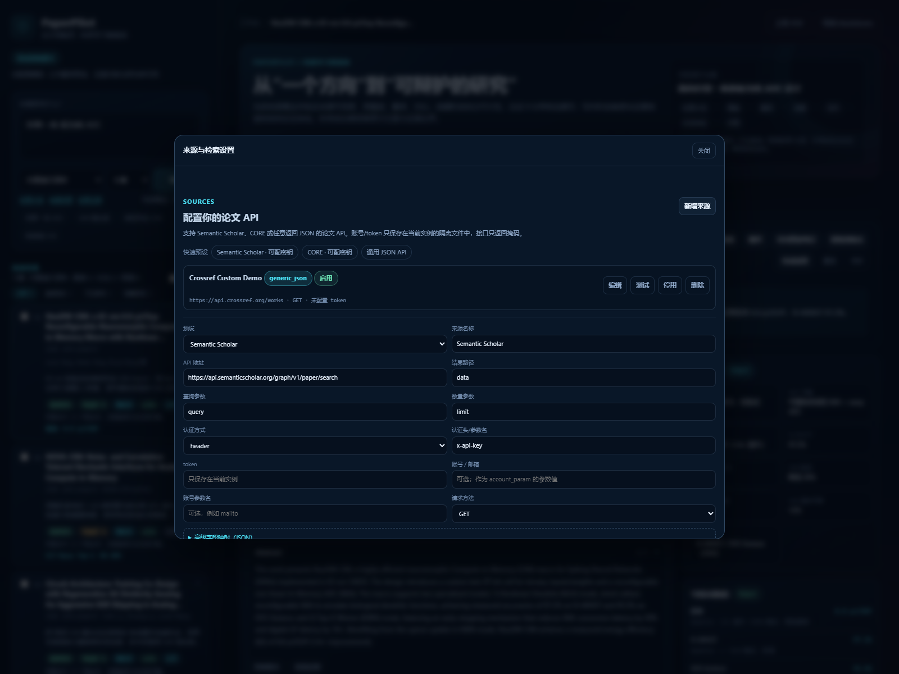

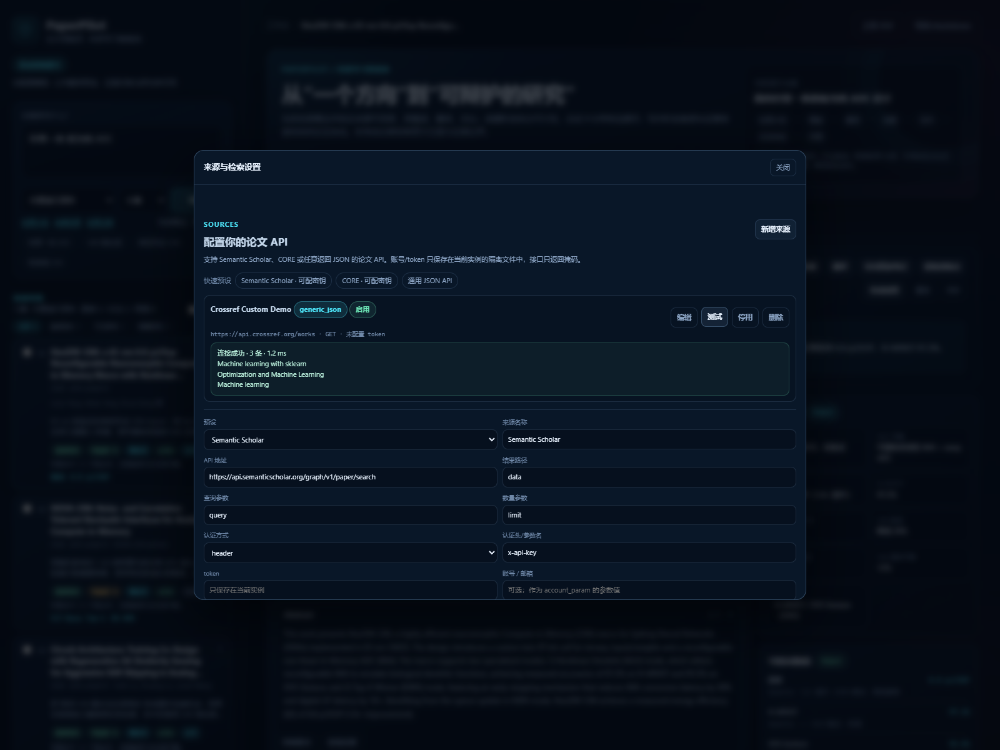

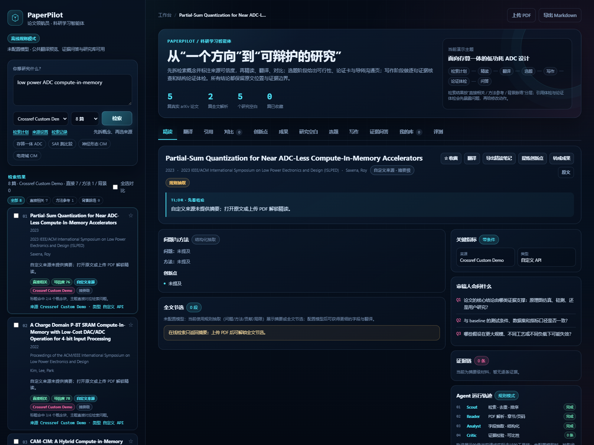

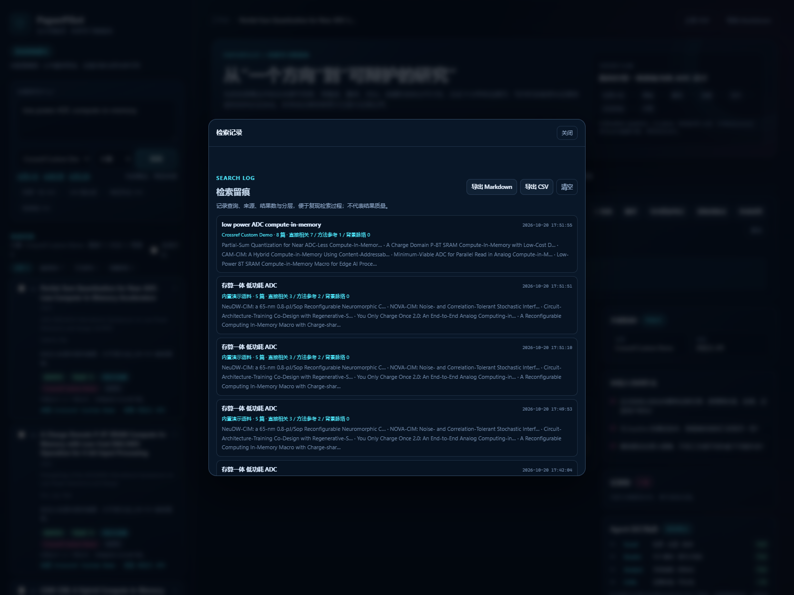

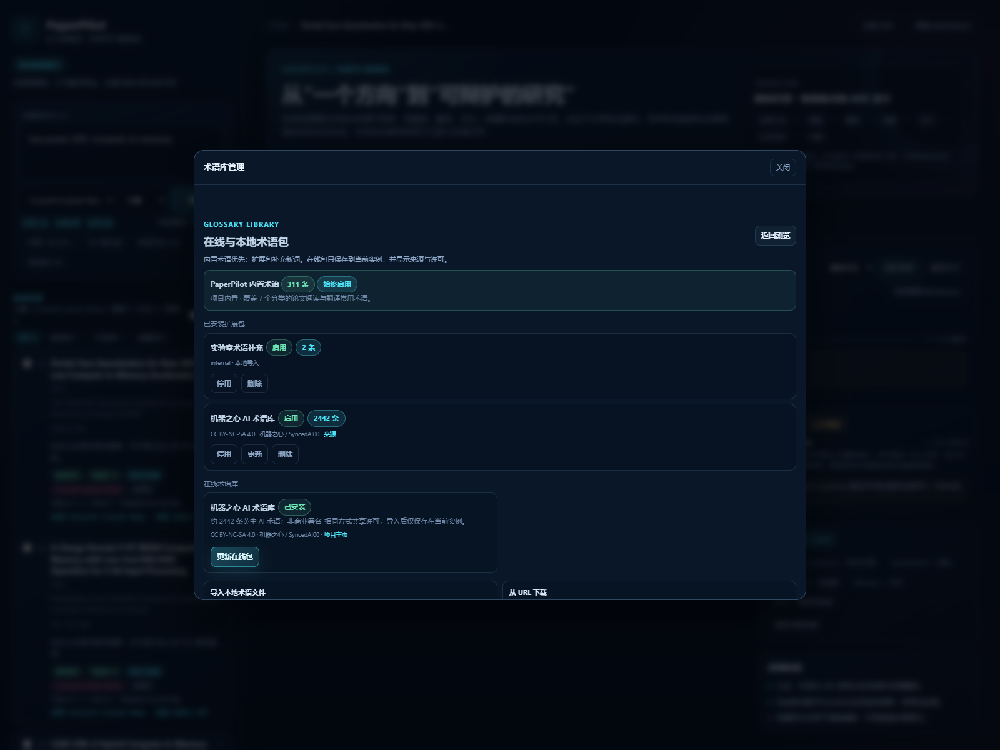

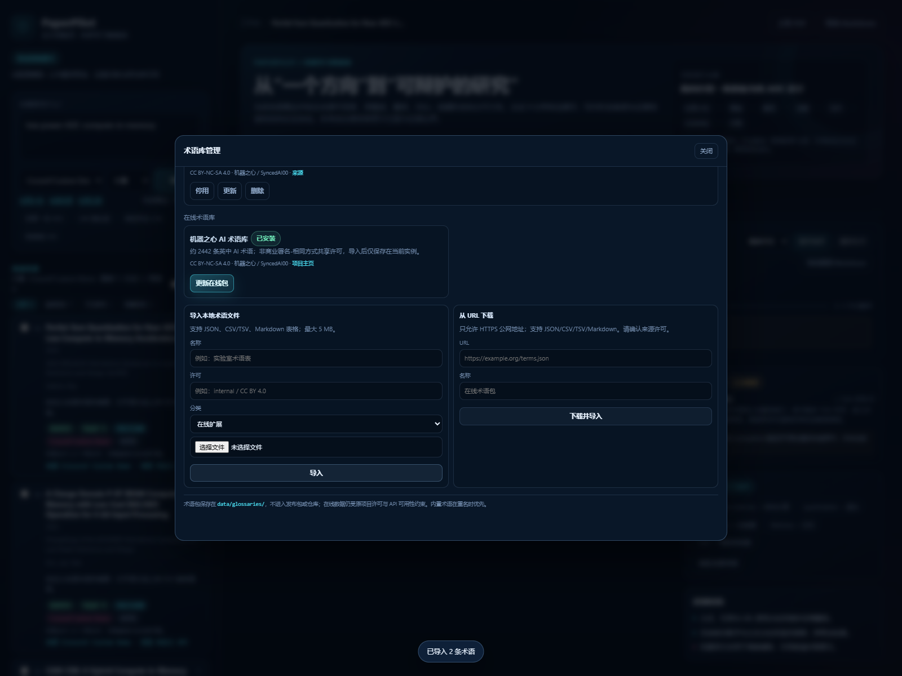

## v0.7 研究流程脚手架真机验证

### 检索计划与证据分层

- 输入“存算一体 低功耗 ADC”，计划拆出 3 个概念块：存算一体 → compute-in-memory / CIM；低功耗 → low power / energy efficient；ADC → analog-to-digital / converter。本地生成耗时 **0.06 ms**。
- 计划为 auto / Crossref / arXiv / Europe PMC / DOAJ / HAL / 演示语料分别给出检索式，并解释同义词扩展、筛选顺序与预印本边界。
- 演示检索 5 条结果分层为 **直接相关 3 / 方法参考 2 / 背景脉络 0**，加分层与可信度标注共 **0.41 ms**；结果按“直接相关优先”稳定排序，侧栏可按层筛选。
- 真实多源聚合返回 8 条结果：**直接相关 5 / 方法参考 3**，来源包括 Crossref 会议论文与 Europe PMC 记录；每张卡片显示来源类型、题录可信度、覆盖概念与分层理由。
- 本机 `export.arxiv.org` 多次连接超时；聚合在 **8.0 秒**上限内返回其余来源结果，并把 arXiv 放入 **180 秒冷却**，同查询复跑 **0.5 ms**。正常网络下冷启动约 **0.9 秒**，缓存后复跑 **153 ms**（本次基准）。这验证了慢源不阻塞主流程，也说明多源结果数会随外部 API 可用性变化。

### 引用体检

测试库中放入 4 条记录，并特意加入 1 条不完整的同名重复记录，用于验证问题检出：

- 总平均题录分 **62.5**，可引用 2 条、待补 2 条、重复组 1 组。
- 缺项检查覆盖作者、年份、来源、DOI、链接、摘要；重复检查同时按规范化题名和 DOI 分组。
- 点击“核验 DOI（联网）”后，Crossref 核验 **1/1 通过**；结果写入 7 天缓存，缓存复跑 **0.2 ms**。
- 所有修复动作只给建议，不自动删改用户记录；测试库数据仅用于验证，不进入交付包。

### 选题四维可行性、论证卡与导师沟通

- 勾选 3 篇论文生成选题地图，候选问题附 **数据可及性 / 方法复杂度 / 时间预算 / 文献支撑** 四维评分与结论（可开题 / 需收窄 / 风险偏高）。
- 每个候选问题生成论证卡：想回答的问题、缺口、最小方法、数据与指标、成功判据、失败模式、证据摘录。
- 导师沟通页生成一页纸 brief、4 个带选项的提问（含“缺口是否真实存在”“数据如何落地”“时间不够先保什么”“如何避免重复”）、4 个追问预演和可直接复制的话术。
- 浏览器实测四维条、论证卡展开、一页纸复制/导出均正常。

### 写作论证体检

用一段含 5 个主张的草稿验证：

- 结构检查识别研究问题、缺口、方法、证据为“已具备”，讨论、局限、结论为“缺失”。
- 论证映射按“引言 / 方法 / 实验”统计主张数、支持度、引用标记与证据线索；没有 `[P#]` 引用标记时明确提示不可追溯。
- 数值句“99.9% 的能效提升”被标为部分支持并指出“数值未在匹配证据中出现”；综合分 **64/100**，给出 7 条优先修改动作。
- 论证体检 **4.2 ms**；导出的 Markdown 含结构检查、章节映射、未支撑句与修改动作。

### 精读笔记与下载

- 精读页“导出精读笔记”生成五栏 Markdown：研究问题、数据与方法、核心发现、局限与边界、与我的选题关联，附审稿人问题与证据摘录。
- Playwright 实际捕获两个下载：`paperpilot-argument-demo.md` 与 `paperpilot-note-demo.md`；文件内容与页面一致。
- 全流程浏览器 **0 个 console error**。

### 性能基准

| 指标 | 实测 |
|---|---:|
| 检索计划本地生成 | 0.06 ms |
| 演示检索 + 分层标注 | 0.41 ms |
| 多源聚合正常冷启动 | 0.86 s |
| 多源聚合慢源超时压力场景（8 秒上限） | 8.0 s |
| 多源聚合缓存/冷却后复跑 | 0.5–153 ms |
| 选题首次 / 复跑（精读缓存） | 2.1 / 1.2 ms |
| 论证体检 | 4.2 ms |
| 引用体检（不联网） | 0.33 ms |
| DOI 核验缓存复跑 | 0.2 ms |
| 主回归 / 专项测试 | 41/41 / 53/53 |

## 早期版本结论

v0.6 轮次在 v0.4.1 的执行速度、解析能力和问题处理质量基础上，新增 **论文翻译工作台、三源检索、311 条分类术语表和引用网络**。自动真机检查从 **7/10 提升到 10/10**，41 条回归用例保持 **41/41**，26 条专项测试通过。重复在线检索从约 1 秒降到 **2–3 ms**；中文跨语言核心问题从 **0 条引用** 提升到 **8 条引用、覆盖 5 篇**；真实 PDF 的章节/作者/标题结构达标从 **2/5** 提升到 **5/5**；翻译工作台完成无密钥整篇 4/4 节翻译和模型模式整篇链路验证。

## 测试环境与语料

| 论文 | arXiv | 页数 |
|---|---|---:|
| FlashAttention: Fast and Memory-Efficient Exact Attention with IO-Awareness | 2205.14135 | 34 |
| LLM.int8(): 8-bit Matrix Multiplication for Transformers at Scale | 2208.07339 | 20 |
| GPTQ: Accurate Post-Training Quantization for Generative Pre-trained Transformers | 2210.17323 | 16 |
| SmoothQuant: Accurate and Efficient Post-Training Quantization for Large Language Models | 2211.10438 | 13 |
| AWQ: Activation-aware Weight Quantization for LLM Compression and Acceleration | 2306.00978 | 15 |

论文均为 arXiv 开放获取 PDF，下载时使用固定 User-Agent、顺序请求并间隔 3 秒，不涉及付费墙或非公开全文。

## 测试方法

1. **HTTP 真机基准**：`scripts/real_world_check.py` 启动独立实例，依次验证中文/英文在线检索、5 篇真实 PDF 上传、限定范围证据问答、选题、写作草稿、主张核查、越界拒答与 6 请求并发。
2. **浏览器实机验证**：在内置浏览器中完成中文检索、原生长传、证据问答；再用 Playwright 选择 3 个 PDF 一次上传，检查批量进度、结果卡片和控制台错误。
3. **回归验证**：`scripts/evaluate.py` 的 41 条用例覆盖检索、PDF、对比、问答、选题、写作、核查与研究库。

## 优化前后对比

| 指标 | 优化前 0.4 | 优化后 0.4.1 | 变化 |
|---|---:|---:|---|
| 真机自动检查 | 7/10 | 10/10 | +3 |
| 在线检索相关命中 | 1/4 | 4/4 | +3 |
| 同一查询复跑耗时 | 1004–1058 ms | 2.3–2.8 ms | 约 360–460 倍 |
| 英文 arXiv 首轮查询 | 1039 ms | 338 ms | 约 3.1 倍 |
| 英文 Crossref 首轮查询 | 960 ms | 327 ms | 约 2.9 倍 |
| PDF 结构质量达标 | 2/5 | 5/5 | +3 |
| 5 篇 PDF 平均上传+解析 | 101.1 ms | 119.0 ms | 解析更完整，仍低于 200 ms/篇 |
| 中文跨语言核心问题 | 0 引用 | 8 引用 / 5 篇 | 从无证据到全覆盖 |
| 中文局限问题 | 3 引用 / 2 篇 | 7 引用 / 4 篇 | 覆盖提升 |
| 英文局限问题 | 4 引用 / 2 篇 | 8 引用 / 5 篇 | 覆盖提升 |
| 6 请求并发问答 | 71.0 ms，部分无引用 | 28.3 ms，均有引用 | 约 2.5 倍 |
| 41 条回归 | 41/41 | 41/41 | 无回归 |

### 在线检索

最终基准中，四个检索用例全部达到概念相关门槛：

- 中文“高效大模型量化推理”在 arXiv 返回 5 篇，命中 quantization / LLM / inference 等概念，首轮 971 ms，复跑 2.3 ms。
- 英文自然语言在 arXiv 返回 5 篇，首轮 338 ms，复跑 2.4 ms。
- 中文查询在 Crossref 返回 5 篇，首轮 1085 ms，复跑 2.8 ms。
- 英文自然语言在 Crossref 返回 5 篇，首轮 327 ms，复跑 2.8 ms。

首轮主要是外部 API 网络耗时；相同查询在 24 小时 TTL 内直接命中查询级缓存。网络失败时只允许同查询旧缓存回退，不再用固定的无关语料充当结果。

### PDF 解析

| 文件 | 解析耗时 | 页数 | 章节 | 数值 | 局限 | 作者 | 标题 |
|---|---:|---:|---:|---:|---:|---:|---|
| 2205.14135.pdf | 136.1 ms | 34 | 5 | 5 | 0 | 5 | 正常 |
| 2208.07339.pdf | 71.4 ms | 20 | 7 | 5 | 3 | 4 | 正常 |
| 2210.17323.pdf | 66.9 ms | 16 | 18 | 5 | 3 | 4 | 正常 |
| 2211.10438.pdf | 125.3 ms | 13 | 11 | 5 | 1 | 6 | 正常 |
| 2306.00978.pdf | 195.1 ms | 15 | 9 | 5 | 2 | 10 | 正常 |

优化内容包括 PDF 连字归一化、常见章节标题识别、参考文献截断、标题—作者边界判断、局限字段证据和数值/指标扩展。FlashAttention 未给出独立局限章节，因此局限数为 0，这是原文边界而不是抓取错误。

### 证据问答

在勾选 5 篇真实论文后：

| 问题 | 引用 | 覆盖论文 | 结果 |
|---|---:|---:|---|
| 这些论文分别解决什么问题？核心方法是什么？ | 8 | 5 | 每条引用带章节和页码 |
| 这些工作的局限性是什么？ | 7 | 4 | 直接 2 / 部分 2 |
| 这些方法在速度、内存或精度上的定量结果分别是什么？ | 8 | 5 | 抽取可核对数值 |
| What are the limitations of these methods? | 8 | 5 | 跨语言检索正常 |
| 这些论文对烹饪技术有什么建议？ | 0 | 0 | 明确拒答 |

补充抽样：

- “GPTQ 的量化误差来自哪里？”只引用 GPTQ 论文（3 条），不再串到 AWQ 的相关工作。
- “AWQ 如何保护显著权重？”只引用 AWQ（3 条）。
- “SmoothQuant 和 AWQ 在量化粒度上有什么区别？”同时覆盖两篇（6 条引用、5 个数值）。
- “What speedups and memory savings do these methods report?”抽取 6 条证据、18 个可核对数值、覆盖 5 篇。

### 选题、写作与核查

- 选题：3 个方法簇、3 个候选问题、三阶段阅读路径、实验计划与写作 brief 均生成；已取消与主题无关的内置缺口注入。
- 写作：5 篇论文生成相关工作草稿，5 条参考文献、2,494 字符、引用键完整。
- 核查：GPTQ 与 AWQ 的数值句被识别为直接支持；“所有方法都在真实手机上实现了 1000 倍加速”标出缺失数值 `1000 倍`，总体结论降为“需要补充引用与数值”，不再因为多数句子通过而显示“证据较充分”。

### 并发与界面

- 6 个并发问答请求：0 失败，总耗时 28.3 ms，P50 12.9 ms，最大 14.3 ms，均有引用。
- 浏览器一次选择 3 个 PDF：约 0.56 秒完成，进度按完成数更新，无页面脚本错误。
- 上传解析在服务端线程池执行，避免阻塞事件循环；静态资源启用 GZip 与一天缓存，入口页保持 `no-cache`。

## 多源检索、术语库与引用网络

### 三源检索

在原有 arXiv / Crossref 之外新增 Europe PMC、DOAJ、HAL。用真实英文查询验证：

| 来源 | 实测 | 数据特点 |
|---|---:|---|
| Europe PMC | 约 1.5 s 返回 4 条相关题录 | 生命科学/预印本，支持题名/摘要字段查询 |
| DOAJ | 约 1.2 s 返回 5 条相关题录 | 多学科开放获取期刊，摘要和 DOI 完整 |
| HAL | 约 1.8–4.1 s 返回 5 条相关题录 | 多学科开放科学仓储，含开放 PDF |

三者共用查询级缓存；解析器测试覆盖完整/缺字段记录，自动跳过没有标题或标识的记录。Europe PMC 使用 `TITLE_ABS:(...)` 提升相关度，并在结果为空时回退普通查询。

### 术语库

- 311 个英中术语，7 个分类：大模型与推理、机器学习基础、芯片与存算、数学与统计、系统与性能、科研与写作、开放科学。
- 翻译提示、译文术语命中、`/api/glossary` 和浏览器术语搜索共用同一套释义。
- 浏览器实测搜索 `attention` 返回 attention / cross-attention / multi-head attention / self-attention 4 条；分类筛选正常。

### 引用网络

使用 DOI `10.3390/computers13110278` 做真实链路测试：

- OpenCitations 返回 **11 条参考工作、19 条被引工作**。
- Crossref 并发补全题录；整个请求约 **6 秒**。
- UI 每侧展示 8 条，显示总数；引用卡片可收藏到研究库、打开原文/PDF，并导出 Markdown。
- 再次请求命中 7 天缓存，**0 ms**。
- 无 DOI 论文不会伪造引用，而是显示“缺少 DOI，引用网络只对 DOI 论文开放”。

## 翻译工作台真机验证

翻译工作台按论文章节组织，支持摘要、单节和整篇翻译；中英双语对照；术语表注入；公式、引用和 URL 占位保护；数字一致性检查；按论文/语言/源文本哈希缓存；双语 Markdown 导出。

### 无密钥公共通道

- 使用内置真实论文 NeuDW-CIM（789 字符摘要），公共接口第一次翻译耗时 **6.1 秒**，返回 3 个对齐片段；数字 **10/10 保留**，公式/引用占位符 **0 缺失**。
- 同一摘要再次翻译命中缓存 **0 ms**。
- 浏览器中点击“翻译各节”：4 个章节全部译成中文，耗时 **12.2 秒**，进度 4/4，无 JS 错误；导出的双语 Markdown 文件名与内容正常。
- 公共通道会显示每日额度与第三方传输提示；额度耗尽时 API 返回 503，不会把失败结果缓存为成功。

### 模型完整翻译

- 使用本地 OpenAI-compatible 模拟服务验证整篇链路：4/4 节完成，耗时 **0.95 秒**，无 JS 错误；模型通道标记为“模型翻译”，不经过公共翻译站。
- 使用真实上传的 GPTQ PDF（16 页、18 个章节）验证：`/api/translation/{paper_id}` 正确返回 18 节，摘要翻译 1,798 字符，数字 10/10 保留、占位符 0 缺失。
- 真实模型质量取决于所配置的模型；模拟服务只验证管道，不代表译文质量。

### 自动测试

```bash
cd paperpilot
python -m unittest discover -s tests -p 'test_*.py'
```

53/53 通过，覆盖章节目录、占位保护、分段、公共缓存/截断、额度错误、模型翻译、缓存失效、工作台 payload、API 错误映射、分类术语、Europe PMC/DOAJ/HAL 解析、OpenCitations 引用网络，以及 v0.7 的检索计划/分层、引用体检、选题四维/论证卡/导师沟通、论证体检与精读缓存。

## 浏览器实机截图

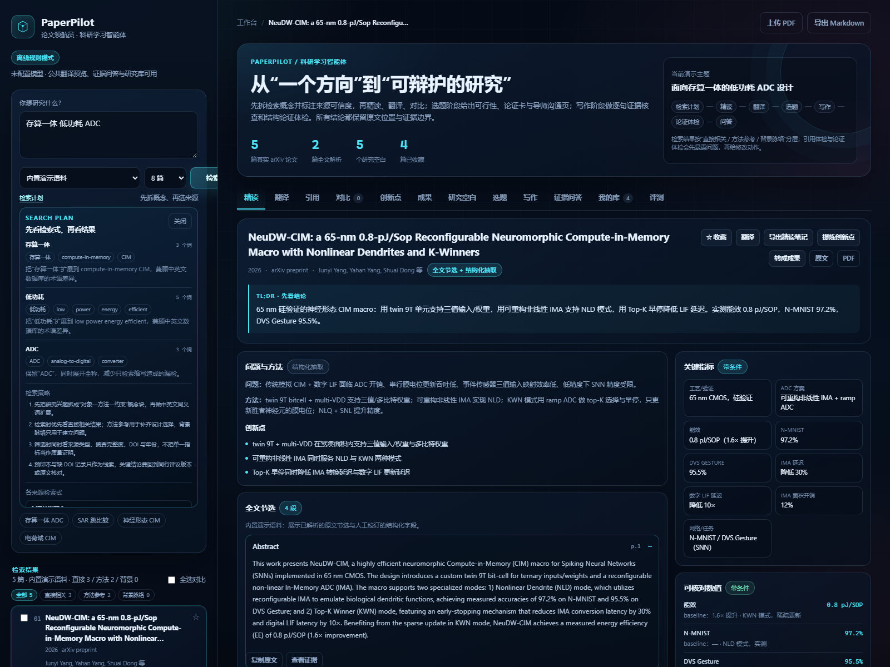

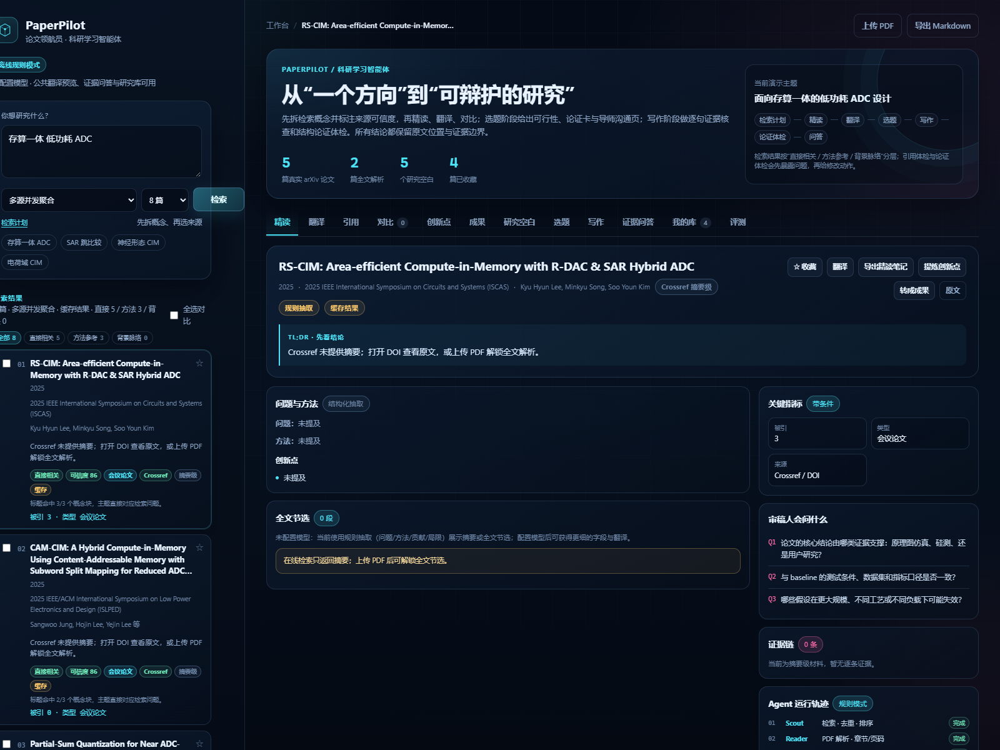

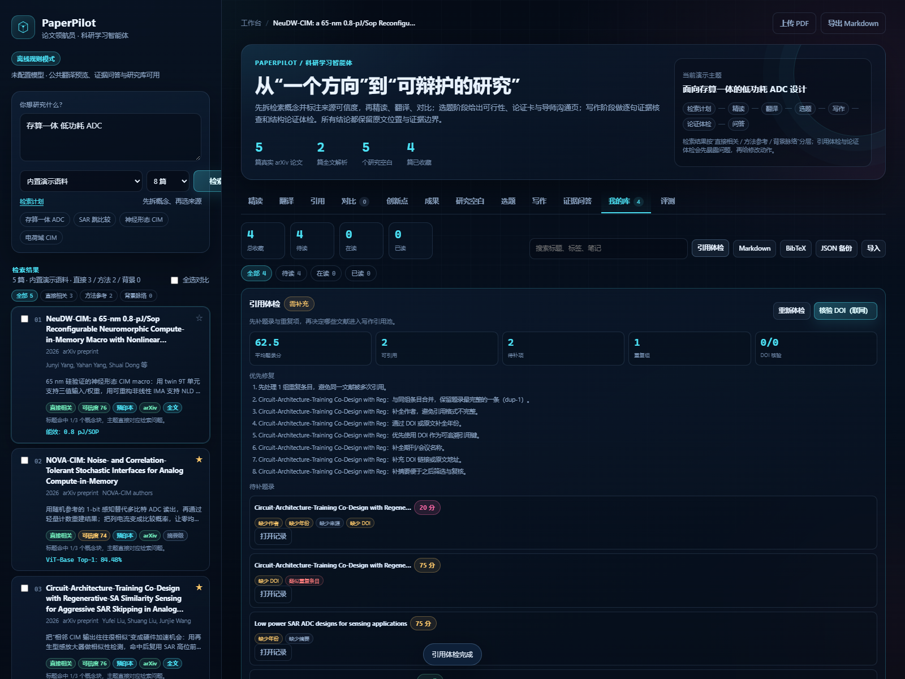

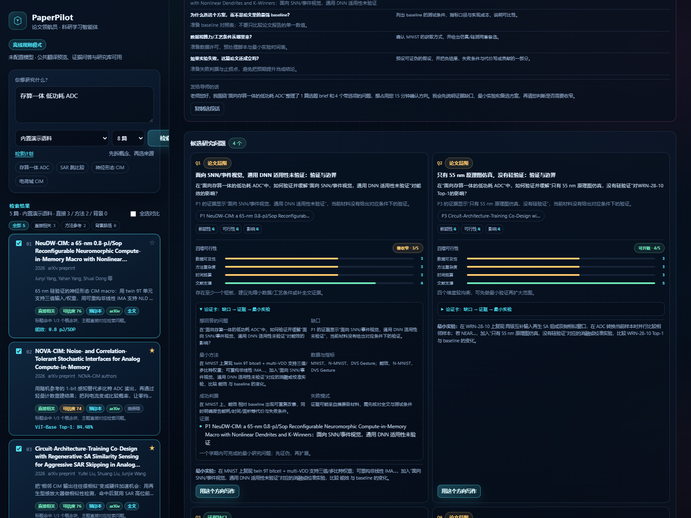

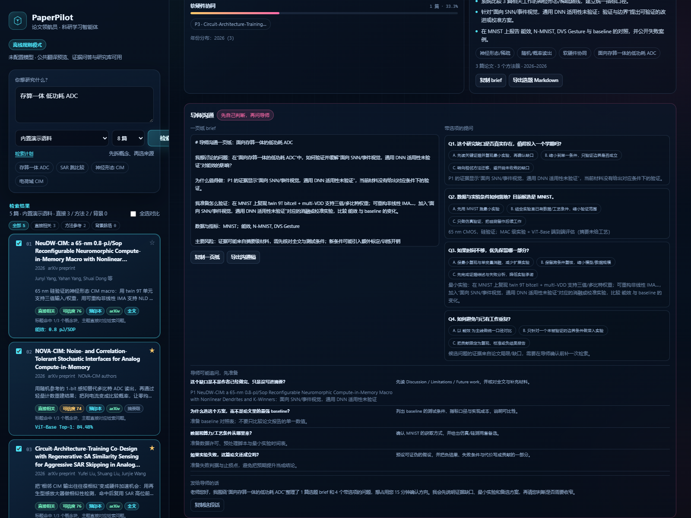

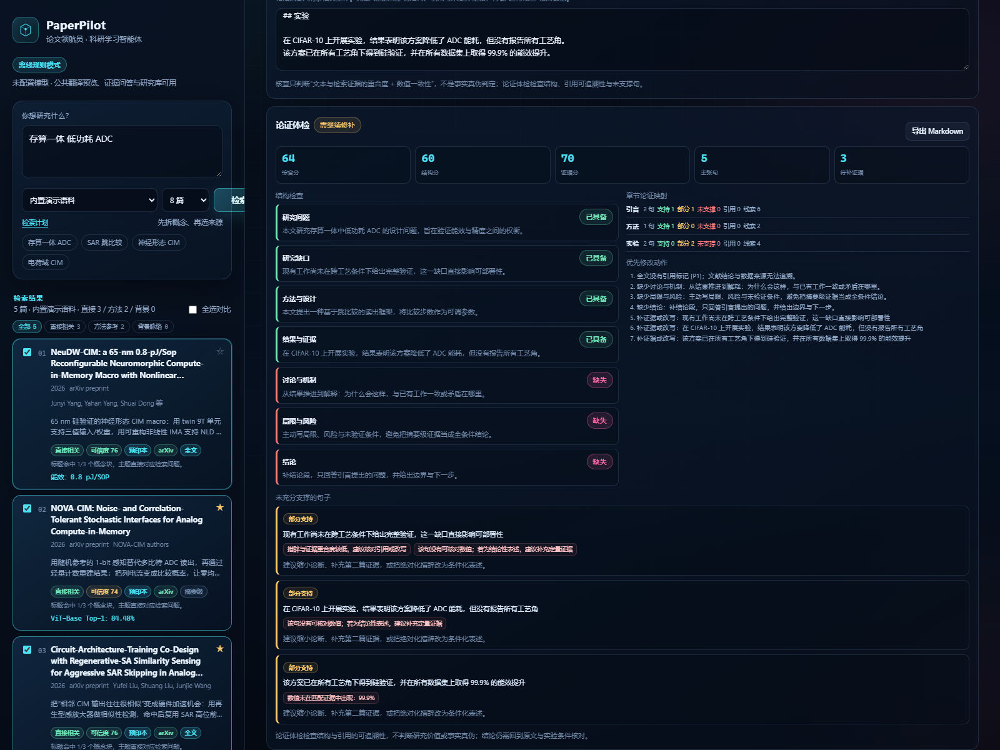

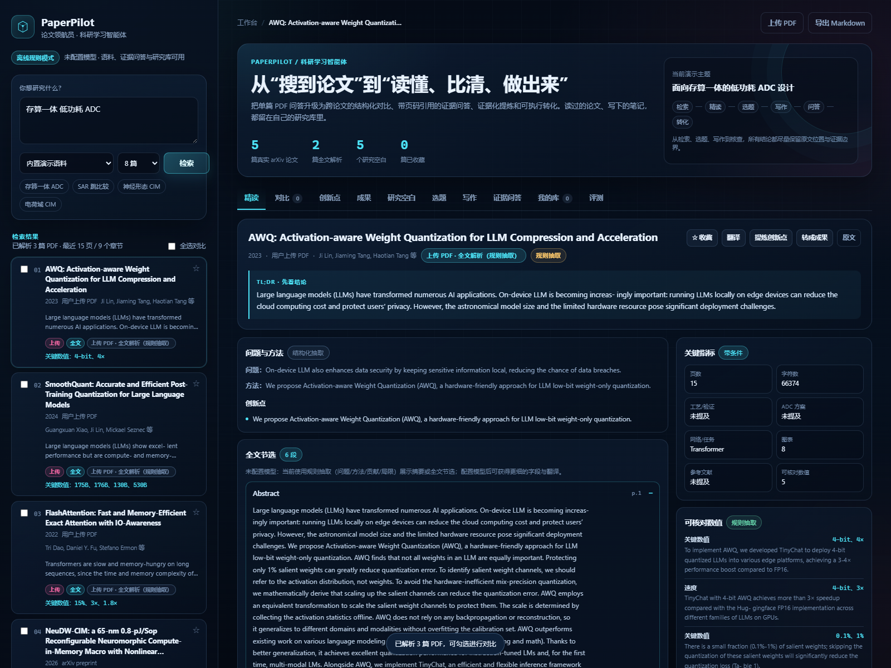

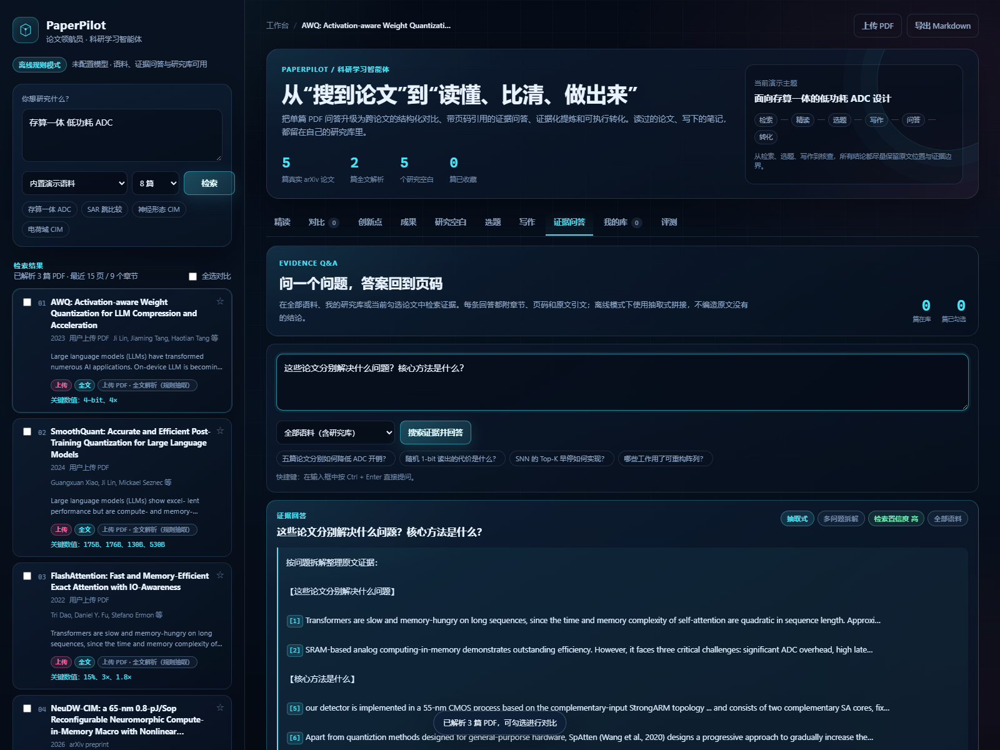

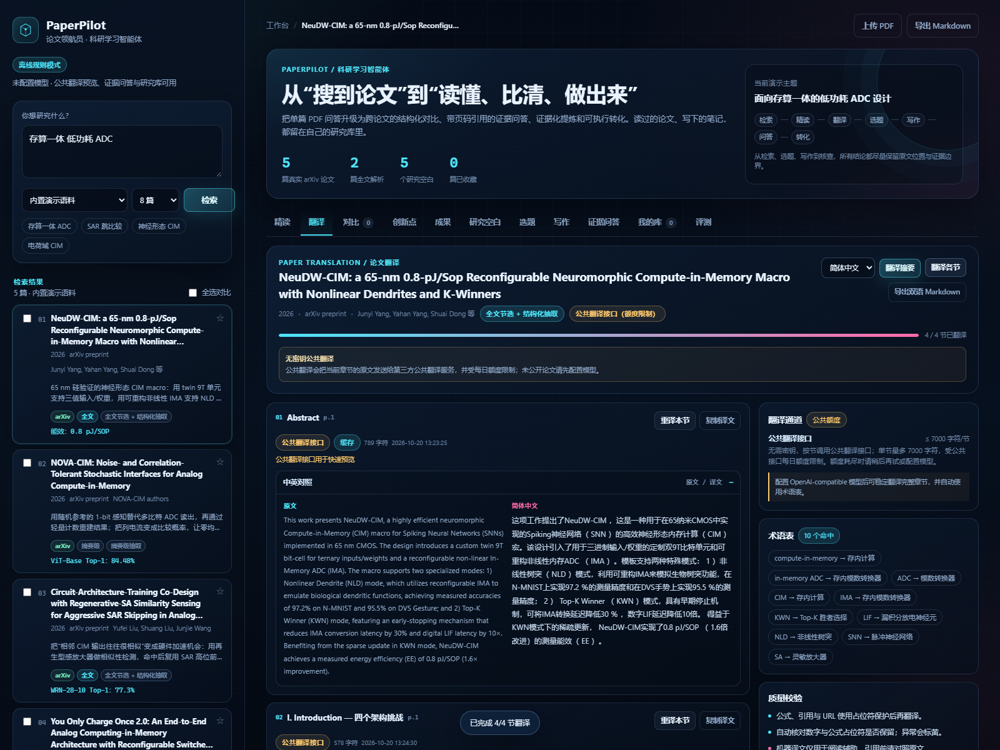

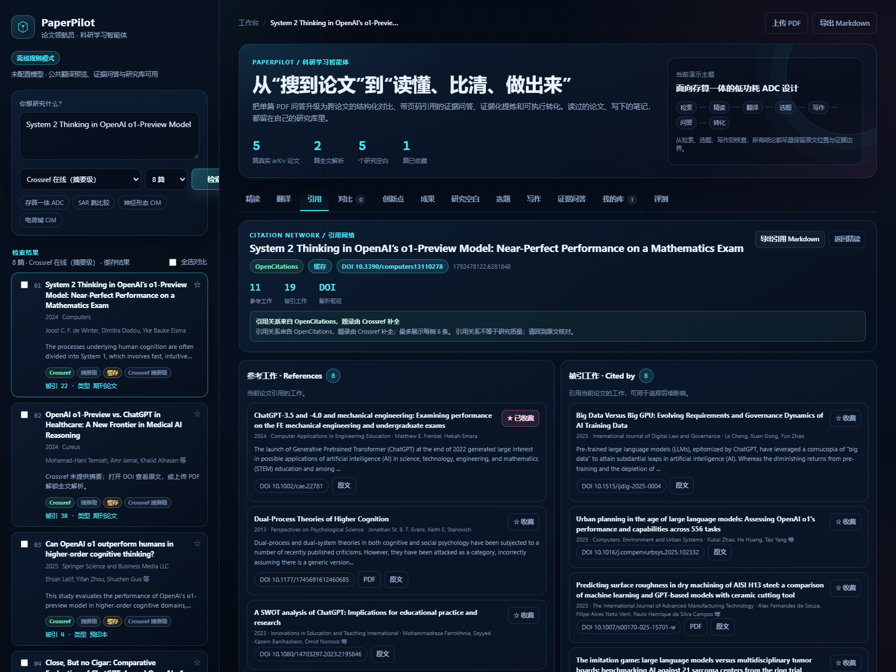

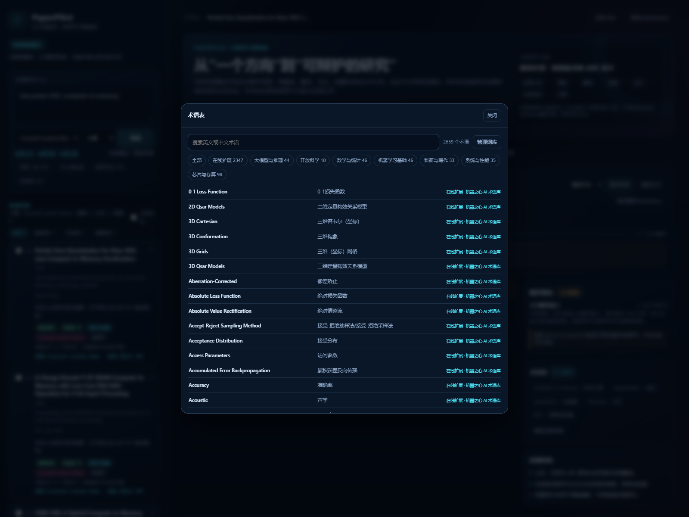

## 本轮优化

1. **检索计划与分层**：概念块/中英扩展/缩写全称、各来源检索式、题录可信度与分层理由；结果按直接相关优先稳定排序。
2. **多源并发聚合**：Crossref / arXiv / Europe PMC 并发、RRF 融合、DOI/题名去重；8 秒响应上限与 180 秒慢源冷却。
3. **引用体检**：题录完整度、重复组、题录分、修复动作；可选 Crossref DOI 核验并缓存 7 天。
4. **选题脚手架**：四维可行性、论证卡、导师一页纸/带选项提问/追问预演，保留人工判断权。
5. **论证体检**：结构缺口、章节论证映射、引用标记与证据线索、未支撑句、优先修改动作。
6. **精读笔记**：五栏 Markdown 导出，把单篇阅读接到选题与写作。
7. **翻译**：章节化翻译、公共/模型双通道、术语表注入、公式/引用/URL 占位保护、数字校验、缓存和双语 Markdown 导出。
8. **多源检索**：Europe PMC、DOAJ、HAL 解析与缓存，统一来源字段和失败回退。
9. **引用网络**：OpenCitations 参考/被引、Crossref 题录补全、DOI 校验、7 天缓存与收藏/导出。
10. **术语库**：311 条、7 类，统一服务翻译、术语浏览和研究写作。
11. **PDF**：连字归一化、常见章节识别、References 截断、标题/作者边界与局限证据。
12. **执行**：精读结果 LRU 缓存 + 深拷贝、检索/翻译/引用/DOI 缓存、PDF 线程池、批量上传并发、GZip 与静态缓存。
13. **诚实性**：数值缺失时核查总评强制降级；分层/可信度/可行性只作筛选提示；论证体检先暴露问题而不代写全文。
14. **自定义来源**：Semantic Scholar/CORE/通用 JSON API，字段映射、认证、账号/token 隔离、测试连接与查询缓存；HTTPS/公网地址校验。
15. **扩展术语库**：在线下载机器之心 AITD（2442 条）与本地 JSON/CSV/TSV/Markdown 导入，启停/更新/删除、许可归属展示，内置术语优先。
16. **检索留痕**：每次检索记录查询/来源/结果数/分层/首批标题，支持 Markdown/CSV 导出与清空。
17. **外部访问**：注入 truststore，受管 Windows/代理环境可正常访问 GitHub/Crossref 等 HTTPS 来源。

## 仍需注意

- 证据检索的候选召回仍是词法检索；混合重排只在 BM25 候选集上进行，不会引入候选集之外的新证据。embedding 默认关闭，需模型 key 与 `PAPERPILOT_EMBEDDINGS=1`。
- 自适应 Planner/Critic 默认是规则策略，不是专家级研究判断；它能暴露开放问题与预算边界，但选题价值仍需人工确认。
- 任务 worker 为单进程单线程，任务与动作为本地 JSON；适合单实例演示，不适合多用户并发或分布式执行。
- 未配置真实 LLM 时，只验证了客户端重试/回退与 mock 链路，不代表真实模型输出质量。
- 表格密集片段偶尔仍会进入引用，需要回到原文核对。
- 无密钥公共翻译依赖 MyMemory，受第三方每日额度、网络和隐私约束；整篇稳定翻译建议配置模型。
- 翻译占位保护和数字比对能降低公式/数值损坏，但机器译文仍需人工校对，不能替代原文。
- 中英学术词表覆盖常见 AI/硬件/系统术语；生僻领域用英文关键词或 Crossref 更稳。
- PDF 版式千差万别，规则的章节/作者边界仍可能出错；上传后应扫一眼标题、作者和章节。
- 主张核查衡量的是“措辞重合 + 数值是否出现”，不是事实真伪判定。
- 自定义来源受第三方 API 限额、字段结构、CORS/网络策略影响；Semantic Scholar 匿名请求可能 429，CORE 需要 token。
- token/password 是当前实例本地文件，未做多用户隔离；不要把不可信用户接入同一实例。
- 在线术语库的许可、准确性与更新由原项目决定；机器之心术语库为 CC BY-NC-SA 4.0，默认不随发布包分发。
- 检索留痕只记录本实例的检索，不包含外部数据库端的检索历史。
- 研究库与任务状态是单实例 JSON 存储；ModelScope 免费实例磁盘为临时存储，重启后可用 JSON 备份迁移；任务报告、证据账本与论文快照同样不随发布包分发。

## 复现

```bash
cd paperpilot
pip install -r requirements.txt
python scripts/evaluate.py
python -m unittest discover -s tests -p 'test_*.py'
python scripts/real_world_check.py --pdf-dir <包含 5 篇 PDF 的目录> --out ../.bench/final.json
python scripts/eval_agent.py
```

`real_world_check.py` 会启动独立实例，不依赖正在运行的本地服务；检索用例需要网络。5 篇论文可从对应的 arXiv `abs` 页面下载公开 PDF。`eval_agent.py` 在临时数据目录中跑 auto/checkpoint/budget 三种 Agent 场景，不触碰本地研究库与任务。

