# PaperPilot · 项目说明

> 一句话：从一个研究方向，到检索计划、证据阅读、可辩护选题与论证体检的科研学习智能体。

## 1. 项目概览

PaperPilot 是一个面向本科生、研究生新生和课程教师的科研学习 Agent。它不是“单篇 PDF 问答”，而是把论文变成可复用的研究资产：

1. **概念图谱**：把论文、概念/方法、数据/任务、指标与局限画成可交互图谱，点击节点回到来源论文与原文摘句；
2. **结构化对比表 + 逐对比可性判定**：把多篇论文的研究问题、方法、数据/任务、指标与局限放到同一张可核查的表里，并对每一对论文判断“可比 / 不可直接比较”及理由；
3. **证据化提炼**：区分“作者声称”“实验证据”“模型推断”，并给出审稿人问题；
4. **可执行产出**：复现计划、代码骨架、实验清单、组会 Slides、课程案例与 Quiz；
5. **可积累的研究库**：收藏、阅读状态、标签、研究笔记、引用体检与 Markdown 导出；
6. **可核查的证据问答**：跨论文提问，答案回到章节与页码，并提示哪些论文没有直接命中；
7. **可审查的研究流程**：检索计划、四维可行性、论证卡、导师沟通页与结构论证体检，把关键判断留在用户手里；
8. **可配置的数据边界**：自定义论文 API 与在线/本地术语包，敏感 token 隔离保存；检索过程自动留痕。

当前版本 8.1.3 包含一个可运行的 Web 应用：

- **v8.1.3 模型治理补齐出口**：在线问答（`purpose=ask`）与整段翻译（`purpose=translation_full`）改走统一网关，审计、预算与降级一致，整段翻译失败返回带原因的 400 而不是 500；模型降级结果不再写入对比缓存；预算拦截在非 JSON 路径也写 `degrade_reason: budget`；网关先查缓存再判预算；长补全超时阈值降到 800 tokens，且只有未被改动的 60 秒默认值会被加宽（显式配置的超时一律按设定执行）；模型调用失败也扣费（请求已出网）；模型预算用尽时运行时间线写明后续只用离线结果；
- **v8.1.2 运行预算账实一致**：Agent 动作执行期间绑定当前运行，动作内嵌套的模型调用（精读、翻译、横向对比）统一计入该运行的 `max_llm_calls`，用尽后按既有路径降级；缓存命中不重复扣费，`budget_used.llm_calls` 与审计中“成功且未缓存”的调用逐条相等；横向对比与成果转化改走同一网关；长补全按 `PAPERPILOT_LLM_LONG_TIMEOUT`（默认 180 秒）执行；
- **v8.1.1 自审加固**：模型精读字段在所有读取路径统一转成正文，旧缓存不再绕过清洗；JSON 仅在 schema 校验成功后缓存；Copilot 比较可引用运行账本且低相关度离线回退；引用编号前后端一致；`citations` 明确省略保留/null 清空/对象替换；GitHub 与 ModelScope 部署复用交付白名单；
- **v8.1 学生写作链路**：项目 Copilot 的“比较”问题进入在线回答并保留引用接地；不足两轮运行时离线对比回退到证据问答；草稿保存支持在同一请求中写入引用表，未携带时保留已有引用；真实模型返回的结构化字段转为纯文本，不再把 `{"text": …}` 拼进正文，修通“选题 → 初稿 → 导出 → 档案”的最后一公里；
- **v4.2 Agent 运行质量**：用真实论文跑通 auto / checkpoint / step / budget / controls 五种 Agent 运行；非硬件语料不再套用 ADC 方法簇，Agent 来源与目标跟随当前检索，方法/局限抽取修正，证据跨动作去重，单一来源超时自动降级，重复检索自动收束；`innovate / gaps / transform` 对非 ADC 论文改用论文自身内容；
- **v4.1 性能与修补**：图谱缓存键覆盖 `tldr / 完整摘要 / 前 3 节 / 结果 / 局限`，且 `topic` 不参与键；关系总数上限 320 条；新增“重置聚焦”与再次点击取消聚焦；图谱接口做 scope/ID/topic 边界校验；所有响应增加安全头（CSP `frame-ancestors` 兼容 ModelScope 嵌入）；
- **概念图谱**：论文、概念/方法、数据/任务、指标、局限五类节点与讨论/评估/报告/局限/共现关系；点击节点查看来源论文与原文摘句，支持类型筛选和 Markdown/JSON 导出；
- **项目 Copilot**：在项目内围绕证据、开放问题、决策、论文、草稿与运行报告提问，答案附可点击引用与证据边界；无依据时明确说不足；建议动作需确认后才执行；
- **可信增强层**：引用接地校验、统一模型调用网关（审计/预算/缓存/结构化修复）、草稿语义核查（支持/部分/不支持，只读）；
- **研究项目工作台**：项目成为顶层实体，承载研究问题、范围、约束与阶段；一个项目下可多轮运行，跨轮记忆自动提升并按需播种，支持 2–3 轮运行对比与 v1.0 独立任务归档；
- **结构化草稿工作台**：章节 + 段落块、证据锚点与引用键、乐观锁与版本恢复、8 条核查规则与 Markdown/LaTeX/BibTeX/JSON/DOCX/PDF 六种导出；
- **运行中实时干预**：SSE 快照流推送进度，7 种控制指令在动作边界生效，网关缓冲 SSE 时自动降级为轮询；
- 左侧检索计划、多源检索、自定义来源与分层结果卡片，支持一键收藏；
- 右侧十四个工作区：精读、翻译、引用、对比、图谱、创新点、成果、研究空白、选题、写作、证据问答、研究任务、我的库、评测；
- 支持单次 1–5 篇 PDF 上传、arXiv/Crossref/Europe PMC/DOAJ/HAL 检索、多源并发聚合、自定义 Semantic Scholar/CORE/JSON API、Markdown/JSON/BibTeX 导出与深链演示；
- 内置 311 条术语，可在线下载机器之心 AI 术语库（约 2442 条）或导入本地 JSON/CSV/TSV/Markdown 术语包；
- 默认离线规则模式，无任何 API key 也能完整演示；
- 配置任意 OpenAI-compatible 模型后，可增强上传 PDF 抽取、翻译与证据问答综合。

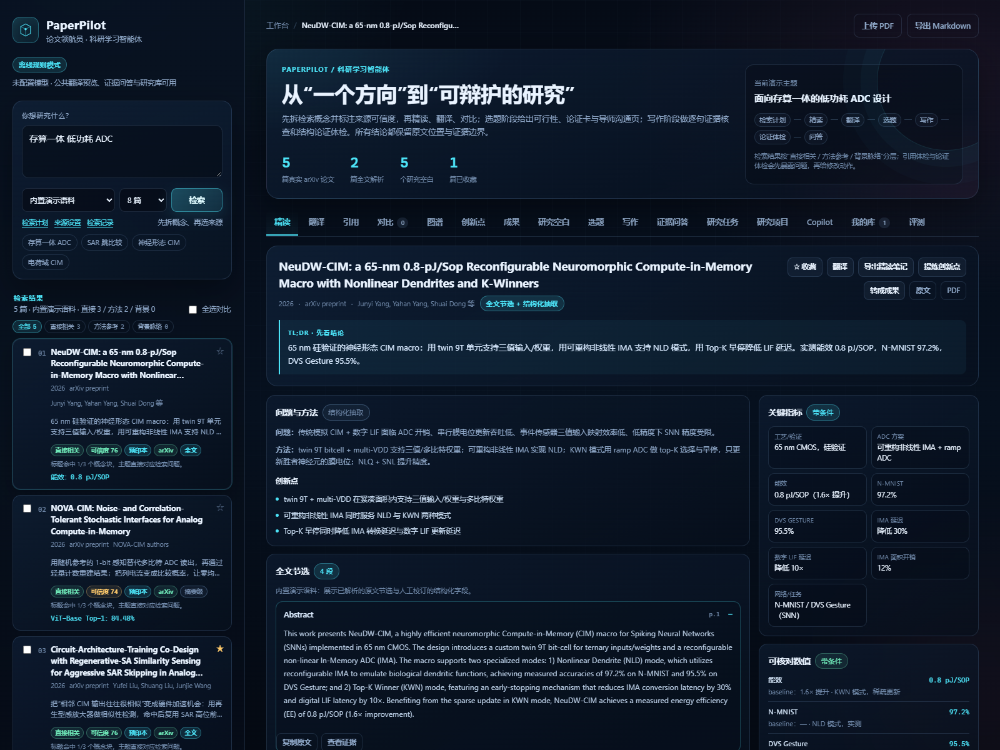

## 2. 问题与目标用户

### 2.1 真实场景

本科生进入课题组、做创新项目、准备毕业设计，第一件事通常是“摸清一个方向”。典型流程是：

> 搜索关键词 → 下载十几篇 PDF → 逐篇问摘要 → 用 Excel 手工抄指标 → 组会上讲不清“别人做了什么、还缺什么”。

这条流程有五个断点：

| 断点 | 具体表现 | 后果 |
|---|---|---|
| 搜不准 | 关键词不会写、同义词不知道、数据库分散 | 漏掉关键工作，重复劳动 |
| 读不完 | 英文长文、术语密集、公式/图表难懂 | 只读摘要，误解方法 |
| 比不清 | 工艺、数据集、测试条件、baseline 不一致 | 把不可比的数字直接排序 |
| 提不出 | 分不清作者声称与实验证据 | 把“future work”当成创新点 |
| 做不出 | 代码跑不起来、超参数缺失、不知道怎么变成自己的实验 | 读完就忘，无法复现或教学转化 |

### 2.2 目标用户

| 用户 | 典型任务 | PaperPilot 的价值 |
|---|---|---|
| 本科生 | 进组、大创、毕设、课程论文 | 一下午读懂一篇难论文，知道下一步做什么 |
| 研究生新生 | 开题、文献综述 | 一周摸清方向，自动生成对比表与研究空白 |
| 教师/助教 | 备课、组会、课程案例 | 把论文转成课程案例、组会提纲与 Quiz |
| 科研团队 | 技术调研、方案选型 | 快速比较路线，保留证据，方便复盘 |

## 3. 产品定位

PaperPilot 是一个**目标驱动、多步执行、工具增强**的 Agent，而不是固定流程的聊天机器人。

- **Planning**：Orchestrator 判断用户要“搜、读、比、问、做”中的哪件事，并把检索计划、选题可行性与论证体检作为显式步骤；
- **Tools**：arXiv / Crossref / Europe PMC / DOAJ / HAL API、检索计划与分层、PDF 解析器、章节-字段感知检索、选题聚类、论证卡、草稿模板、主张核查、引用体检、备份导出；
- **Memory**：论文缓存、解析结果、精读缓存、研究库与笔记；
- **Loop**：检索计划 → 检索 → 分层 → 解析 → 抽取 → 校验 → 对比/问答/转化 → 选题/写作体检 → 用户确认；
- **Human-in-the-loop**：低置信度字段、对比表、复现计划、四维可行性与导师沟通都保留人工判断与修改。

PaperPilot 会根据材料条件调整行为：

- 检索结果只有摘要 → 标注为“摘要级”，提示上传 PDF；
- 对比条件不一致 → 触发“不可直接比较”告警，而不是硬排序；
- 证据不足 → 在创新点页标注“证据缺口”，并生成审稿人问题；
- 问答没有命中 → 明确说“没有检索到可引用证据”，不编造引用；
- 跨论文总览 → 显示命中/未命中的论文，不用低相关片段硬凑。

## 4. 功能清单

### 4.1 核心工作区

| 模块 | 能力 | 实现要点 |
|---|---|---|
| 精读 | TL;DR、问题/方法、创新点、全文节选、指标、审稿人问题、证据链、五栏笔记导出 | PDF 逐页解析；每条结论保留 section + page + quote；精读结果 LRU 缓存 |
| 翻译 | 摘要/章节/整篇翻译；中英对照、311 条内置术语 + 在线/本地扩展包、占位保护、缓存与双语 Markdown 导出 | 公共接口预览 + 模型完整翻译；公式/引用/URL 保护；数字自动比对 |
| 来源设置 | Semantic Scholar/CORE/通用 JSON API；账号/token、字段映射、测试连接、启停与密钥隔离 | 只允许 HTTPS 公网地址；token 只返回掩码 |
| 检索留痕 | 查询、来源、结果数、分层与首批结果；Markdown/CSV 导出、清空 | 自动记录，不参与结果质量判断 |
| 引用 | 参考工作 / 被引工作网络；Crossref 题录；收藏、原文/PDF、Markdown 导出 | OpenCitations + Crossref；DOI 解析；7 天缓存 |
| 图谱 | 论文/概念/任务/指标/局限五类节点与讨论、评估、报告、局限、共现关系 | 最多 20 篇、每类 8 节点；点击节点回到论文与原文摘句；Markdown/JSON 导出 |
| 对比 | 2–10 篇论文自动抽取字段；对比表、逐对可比性判定、结构化共识、局限分歧 | 统一 schema；共同指标与各篇数值同时展示，不可比论文对明确建议分开阅读 |
| 创新点 | 作者声称 / 实验证据 / 模型推断三栏；假设、局限、审稿人问题 | 三栏分离；评分仅用于讨论 |
| 成果 | 复现计划、代码骨架、实验清单、组会 Slides、课程案例、Quiz | 先给最小验证实验；明确“不是自动复现” |
| 研究空白 | 从证据缺口生成研究问题，附新颖性/可行性/影响评分与最小实验 | 内置 5 个可演示问题 + Idea Critic |
| 证据问答 | 问题拆解、章节意图、字段证据、支持度矩阵、可核对数值、页码引用、检索模式与引用核验 | BM25 候选 + 混合重排；无证据拒答；离线抽取式；每条引用标记“原文已核对/待核对” |
| 选题 | 方法簇、证据缺口、候选问题、四维可行性、论证卡、阅读路径、导师沟通页 | 规则聚类 + 证据缺口；可行性/论证卡只作讨论脚手架 |
| 写作 | 相关工作 / 提纲 / 摘要骨架、引用键、逐句核查、结构论证体检 | 模板草稿；数值与支持度核查；结构缺口与修改动作 |
| 研究任务 | 自适应计划、动作时间线、检索/选题检查点、证据账本、开放问题、预算与人工决策 | 单 worker + JSON 持久化；Planner/Critic 动态动作；离线模板 / LLM 润色双通道 |
| 我的库 | 收藏、待读/在读/已读、标签、研究笔记、搜索、引用体检、Markdown/JSON/BibTeX、JSON 导入 | 本地 JSON 持久化；题录完整度/重复/DOI 核验；可跨实例迁移 |
| 评测 | 41 条内置回归用例与最近一次结果 | 检索、Crossref、PDF 抽取、证据、对比、翻译、转化、空白、选题、写作、核查、问答支持度、研究库备份 |

### 4.2 翻译工作台

翻译工作区按“论文章节”组织，而不是只翻译一个弹窗：

| 能力 | 说明 |
|---|---|
| 翻译范围 | 摘要、任意单节、整篇逐节翻译；中英逐节对照 |
| 无密钥模式 | 调用公共翻译接口（MyMemory），无需 API key；受第三方每日额度限制，单节可配置字符上限 |
| 模型模式 | 配置任意 OpenAI-compatible 模型后，逐节完整翻译；提示词注入术语表，要求保留公式、引用、数字与 URL |
| 术语一致 | 311 条、7 个分类的术语表（AI/ML、芯片/存算、数学统计、系统、科研写作等）；可搜索浏览；把命中术语注入模型提示 |
| 质量保护 | 公式、引用、URL 先转成占位符，翻译后恢复；自动比对数字数量与占位符完整性，异常在界面标黄 |
| 缓存 | 按论文 + 目标语言 + 源文本哈希缓存；源文本或翻译通道变化时自动失效 |
| 导出 | 双语 Markdown，含原文、译文、章节页码、术语表与机器翻译声明 |
| 隐私 | 公共接口会把所选章节原文发送给第三方；未公开论文应配置模型或避免使用公共翻译 |

### 4.3 检索计划、分层与多源检索

检索前先把研究方向拆成概念块，再选择来源：

- 概念块：保留原始表述，补充中英同义词与缩写全称（如 ADC → analog-to-digital converter）；
- 各来源检索式：Crossref / arXiv / Europe PMC / DOAJ / HAL / 内置语料分别生成可复制检索式，并解释扩展策略；
- 结果分层：直接相关 / 方法参考 / 背景脉络，附命中概念、来源类型与题录可信度；
- 可信度：综合来源类型、题录完整度、摘要可用性、同行评议与被引信号，明确列出 warning，不冒充质量裁决；
- 多源并发聚合：Crossref、arXiv、Europe PMC 并发检索，RRF 融合 + DOI/题名去重；8 秒响应上限，超时来源冷却 180 秒后跳过。

| 来源 | 特点 | 解析内容 |
|---|---|---|
| Europe PMC | 生命科学、医学与预印本；支持题名/摘要字段检索 | 标题、作者、年份、期刊、摘要、开放获取 PDF |
| DOAJ | 多学科开放获取期刊 | 标题、作者、年份、期刊、摘要、DOI/全文链接 |
| HAL | 法国开放科学仓储，覆盖多学科 | 标题、作者、年份、期刊/会议、摘要、PDF |
| Crossref | 跨出版商 DOI 题录 | DOI、年份、摘要、出版商、被引计数 |
| arXiv | 预印本 | 标题、作者、年份、摘要、PDF |

所有来源共用查询级缓存与同查询失败回退；来源只提供摘要时，UI 会标注“摘要级”。

### 4.4 引用网络与引用体检

对带 DOI 的论文，通过 OpenCitations 查询参考工作与被引工作，再用 Crossref 并发补全题录。

- 每侧默认展示 8 条，显示总数；可按标题/DOI/PDF 查看；
- 题录注册到当前语料，可一键收藏到研究库；
- 支持导出 Markdown；
- 缓存 7 天；无 DOI 的预印本会显示明确的不可用原因。

研究库新增引用体检：

- 题录完整度：标题、作者、年份、来源、DOI、链接、摘要；
- 重复检查：按规范化题名与 DOI 分组，给出合并建议；
- 题录分与可引用状态：按完整度、重复、DOI 核验结果计算；
- DOI 核验：仅在用户点击后访问 Crossref，题名相似度低于阈值标为“不一致”，结果缓存 7 天；
- 只给修复动作，不自动删改用户记录。

### 4.5 选题与写作脚手架

| 能力 | 说明 |
|---|---|
| 四维可行性 | 数据可及性、方法复杂度、时间预算、文献支撑各 1–5 分，给出“可开题 / 需收窄 / 风险偏高”与理由 |
| 论证卡 | 问题、缺口、最小方法、数据与指标、成功判据、失败模式、证据摘录 |
| 导师沟通页 | 一页纸 brief、带选项的提问、导师可能追问与准备材料、可复制话术 |
| 论证体检 | 检查问题/缺口/方法/证据/讨论/局限/结论，统计引用标记与逐句证据线索，列出未充分支撑句和优先修改动作 |
| 精读笔记 | 研究问题、数据与方法、核心发现、局限与边界、与我的选题关联，导出 Markdown |

### 4.6 自定义论文来源

自定义来源把“只能用内置几个 API”变成可配置的检索工具：

| 能力 | 说明 |
|---|---|
| 预设 | Semantic Scholar（可选 x-api-key）、CORE（bearer token）、通用 JSON API |
| 配置 | API 地址、GET/POST、查询参数、数量参数、额外参数、结果路径、字段映射（支持 `authors[].name`） |
| 认证 | none/header/bearer/query/basic；账号/邮箱可作为独立参数 |
| 安全 | 只允许 HTTPS、443 端口、公网地址；拒绝 URL userinfo、本机/内网/回环地址；已知学术 API 主机受控放行 |
| 密钥 | token/password 存在独立的 secrets 文件，接口只回显 `••••` 掩码；删除来源会删除对应密钥 |
| 运维 | 测试连接返回条数、耗时和前 3 个标题；查询结果按来源配置 + 查询缓存 1 小时；可启停 |
| 解析 | 返回结果统一成标题、摘要、作者、年份、venue、DOI、URL/PDF；进入分层、可信度、收藏与精读流程 |

示例：用 Crossref 作为通用 JSON API 配置 `base_url=https://api.crossref.org/works`、`query_param=query`、`limit_param=rows`、`result_path=message.items`，字段映射到 `title/author[].family/DOI/issued.date-parts`，可返回真实题录。

### 4.7 在线与本地术语库

- 内置 311 条术语始终启用；扩展包按“内置优先、扩展补新词”合并。
- 在线预设：机器之心 AI 术语库（GitHub，约 2442 条，CC BY-NC-SA 4.0，非商业署名-相同方式共享）；下载后保存在当前实例，并记录来源、许可与归属。
- 本地导入：JSON、CSV/TSV、Markdown 表格，最大 5 MB；支持自定义名称、许可和分类。
- 管理：启停、更新在线包、删除；`/api/glossary`、翻译术语命中与浏览器术语浏览共用合并结果。
- 来源与许可是扩展包的一等字段；不把在线数据默认打进发布包。

### 4.8 检索留痕

- 每次 `/api/search` 自动记录时间、查询、来源、结果数、直接/方法/背景计数与首批 5 个标题。
- 支持界面查看、Markdown/CSV 导出和清空；最多保留 200 条。
- 留痕用于复现检索过程与写检索日志，不代表结果质量或证据强度。

### 4.9 上传与导出

| 能力 | 说明 |
|---|---|
| 上传 PDF | 单次 1–5 篇，每篇 ≤25 MB、≤80 页；PyMuPDF 逐页解析；提取标题、作者、年份、章节、图表、数值、局限与 DOI |
| 导出 | 当前工作区 Markdown；翻译工作台双语 Markdown；精读笔记；选题/导师沟通/论证体检 Markdown；研究库整体 Markdown/JSON/BibTeX；检索留痕 Markdown/CSV |

### 4.10 自适应研究 Agent（v1.0）

v1.0 不再强制七步，而是用 Planner–Critic 动作循环决定下一步：

| 动作 | 使用的能力 | 何时出现 |
|---|---|---|
| `search` | 检索计划、多源检索、分层与可信度 | 无候选、覆盖不足、核查后扩展 |
| `read` | 精读摘要、问题/方法、局限与证据 | 有未读候选 |
| `ask` | 证据问答、引用核验 | 开放问题需要直接证据 |
| `compare` | 对比表、共识、分歧与可比性提醒 | 已读 ≥2 篇且对比缺失/过期 |
| `topic` | 方法簇、候选问题、四维可行性与论证卡 | 对比完成或单篇精读后 |
| `draft` | 相关工作模板与引用键 | 候选方向已选 |
| `review` | 逐句主张核查 + 结构论证体检 | 写作骨架完成 |
| `report` | 离线 Markdown 模板；可选 LLM 润色 | 证据闭环、预算耗尽或用户停止 |

- **证据账本**：记录论文、章节、页码、quote、核对状态与来源动作；未解决缺口转成开放问题。
- **三档自主程度**：`auto` 全自动；`checkpoint` 默认，在检索/选题/证据不足/收束前暂停；`step` 每个动作前暂停。
- **四类预算**：动作、时间、论文、LLM 调用；预算耗尽时强制收束一次，不无限循环。自 v8.1.2 起，动作内嵌套的精读与对比调用也计入 `max_llm_calls`：在默认 `max_papers 6 / max_llm_calls 4` 下，超出预算的那几篇精读会按规则结果降级；需要全量模型精读请调高 `max_llm_calls`。
- **人工决策**：检索检查点改选论文、选题检查点选择方向、补充约束、停止并生成简报。
- **持久化与迁移**：动作、证据、问题与决策写入 `data/agent_runs.json`；报告写入 `data/agent_runs/<id>/report.md`；v0.9 固定步骤任务自动迁移为 `legacy` 动作时间线。
- **API**：创建支持 `mode / max_actions / max_seconds / max_papers / max_llm_calls`；动作支持 `approve / retry / skip / cancel / resume / stop`。

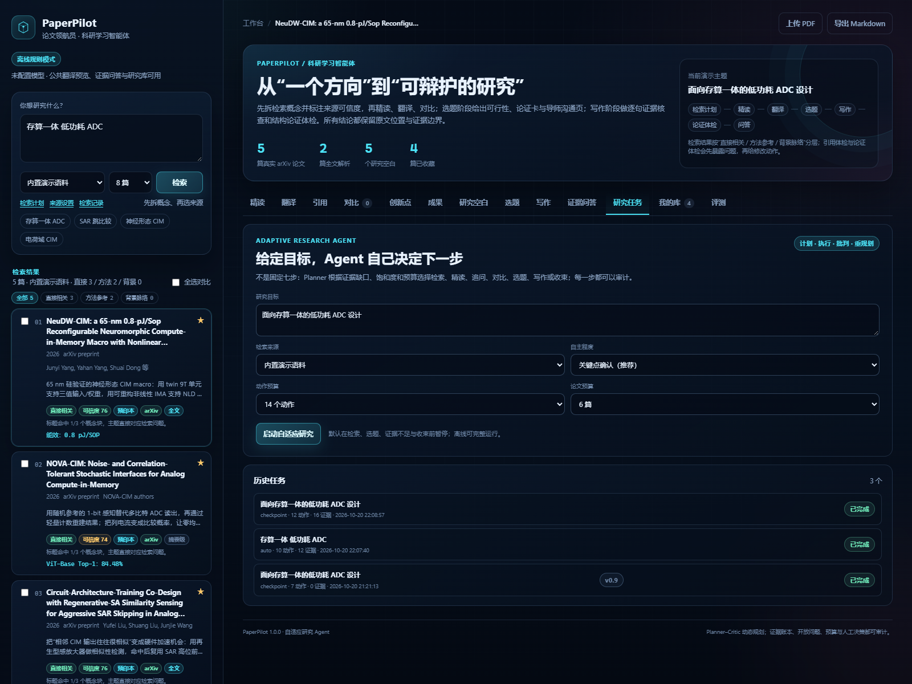

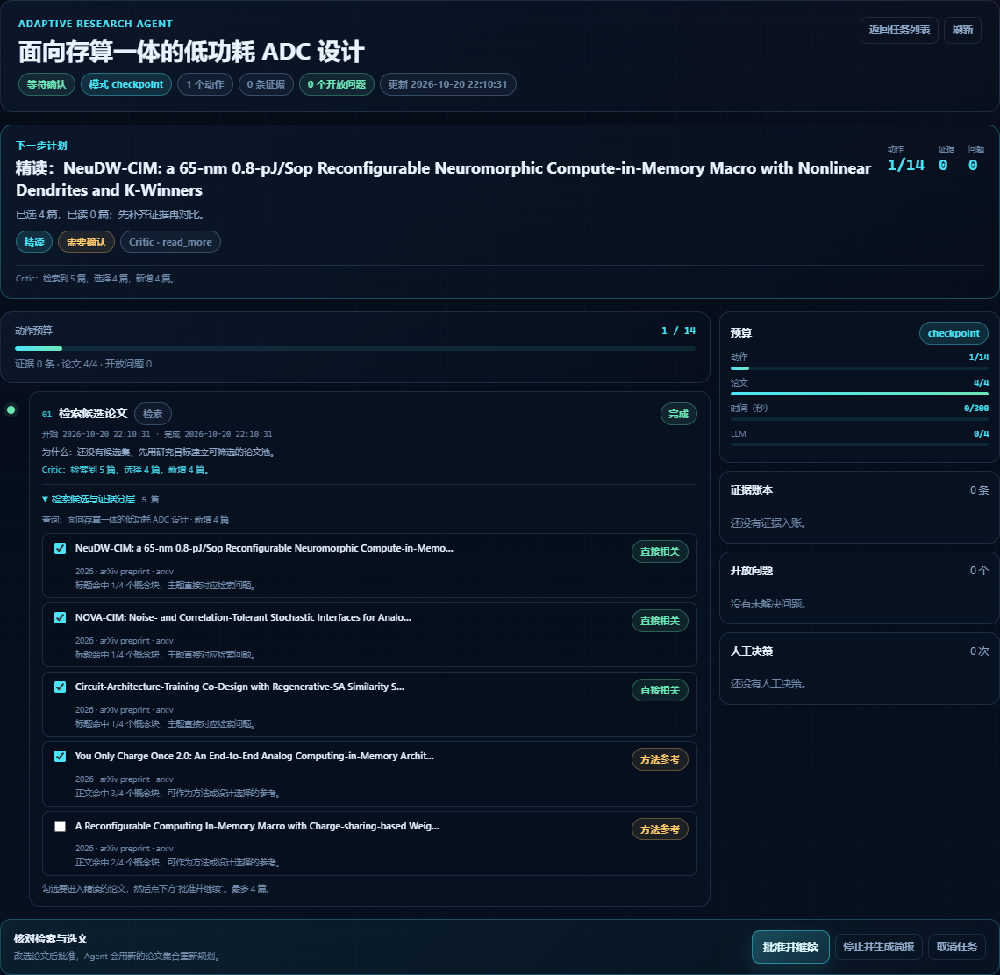

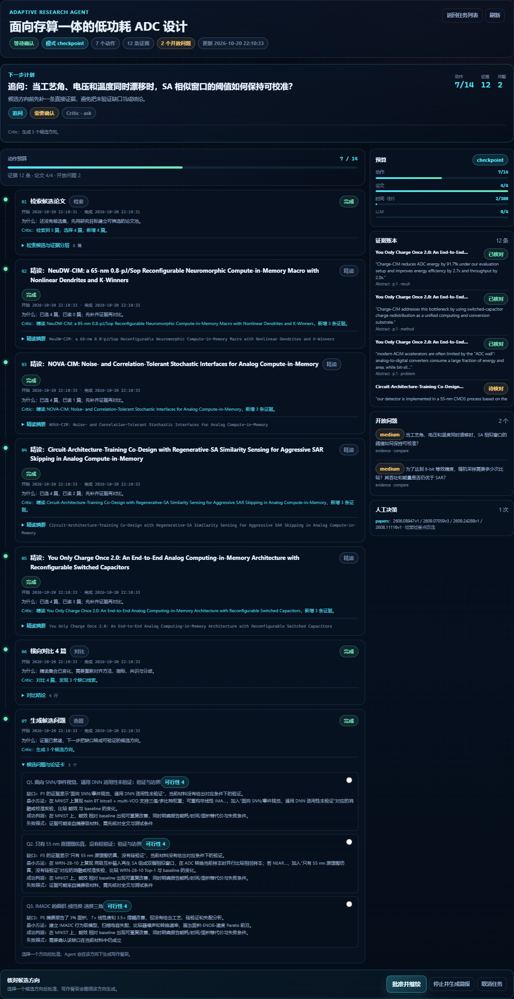

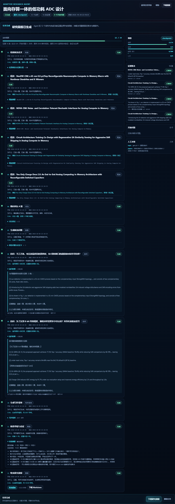

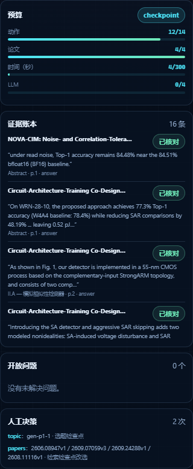

### 4.11 研究工作区与写作工作台（v2.0）

v2.0 把“一次任务”升级为“一个可持续推进的研究项目”，三块能力同版交付。

**项目与跨轮记忆**

| 能力 | 说明 |
|---|---|
| 项目实体 | 研究问题、范围、约束、标签与阶段（立项 → 探索 → 阅读 → 写作 → 核查 → 收束），阶段可自动前进也可手动回退 |
| 记忆提升 | 每轮运行结束后，已核对证据、开放问题、人工决策与论文快照自动进入项目记忆；条目使用确定性 ID，重复提升幂等 |
| 记忆播种 | 新建运行时按项目记忆带入（默认 40 条证据 / 20 个问题），并记录 `seed_summary` 说明带入了多少 |
| 运行归属 | 项目内运行互斥排队，跨项目排队不受影响；v1.0 独立任务可归档进项目，也可解除归档，归档后记忆保留 |
| 运行对比 | 同一项目 2–3 轮运行的动作数、证据数、已核对数、已解决问题、开放问题、报告字符、动作序列与共有/独有证据 |

**实时运行与干预**

- `GET /api/agent/runs/{id}/stream` 以 `stream_seq` 递增的紧凑快照推送进度，15 秒心跳，终态运行推送一次后关闭；
- 7 种控制指令 `pause / resume / replan / set_mode / add_constraint / add_papers / inject_question` 一律在动作边界生效，暂停优先于后续指令，`set_mode` 不绕过检查点；
- 托管网关缓冲或不支持 SSE 时，前端自动降级为 1.5 秒轮询，功能不中断。

**草稿与写作闭环**

- 草稿为章节 + 段落块结构，段落可绑定项目证据 ID 与引用键，未知证据/未知引用直接拒绝；
- `revision` 乐观锁，冲突返回 409；最多 20 个版本快照（手动、Agent 写入前、恢复前），可恢复；
- Agent 新增 `write` 动作，Planner 在 `draft` 之后、`review` 之前按草稿缺口撰写章节；离线模式引用项目证据原文并标记 `needs_evidence`，不伪造来源；
- 草稿核查 8 条规则（缺证据、未知证据、未知引用、数值不一致、未支撑主张、重复段落、空章节、缺标题）按高/中/低分级，只标记问题并给建议，不代写正文、不做事实真伪裁决；
- 导出 Markdown、LaTeX（含 `ctex` 的 zip 包）、BibTeX、JSON 四种格式，引用键由服务端生成并校验。


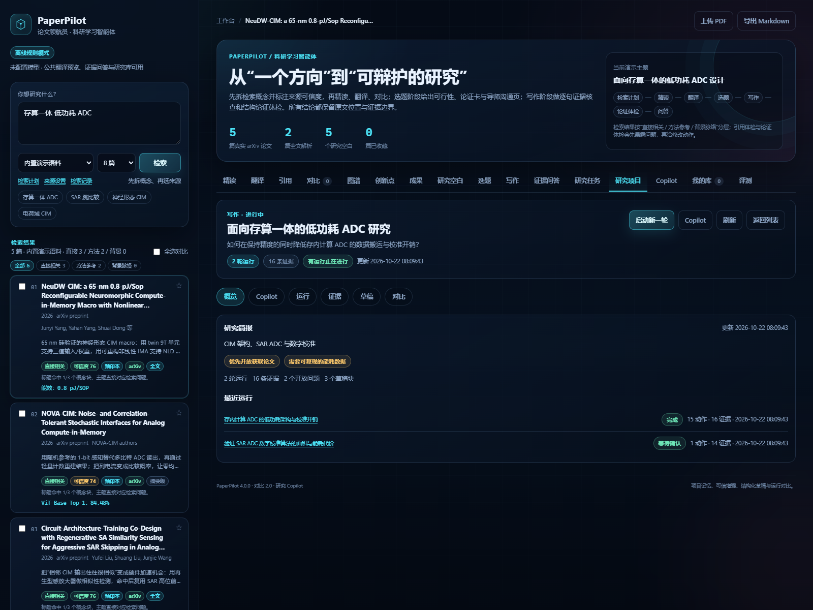

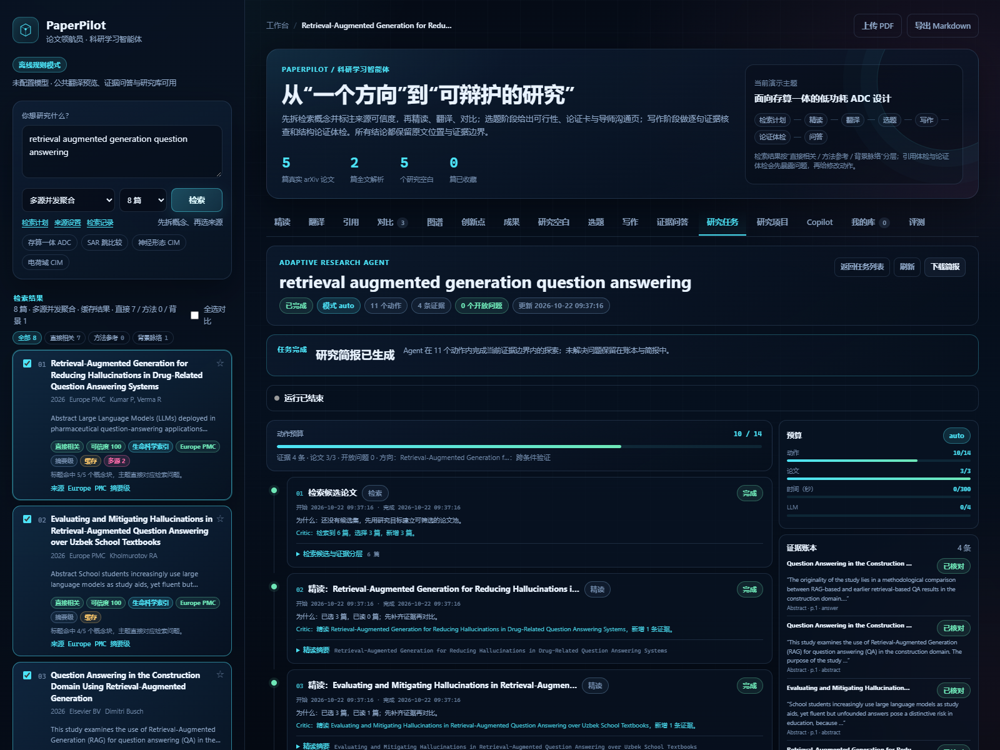

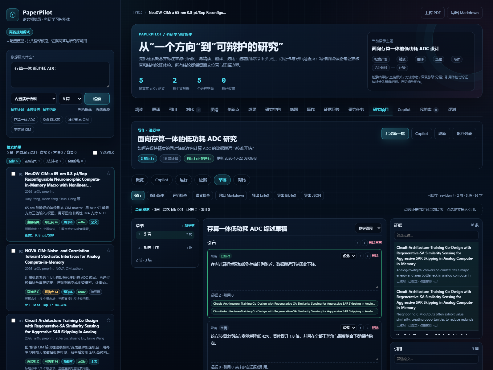

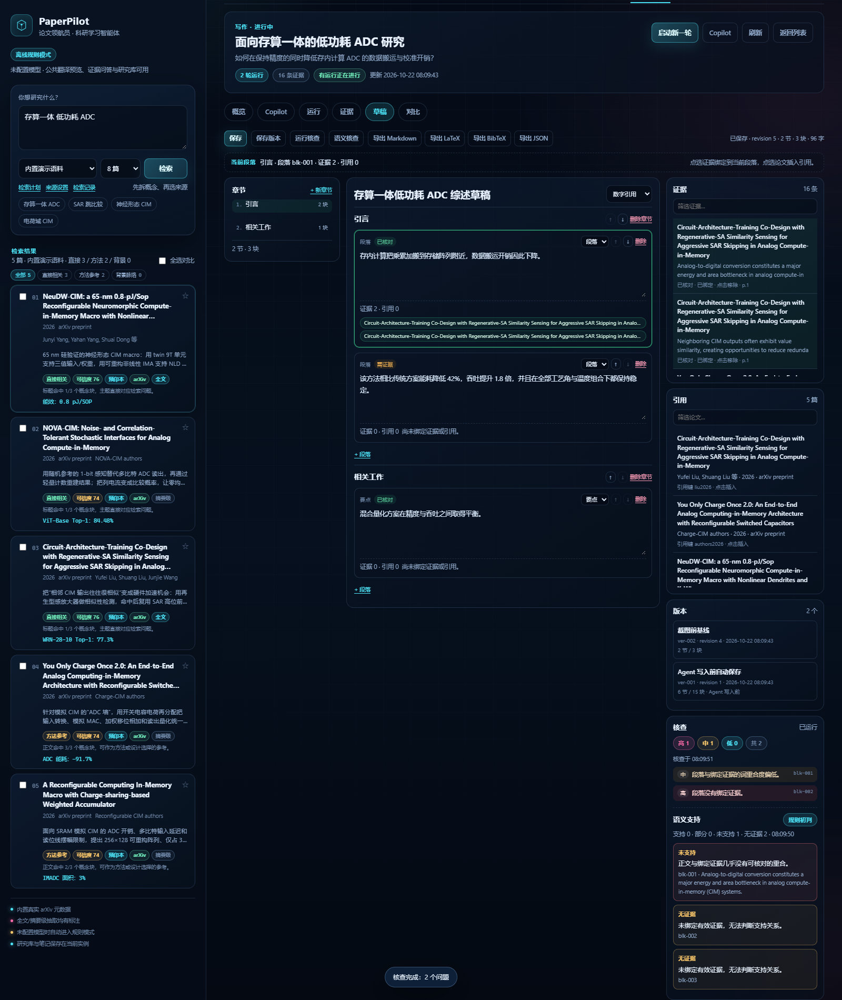

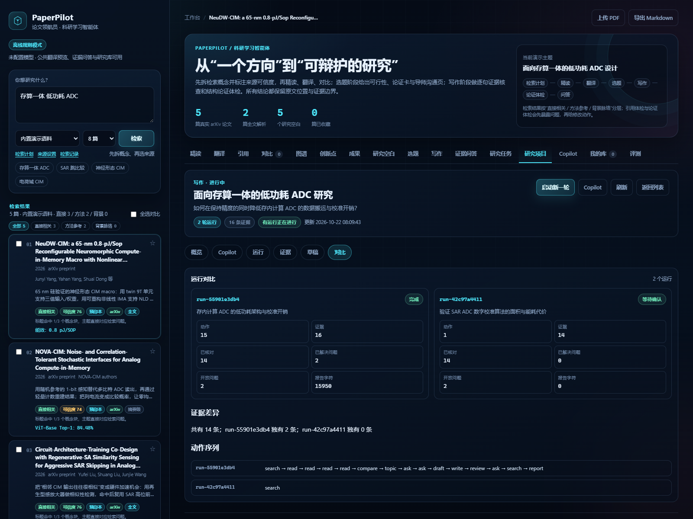

### 4.12 项目 Copilot 与可信增强（v3.0）

v3.0 把项目里已经沉淀的证据、问题、决策、草稿与运行报告变成可对话的资产，并把可选的模型路径做成可审计、可测试、受证据约束的增强层。

**项目 Copilot**

| 能力 | 说明 |
|---|---|
| 项目内问答 | 只读取当前项目的证据、开放问题、决策、论文、草稿与最近两份运行报告；不引入外部知识 |
| 8 类意图 | status / evidence / gap / decision / draft / compare / method / general，离线用关键词加权与项目状态路由 |
| 引用与边界 | 答案附证据/草稿块/运行/问题/决策/项目引用，可点击跳转到对应标签；没有足够证据时返回“证据不足”且不附引用 |
| 建议动作 | `new_run / inject_question / add_constraint / open_draft / run_audit / compare_runs / open_evidence`，全部 `requires_confirm=true`，后端不执行 |
| 对话存储 | `data/projects/<id>/assistant.json`，单会话最多 60 条消息，支持 Markdown 导出与清空 |

**可信增强**

- 引用接地校验：编号必须在上下文范围内；引句必须是资产原文子串；含数字的句子必须能回到所引片段；未支撑句只计数、不改写；
- 在线回答只接受 `{answer, used_indices, insufficient, boundary}` JSON；解析或校验失败一次修复，仍失败回退离线并标记 `llm_degraded`；
- 统一模型网关是**唯一**模型出口：一致性审计 F1 会扫描 `app/` 中绕过它的 `llm.chat` / `chat_json` 导入或调用并判失败（v8.1.3 之前 `ask` 与整段翻译就是这样静默绕过的）。网关记录用途、模型、延迟、字符数与失败原因到有界 `llm_calls.json`，不保存 prompt、密钥或用户全文；调用前检查运行预算；
- 草稿语义核查按块输出 `supported / partial / unsupported / insufficient`，附绑定证据引句与理由；不写草稿、不改块状态；
- `scripts/mock_llm_server.py` 用标准库模拟 OpenAI-compatible 接口，覆盖合法回答、越界引用、空引用、坏 JSON、传输错误与 prompt injection，测试无需真实密钥。

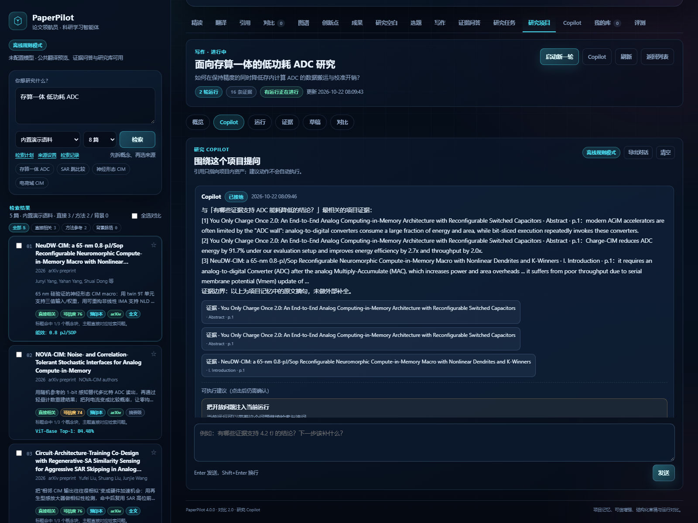

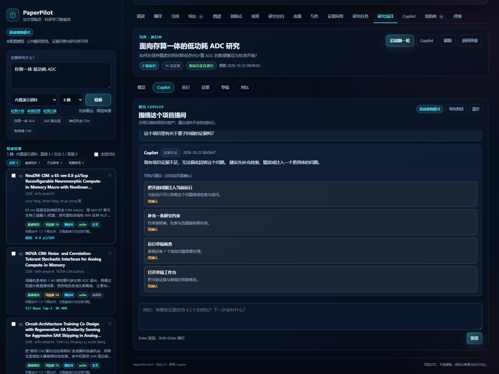

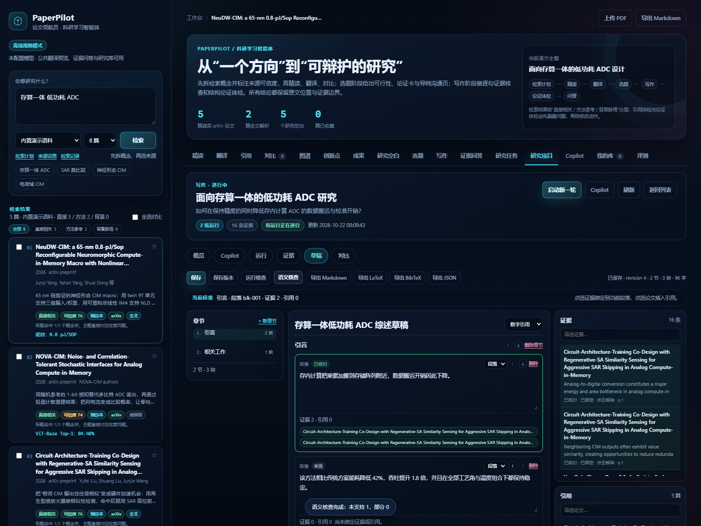

### 4.13 稿件与导出（v5.0）

- **稿件元数据**：标题、副标题、作者（姓名/单位/邮箱，最多 20 人）、摘要、关键词（最多 12 个，自动去重）、基金、语言与导出样式，随项目保存在 `manuscript.json`。
- **引用样式**：GB/T 7714-2015、APA 7、IEEE 三种学术样式，并保留 v2 的 `numeric` 与 `author-year`（输出与旧版逐字节一致）。文内标记与参考文献条目由同一引擎生成，支持卷(期)、页码、文献类型标识（[J]/[C]/[M]/[EB/OL]）与三位以上作者的"等/et al."。
- **一致性校验**：正文引用键与条目双向比对（缺条目为错误、未被引用为提醒）、缺题名/作者/年份为错误、缺卷期页码或链接按样式给提醒；错误级问题会在导出前提示。
- **DOCX 导出**：课程论文/毕设级模板——标题层级、题注、参考文献表、页眉短标题、页脚页码域；与 Markdown/LaTeX 共用同一内容模型。公式按 LaTeX 源码保留并计数提示（不排版 OMML、不做期刊模板与分页预览）。
- **投稿前检查**：字数、图表题注编号连续性、交叉引用存在性、引用完整性、未绑定证据的正文块、未支持/部分支持主张、跨论文矛盾、公式数量，每项可定位到块或条目。
- **界面**：草稿页「稿件设置」抽屉，可填写元数据、切换样式、预览文内标记与参考文献、查看检查清单、导出 DOCX/Markdown/LaTeX。

### 4.14 持续研究（v5.0）

- **检索订阅**：保存检索式（关键词/来源/间隔 1 小时–30 天/条数/关联项目），可立即执行、启停与删除；后台调度默认关闭（`PAPERPILOT_SCHEDULER=1` 开启），单进程线程、每轮最多 3 条、失败退避。
- **增量索引**：论文指纹按 DOI → arXiv ID → 标题+年份哈希生成，同一论文跨来源合并；索引只存指纹与关联，不存全文；上限 5000 篇，按最后出现时间淘汰。
- **差异定位**：新增论文相对项目内论文分类为 `conflict`（同名指标方向相反）、`support`（同名指标方向一致）、`method`（方法描述高度重合）、`irrelevant`；冲突项写入项目矛盾记录并可在草稿核查中定位。
- **界面**：项目页「订阅跟踪」抽屉，展示订阅列表、上次差异、下次执行时间、索引与调度状态。

### 4.15 补全与复核（v5.1）

- **PDF 导出**：草稿工具栏与稿件抽屉均可导出 PDF。服务器调用本机 XeLaTeX 渲染 `ctexart` 文档（标题、作者、摘要、关键词、章节、参考文献），连续编译两次解析引用；未安装 TeX 时返回 503 与安装提示，编译失败返回 422 与日志摘要。公式按 LaTeX 源码保留。
- **矛盾模型复核**：核查面板新增「矛盾复核」，模型对已记录的跨论文矛盾给出 `confirmed / dismissed / uncertain` 与理由；不得改写原文、指标或严重度；回显引句必须是原文子串，否则作废；离线或未配置 key 时降级且不改写记录；被排除的矛盾不再出现在草稿核查里。
- **订阅并发保护**：同一订阅同时只允许一个执行，第二个调用返回 `busy`；调度状态展示运行中的订阅；一条订阅失败不会阻塞同批其他订阅。仅保证单进程单 Worker。
- **同领域硬负例修复**：主张的数值大多不在绑定证据中、或系统/方法名称大多不在证据中时，判为 `unsupported`，不再把另一篇论文的同领域句子判成 `partial`。
- **金标集工作台**：`scripts/golden_workbench.py` 提供候选抽取、单文件校验、双人标注合并与规模统计；候选标签必须人工填写，未标注或待裁决集合不会进入评测。人工 4 主题 × 6 篇 / ≥200 条标注仍未完成。

### 4.16 并发、语料与线上 PDF（v5.2）

- **跨进程订阅锁**：每订阅一个锁文件（默认 `data/locks/<id>.lock`），用 `O_CREAT|O_EXCL` 原子抢占；线程锁与文件锁双层保护，第二个进程/Worker 返回 `busy`；释放校验 token，崩溃遗留锁 30 分钟后回收。只保证本地文件系统语义。
- **4 主题 × 6 篇金标语料**：从 Crossref 与 Europe PMC 抓取真实摘要，清洗、去重后提交到 `data/eval/golden/corpus/`；离线可复现。
- **225 条人工候选池**：每主题 52–60 条，`label` 全部留空；`golden_workbench.py check --corpus-dir` 校验引句为原文子串。
- **351 条多主题构造集**：逐字 supported、追加从句 partial、改数字 partial、跨论文 unsupported 四类探针，覆盖 4 个主题；仍是构造集，不是人工标注。
- **线上 PDF**：ModelScope 镜像安装 XeLaTeX + ctex + Noto CJK 字体（fontset=ubuntu），设置 `PAPERPILOT_XELATEX`；线上 `format=pdf` 可返回 `%PDF`，本地无 TeX 时仍为 503。
- **特性位**：`/api/meta` 42 项，新增 `cross_process_lock`。

### 4.17 投稿与审稿（v6.0）

- **投稿档案**：课程论文、通用期刊、IEEE 会议、双盲期刊四套参考要求（标题/摘要/关键词/亮点/引用样式/盲审）；检查叠加在 `preflight` 上，返回错误/提醒/提示与是否阻断。
- **投稿包**：一键 ZIP，含正文 DOCX、PDF（有 TeX 时）、投稿信、亮点、标题页、检查清单、RIS/BibTeX、回复模板与 README；PDF 失败只写 `PDF-NOTE.txt`。
- **双盲导出**：DOCX/PDF 去掉作者、单位、基金，DOCX 核心属性作者清空；作者信息单独放标题页。
- **审稿视角**：规则汇总支持/部分/不支持主张、证据覆盖、核查问题与跨论文矛盾，给出优点、主要/次要问题、待回答问题与推荐等级；只读，附“不是同行评审”声明。
- **回复模板**：自查表 + 审稿人意见占位表，可下载 Markdown。
- **参考文献互操作**：RIS / EndNote XML 导入导出；DOI/标题去重，revision 冲突 409，单次 ≤200 条、总量 ≤500 条；拒绝 DTD/实体声明。
- **界面**：草稿工具栏「投稿包」抽屉；档案选择、检查、亮点、投稿信、打包、审稿视角、回复模板、文献导入导出；导入后自动重载草稿。

### 4.18 作者元数据与审稿映射（v6.1）

- **作者信息**：作者支持 ORCID（ISO 7064 校验位）与通讯作者标记（最多一位）；稿件新增作者贡献/CRediT、数据可用性、代码可用性、利益冲突与致谢。
- **投稿件**：标题页与投稿信使用通讯作者、ORCID 与真实利益冲突声明；双盲 DOCX/PDF 除作者/单位/基金外同时移除致谢；数据/代码可用性与利益冲突保留。
- **正文渲染**：DOCX/PDF 在正文后输出致谢、数据可用性、代码可用性与利益冲突。
- **审稿映射**：每条审稿意见按词法重合定位最多 3 个草稿块（附章节与重合度）；回复模板可带意见原文与建议定位。
- **界面**：稿件抽屉新增 ORCID/通讯开关与投稿信息字段；投稿抽屉新增“审稿意见映射”文本框与映射表。
- **特性位**：`/api/meta` 47 项，新增 `author_metadata`、`reviewer_mapping`。

### 4.19 自定义大模型（v6.2）

- **显眼入口**：顶栏常驻「模型设置」按钮（带在线/离线状态点与当前模型名），侧栏模式行有「配置我的模型」，未配置模型时工作区顶部出现接入提示条。
- **常见大模型预设**：OpenAI、DeepSeek、月之暗面 Kimi、阿里通义千问（百炼兼容模式）、智谱 GLM、自定义 OpenAI 兼容网关；每个预置带接口地址、常用模型清单与取 Key 的控制台链接，模型名仍可自由填写。
- **自己的 API**：接口地址、模型名、API Key、超时、重试、向量模型与“启用向量检索增强”均可在界面填写；保存即生效（写回运行时配置），无需重启或修改环境变量。
- **测试连接**：一次最多 512 token 的最小补全（推理型模型会先用掉一部分额度，32 token 时会返回空内容）；表单里未保存的值也能直接试。401/403、404、429、5xx、超时、连接失败与非 OpenAI 兼容返回分别给出中文提示，4xx 会附供应商原文（截断 160 字并掩码 Bearer/sk- 形态的串）。被截断的 `delta` 形状回复按有效内容处理，空内容会明确报错而不是静默通过。
- **分用途模型**：研究报告生成、项目 Copilot、草稿写作、语义核查、矛盾复核可各自指定模型，留空统一用默认模型；切换供应商自动清空旧路由。
- **密钥与配置隔离**：配置写 `data/llm_settings.json`，密钥单独写 `data/llm_settings.secrets.json`；接口只返回末 4 位掩码；`PAPERPILOT_LLM_PERSIST_KEY=0` 时密钥只在内存、不落盘也不回显掩码（线上创空间默认）。两份文件都在 `.gitignore` 与交付包排除名单内。
- **地址安全**：默认只允许公网 HTTPS 443，拒绝回环/内网/链路本地/元数据地址与带账号的 URL；本机网关需显式 `PAPERPILOT_ALLOW_PRIVATE_LLM=1`。
- **优先级与回退**：界面设置 > 环境变量 > 内置默认；`POST /api/llm/settings/clear` 删除两份文件并回到环境变量配置，徽章与提示条同步回到离线规则模式。
- **接口**：`GET|POST /api/llm/settings`、`POST /api/llm/settings/test`、`POST /api/llm/settings/clear`；`/api/meta` 暴露 `llm_settings`。
- **失败原因可区分**：模型调用遇到 4xx 时按 `auth`（401/403）、`rate_limit`（429）、`request`（其他 4xx）分类记录，并附脱敏后的供应商原文；模型抽屉显示“限流/额度”“鉴权失败”等中文，而不是统一的“网络降级”。
- **真实模型实测**：`scripts/live_agent_check.py` 用环境变量里的真实 key 起隔离实例，依次验证设置探活、Agent auto 运行（模型撰写简报）、Copilot 接地问答、草稿语义核查与矛盾扫描，产出 JSON/Markdown 证据；无 key 退出 2 且不写报告。
- **特性位**：`/api/meta` 当前 52 项（v6.2 为 48，v7.0 新增 `dossier`，v7.2 新增 `ocr`，v7.4 新增 `pdf_pages`，v8.0 新增 `pdf_evidence`）。

### 4.20 跨部件一致性自查（v6.3）

- **审计脚本**：`scripts/audit_consistency.py` 用演示语料跑一次完整链路（搜索 → Agent 自动运行 → 草稿 → 稿件 → 投稿包 → 审稿），逐项核对“部件之间对不对得上”，共 42 项，全部离线、退出码即结论。
- **覆盖的关系**：搜索来源与分层；精读的输入/产物/标题/论文；对比的论文集合与行列；候选问题引用；追问的题目、引用论文与原文；每条证据能否回原文；简报的 `[Pn]` 图例、参考文献编号与计数；草稿块的证据/引用键、文内编号顺序、DOCX 正文；稿件标题/作者与标题页、投稿信；投稿包 DOCX 与草稿一致、亮点来源、清单计数；双盲去标识；审稿统计与草稿主张、意见映射的段落、回复模板；引用样式切换后的预览与导出。
- **本版修掉的问题**：10 条证据引句并非原文（现全部逐字）；简报引用缺图例、参考文献不编号（模型写的图例按运行顺序重建）；草稿/稿件两处样式选择互不同步（现在保存即双向镜像，且不改草稿 revision）；参考文献预览编号重复、APA 仍显示编号；预览使用上一次缓存的样式；GB/T 7714 的 `et al..` 双句点。
- **界面自查**：标签页与面板内容、稿件/草稿样式互同步、预览随样式变化、投稿档案说明随选择变化、0 console error。
- **模型路径审计**：`scripts/live_audit_consistency.py` 检查“模型写出来的东西是否仍与证据绑定”——简报图例与每个数字能否回到证据、Copilot 的数字是否来自所引原文、语义核查会不会把编造数字判成“支持”。端点不可用（配额/鉴权）时以退出码 3 拒绝执行且不写报告，避免把供应商问题误报成一致性缺陷。

### 4.21 真实模型路径一致性（v6.3.2）

- **审计**：`scripts/live_audit_consistency.py` 用真实 key 起隔离实例，跑 Agent（模型写简报）→ Copilot → 草稿语义核查 → 调用审计，共 10 项。L4 的数字基准取本次运行的论文快照（摘要、tldr、指标、结果），并跳过 Markdown 标题里的章节编号；L5 要求引用列表覆盖回答中出现的每个 `[n]`；L6 的数字来源包含引用条目的标题。
- **推理型模型**：当端点返回空正文且 `finish_reason=length`、`reasoning_tokens` 已占满上限时，网关把它识别为“推理额度耗尽”，空回复重试将上限提高到 16384；普通空回复仍按原上限重试。真实报告在该预算下完整生成。
- **简报题录**：图例与 `## 参考文献` 始终按运行论文顺序重建，模型自写的图例、错误题录与幽灵编号都会被替换；离线简报保持作者/会议/年份/DOI 的完整题录格式。
- **Copilot 边界**：模型返回的“证据边界”与正文一起解析 `[n]`，边界里提到的片段也会出现在 `citations`；越界编号仍按原有逻辑回退。
- **真实结果**：阿里云百炼兼容端点 · `deepseek-v4.1-flash-1017`，10/10；简报 11,503 字符、`mode=llm`，Copilot 4 条引用、回答中 `[1]–[4]` 全部有落点，语义核查原文引句 `supported`、编造数字 `insufficient`，3 次模型调用零降级。

### 4.22 交付树清理与复验（v6.3.3）

- **删除无引用脚本**：6 个旧版截图脚本（`capture_screenshots.py`、`_v07`、`_v08`、`_v51`、`_v60`、`_v61`，共 1,605 行）；保留仍被复现命令引用的 `_v20`、`_v30`、`_v62`。
- **删除内部开发计划**：`docs/superpowers/` 不再随产品分发。
- **未使用代码**：`ruff --select F` 在 `app/`、`scripts/`、`tests/` 全绿；清掉 34 处未使用导入/变量。
- **非产品措辞**：历史文档中的早期任务措辞改为中性的“演示视频/单实例部署”，移除开发工具名称；`search._parse_*` 作为测试/调用方再导出保留。
- **复验**：590/590 测试、90/90 验收、42/42 离线一致性、41/41 回归、13/13 Copilot、`eval_content --strict` 0；真实端点模型路径 10/10；60 张截图 OCR 抽查无非产品任务或旧版本标注。

### 4.23 可复现研究档案（v7.0）

- **导出**：`GET /api/projects/{id}/dossier` 或 `scripts/dossier.py export` 生成 `.paperpilot.zip`，内含 `manifest.json`、`dossier.json`、`DOSSIER.md`。项目元数据、记忆、全部关联运行与报告、草稿与版本快照、稿件、Copilot 历史、模型调用审计都进入档案；PDF 原件、上传文件、密钥与其他项目数据不进入。
- **校验**：`POST /api/dossiers/verify` / `scripts/dossier.py verify` 只读，逐文件大小/SHA-256、根哈希、ZIP allowlist（三个精确条目）、解压上限与结构全部通过才可导入；篡改、额外条目、路径穿越与超限均拒绝。
- **导入**：`POST /api/dossiers/import` / `scripts/dossier.py import` 创建新项目并重映射项目 ID、运行 ID、证据/问题/决策来源与 Copilot 运行引用；草稿版本快照可恢复；非终态运行冻结为 `interrupted`；同一档案可重复导入且不覆盖现有项目。
- **界面**：主导航“研究档案”标签提供项目选择、导出下载、上传校验、摘要预览与导入；390px 下纵向排列、0 横向溢出。
- **安全边界**：ZIP 压缩包 ≤25 MB、解压 ≤100 MB；导入不把 ZIP 内路径写入磁盘；模型调用审计去掉 `detail` 字段，档案构建不读取 `llm_settings*.json`。
- **专项审计**：`scripts/dossier_audit.py` 在隔离目录跑导出→校验→导入→篡改拒绝→密钥排除，10/10；真实浏览器冒烟验证下载、校验预览、导入与 390px 布局。

### 4.24 本地 PDF 全链路自查（v7.1）

- **来源**：搜索与 Agent 新增“本地 PDF”来源，按标题/摘要/章节文本检索当前实例已上传的 PDF；没有上传时明确提示先上传，不再静默回退演示语料。
- **上传边界**：损坏 PDF 返回 400；无可提取文字的扫描件返回 400 并提示 OCR；非 PDF 415；超过 25 MB / 80 页拒绝。
- **结果抽取**：能效结果只保留能量单位，不把准确率百分号混入；排除“某文献 reports that…”等引用他人工作的句子；图题/表题与单纯 trade-off 不再当作局限。
- **离线翻译提示**：上传 PDF 不再提示“演示论文有人工对照”；改为“本地 PDF 没有人工双语对照，配置模型后可翻译”。
- **在线精读/翻译**：都走 `audited_chat_json`（purpose `read` / `translation`）；精读预留 16384 token，容忍模型返回的 JSON 控制字符、额外数组项和对象/列表型 prose 字段；调用与降级进入 `/api/llm/audit`。
- **档案**：含上传 PDF 的项目档案导入后恢复论文元数据（不含 PDF 原件），返回 `restored_uploads`。
- **复现审计**：`scripts/pdf_audit.py` 离线 24/24；`scripts/live_pdf_check.py` 真实模型 12/12。

### 4.25 本地扫描件 OCR（v7.2）

- **触发**：PDF 文本层少于 80 字符时，`app/services/ocr.py` 用 PyMuPDF 渲染页面并调用本机 `tesseract`；默认 `eng+chi_sim`、最多 12 页、单页 45 秒超时。
- **入口**：识别文本进入既有的章节、证据、检索、问答与 Agent 链路；上传响应返回 `ocr_used` / `ocr_pages`，论文 `extraction_level` 标记“本地 OCR”；上传结果栏与 toast 显示 OCR 页数。
- **降级**：`PAPERPILOT_OCR=off` 或未安装 Tesseract 时返回 400，提示上传可搜索 PDF 或先 OCR；OCR 未识别出足够文字同样返回 400，不产生空论文。
- **镜像**：两个 Dockerfile 安装 `tesseract-ocr`、`eng`、`chi_sim` 语言包；OCR 全程本地，不上传云端。
- **状态**：`/api/meta` 新增 `ocr` 状态与 `ocr` 特性位（当前 50 项）。

### 4.26 OCR 多页与截断边界（v7.3）

- **页数**：默认 OCR 页数 12 → **80**，与上传 PDF 上限一致；`PAPERPILOT_OCR_MAX_PAGES` 可调低/调高。
- **截断可见**：OCR 未覆盖全部页面时，论文/上传响应返回 `ocr_truncated` 与 `ocr_warning`；上传结果栏显示“其余页未识别”并弹出警告。
- **标题**：OCR 标题只取前几行，遇空行、作者/机构、Abstract/Keywords 停止，不再把整页正文当标题。
- **测试**：3 页图像型 PDF 全文 OCR 与 `PAPERPILOT_OCR_MAX_PAGES=1` 截断警告覆盖；OCR 专项 6/6。
- **边界**：80 页是页数上限，不是耗时上限；复杂表格、公式、手写体识别质量仍不保证。

### 4.27 原文页预览与证据定位（v7.4）

- **页面 API**：`GET /api/paper/{id}/pages/{page}` 从本地 PDF 渲染单页 PNG（150 dpi，单页上限 220 dpi）；只接受上传 PDF 与随包演示 PDF，路径白名单、页码边界，缺页 404。
- **阅读页**：本地 PDF 的阅读页新增“原文页”按钮；章节页码、证据页码旁出现“查看”链接，打开模态查看器，可上一页/下一页。
- **标记**：`/api/paper` 与 `/api/read` 返回 `local_pdf`；`/api/meta` 新增 `pdf_pages` 特性位（当前 51）。
- **失败可见**：页面加载失败显示“该页无法预览：论文没有本地 PDF 或页码超出范围”，不伪造页面。
- **测试**：上传 PDF 页面 PNG、越界/未知论文 404、阅读标记、前端契约与浏览器 p.1→p.2 翻页。

### 4.28 证据浏览器与词级高亮（v8.0）

- **定位 API**：`GET /api/paper/{id}/locate?page=&quote=` 用 PDF 文本层搜索引句，返回归一化矩形；多行引句拆成多个框；未命中返回 `matched=false` 与说明，不伪造坐标。
- **页面高亮**：阅读页证据/章节的“查看原文页”携带引句；页面查看器叠加黄色高亮层，显示“已定位证据 · N 处”，并支持翻页。
- **OCR/扫描件边界**：没有文本层的页面显示“未定位到文本层”，只能看原图，不声称词级定位。
- **标记**：`/api/meta` 新增 `pdf_evidence` 特性位（当前 52）。
- **测试**：坐标归一化、未命中说明、越界/未知论文 404；浏览器定位 6 处高亮。

### 4.29 暂未实现

- 候选集之外的向量召回、知识图谱与增量索引（混合检索是对 BM25 候选的重排；embedding 需模型 key 且默认关闭）；
- 多用户协作、分布式任务队列与代码沙箱；
- 论文与 GitHub 仓库自动对齐、代码沙箱复现；
- 图表自动数字化；
- 多用户账号、协作批注、跨设备同步与分布式任务队列。

## 5. 系统架构

```text
用户
  ↓
Orchestrator（意图识别 / 任务规划 / 人工确认）
  ├─ Adaptive Planner/Critic 证据覆盖/饱和度/开放问题/预算 → 下一步
  ├─ Action Runner  search/read/ask/compare/topic/draft/review/report
  ├─ Evidence Ledger  证据、开放问题、人工决策、动作轨迹
  ├─ Retrieval     BM25 候选 + 术语/章节扩展重排 + 可选 embedding + 引用核验
  ├─ Scout       检索计划、查询扩展、多源并发、去重排序、证据分层
  ├─ Reader      PDF 解析、章节/页码、证据定位、五栏笔记
  ├─ Translator  章节翻译、术语一致、公式/引用保护与双语对照
  ├─ Analyst     字段抽取、横向对比、创新点
  ├─ Critic      证据校验、可比性、研究空白、引用体检
  ├─ Planner     研究版图、候选问题、四维可行性、论证卡、导师沟通
  ├─ Builder     复现计划、代码骨架、教学材料
  ├─ Writer      相关工作/提纲/摘要骨架、主张核查、论证体检
  └─ Librarian   研究库、笔记、问题拆解与证据检索
  ↓
工具层：arXiv / Crossref / Europe PMC / DOAJ / HAL / OpenCitations / PDF Parser / 章节-字段感知 Retriever / 任务 Runner / 混合检索与引用核验 / Markdown · JSON · BibTeX Export
  ↓
存储：本地 JSON（研究库、任务与步骤、精选论文快照、来源配置、术语包、留痕、检索/翻译/引用/DOI/embedding 缓存）+ 上传 PDF
```

当前版本的可运行链路：

```text
浏览器
  ↓
FastAPI（app/main.py）
  ├─ /api/search       → services/search.py + planner.py（多源检索/自定义来源/分层/可信度）
  ├─ /api/search/plan  → services/planner.py（概念块/来源检索式）
  ├─ /api/sources/custom → services/custom_sources.py（来源 CRUD/测试/密钥隔离）
  ├─ /api/glossary     → services/glossary_store.py（内置+扩展术语合并）
  ├─ /api/glossary/packs → services/glossary_store.py（在线/本地术语包）
  ├─ /api/history      → services/history.py（检索留痕）
  ├─ /api/upload       → services/pdf.py（PyMuPDF 逐页解析、元数据提取）
  ├─ /api/read         → services/analysis.py（精读、指标、证据、缓存）
  ├─ /api/translate    → 术语表 / LLM
  ├─ /api/compare      → 统一 schema + 可比性守卫
  ├─ /api/innovate     → 三栏分离 + 审稿人问题
  ├─ /api/transform    → 复现计划 / 代码骨架 / Slides / Quiz
  ├─ /api/gaps         → 研究空白雷达
  ├─ /api/ask          → services/ask.py + retrieval.py（问题拆解 + 混合重排 + 支持度 + 引用核验）
  ├─ /api/agent/runs   → agent_runs.py + agent_policy.py + agent_actions.py（自适应任务/证据账本/恢复/报告）
  ├─ /api/topic        → services/research.py（选题版图/可行性/论证卡/导师沟通）
  ├─ /api/draft        → services/research.py（相关工作/提纲/摘要骨架）
  ├─ /api/check        → services/research.py（逐句主张—证据核查）
  ├─ /api/argument     → services/argument.py（结构论证体检/章节映射）
  ├─ /api/library      → services/library.py（研究库 CRUD / 引用体检 / 导出）
  └─ /api/eval         → 回归集结果
```

技术栈：

| 层 | 选型 |
|---|---|
| 前端 | 原生 HTML/CSS/JS，零构建依赖，离线可用 |
| 后端 | FastAPI + Uvicorn |
| PDF | PyMuPDF（逐页文本、页码保留） |
| 检索 | arXiv / Crossref / Europe PMC / DOAJ / HAL + 自定义 JSON API + 检索计划/分层 + 本地缓存 + 章节-字段感知 BM25 + 混合重排 |
| 存储 | 本地 JSON（研究库、任务与步骤、精选论文快照、来源配置、术语包、留痕、缓存）+ 上传 PDF |
| 模型 | 任意 OpenAI-compatible Chat Completions / Embeddings（可选；超时、重试、JSON 校验、回退） |
| 评测 | 自建 41 条回归集 + 532 条全量测试 + 13 项 Copilot 专项 + 内容质量评测 `eval_content.py` + 金标集工作台 `golden_workbench.py` + 投稿/审稿 `submission.py` / `reviewer.py` + 语料抓取 `fetch_golden_corpus.py` + `scripts/evaluate.py` / `eval_agent.py` / `eval_workspace.py` / `eval_assistant.py` / `eval_real_llm.py` / `bench_v07.py` |
| 部署 | 本地 `run.py` / Docker Compose / Windows `start.bat` |

## 6. 关键设计

### 6.1 证据优先

每个结构化字段尽量附：

```json
{"section": "Abstract", "page": 1, "quote": "原文引文"}
```

找不到就写“未提及”，不用常识补全。UI 中每条证据可以展开查看原文与页码。

### 6.2 三栏分离

创新点页固定分成：

1. **作者声称**：论文自己说做了什么；
2. **实验证据**：数字、对比、消融、测试条件；
3. **模型推断**：Agent 基于证据的推测，明确标注“不是论文结论”。

### 6.3 可比性守卫

不同论文的工艺节点、验证方式（原理图仿真/硅测）、数据集、网络、位宽、测试条件不同。PaperPilot 在对比页固定提示：

> “表中数字不可直接比较或按大小排序；‘未提及’表示当前材料没有给出该字段，不代表论文没有做。”

v3.2 进一步对**每一对论文**输出可比性判定：共享指标、数据/任务词与主题词作为可比依据；年份差、证据层级差与指标缺口写入差异；没有足够共同维度时标记“不可直接比较”，并建议分别阅读。共识只陈述“哪些论文报告了哪个指标、各篇值是多少”，不把数值强行排序；分歧优先引用各论文的局限从句。

### 6.4 抽取层级可见

每篇论文都标注：

- `全文节选 + 结构化抽取`：有 PDF 解析、页码、章节、证据；
- `摘要级抽取`：只有公开摘要，不能假装有全文证据。

### 6.5 问答覆盖透明

证据问答先做问题拆解与意图识别，再按章节/字段加权检索，按论文去重并控制每篇证据数。响应同时返回：

- 命中片段、章节/页码与可核对数值；
- 每篇论文的支持度（直接证据 / 部分相关 / 未命中）；
- 检索置信度、问题方面与片段数；
- 超出语料时明确拒答。

离线模式只做原文抽取式拼接；在线模式生成综合回答，但必须以 `[n]` 引用给定证据。

### 6.6 研究可积累

研究库保存到 `data/library.json`，包含论文元数据、状态、标签、笔记和时间戳。支持搜索、状态筛选、标签筛选与整体导出。该文件不进入发布包、镜像或 Git 仓库。

### 6.7 离线可演示

PaperPilot 默认使用内置真实 arXiv 元数据与两篇开放获取全文，配合人工校订的结构化字段，保证十三个工作区都能完整演示。配置模型后，上传 PDF、问答与研究简报可获得增强。

## 7. 操作指南

### 7.1 启动

```bash
cd paperpilot
pip install -r requirements.txt
python run.py
```

或 Windows 双击 `start.bat`，或 `docker compose up --build`。

默认地址：`http://127.0.0.1:8765`。

### 7.2 检索与收藏

- 左侧输入研究方向，例如“存算一体 低功耗 ADC”；
- 选择“内置演示语料”或“arXiv 在线”；
- 点击“检索”；
- 结果卡片显示年份、venue、作者、TL;DR、抽取层级与头条指标；
- 点击卡片右上角星标收藏；再次点击移除；
- 勾选 2–5 篇，点顶部“对比”。

### 7.3 精读

- 点击论文卡片；
- 查看 TL;DR、问题/方法、创新点、全文节选、关键指标、审稿人问题、证据链、Agent 运行轨迹；
- 点击“翻译”进入翻译工作台，翻译摘要或整篇，查看中英对照与术语；
- 点击“查看证据”展开原文引文与页码；
- 点击“复制原文”复制章节文本；
- 点击“★ 收藏”加入研究库。

### 7.4 对比 / 创新点 / 成果 / 空白

- **对比**：勾选 2–10 篇，查看对比表、可比性提醒、共识、分歧、可继续做的空白；
- **创新点**：作者声称 / 实验证据 / 模型推断三栏 + 评分 + 审稿人问题；
- **成果**：复现计划、代码骨架、组会提纲、Quiz、课程案例；
- **研究空白**：5 个带评分与最小实验的问题，附 Idea Critic。

### 7.5 证据问答

- 打开“证据问答”；
- 选择范围：全部语料 / 我的研究库 / 左侧勾选论文；
- 查看问题拆解、支持度矩阵与可核对数值；
- 输入问题，或点击示例；
- 查看回答、证据覆盖、引用卡片；
- 点击引用卡片“打开精读”回到论文，或“收藏”加入研究库；
- 离线模式为原文拼接；在线模式为模型综合。

示例问题：

- 五篇论文分别如何降低 ADC 开销？
- SAR 跳比较如何降低 ADC 能耗？
- SNN 的 Top-K 早停如何实现？
- 哪些工作用了可重构阵列？

### 7.6 我的库

- 查看总收藏、待读、在读、已读；
- 切换阅读状态；
- 编辑标签（逗号分隔）与研究笔记，点击“保存笔记”；
- 按标题、标签、笔记搜索；点击标签快速筛选；
- 点击 Markdown / BibTeX / JSON 备份下载；
- 点击“导入”选择 JSON 备份，合并到当前研究库；
- 点击“打开精读”回到论文。

### 7.7 上传 PDF

- 右上角“上传 PDF”，支持一次选择 1–5 篇；
- 每篇 ≤25 MB、≤80 页；
- 解析后自动进入精读，显示页数、章节数、作者、年份与 Abstract；
- 离线时用规则抽取标题、作者、章节、图表、数值、工艺与局限；配置模型后可进一步结构化。

### 7.8 选题与写作

- 打开“选题”，输入方向，生成方法簇、候选问题、阅读路径和实验计划；
- 在候选问题卡片点“用这个方向写作”，进入“写作”；
- 选择相关工作 / 提纲 / 摘要骨架，生成带引用键的草稿；
- 点“送入核查”，检查逐句支持度、缺失数值与引用；
- 结果可导出 Markdown，所有草稿都必须人工改写和核对。

### 7.9 导出与深链

- 右上角“导出 Markdown”按当前工作区导出；
- 深链：`/#compare`、`/#innovate`、`/#transform`、`/#gaps`、`/#ask`、`/#library`、`/#eval`。

### 7.10 接入自己的大模型（v6.2）

1. 点顶栏「模型设置」（未配置模型时工作区顶部也有提示条）；
2. 选一个供应商芯片（OpenAI / DeepSeek / 月之暗面 Kimi / 阿里通义千问 / 智谱 GLM / 自定义），接口地址与常用模型会自动填好，可再改；
3. 粘贴自己的 API Key（输入框是密码框，保存后页面只显示末 4 位掩码）；
4. 先点「测试连接」——它会用一次最多 32 token 的最小补全真实请求一次，失败会告诉你是密钥被拒、模型名不对、限流还是返回格式不对；
5. 通过后点「保存并启用」，左侧模式徽章立刻变成“在线增强模式”，顶栏按钮上显示当前模型名；
6. 需要更细的控制，在“分用途模型”里给研究报告、Copilot、草稿写作、语义核查、矛盾复核分别指定不同模型，留空即用默认模型；
7. 换机器或想收回密钥，点「清除配置」——两份文件都会被删除，回到环境变量配置（若没有则回到离线规则模式）。

本机网关（Ollama、vLLM、OneAPI 等）默认被地址安全规则挡住；确需使用时在启动环境里设置 `PAPERPILOT_ALLOW_PRIVATE_LLM=1`。公共演示实例把 `PAPERPILOT_LLM_PERSIST_KEY` 设为 0，此时密钥只留在内存、重启即失效，也不会回显掩码。

## 8. 效果演示

### 8.1 场景一：一周摸清“存算一体 ADC”

1. 输入“存算一体 低功耗 ADC”；
2. 得到 5 篇真实 arXiv 论文卡片；
3. 勾选 3 篇 → 对比表自动列出工艺/验证、ADC 方案、任务、头条指标、主要局限与原文证据；
4. 对比页给出共识、分歧与“不可直接比较”提醒；
5. 研究空白页生成 5 个可验证问题；
6. 证据问答问“这些工作的创新点是什么？”，得到支持度矩阵、可核对数值与页码引用。

### 8.2 场景二：一下午读懂一篇 ISSCC 风格论文

以 *Circuit–Architecture–Training Co-Design with Regenerative-SA Similarity Sensing for Aggressive SAR Skipping in Analog Compute-in-Memory* 为例：

- TL;DR：用 SA 做相似性检测，命中则复用 SAR 前缀、跳比较，再用硬件感知训练补偿误差；
- 关键指标：55 nm 原理图仿真，WRN-28-10 Top-1 77.3%（W4A4 baseline 78.4%），SAR 比较减少 48.19%，ADC 能耗减少 27.18%；
- 审稿人问题：只有 TT 角、25 个扰动样本，如何证明 PVT 下可靠？
- 证据链：8 条带页码/章节的原文引文；
- 成果页：复现计划、`skip_sar` 代码骨架、组会提纲、Quiz。

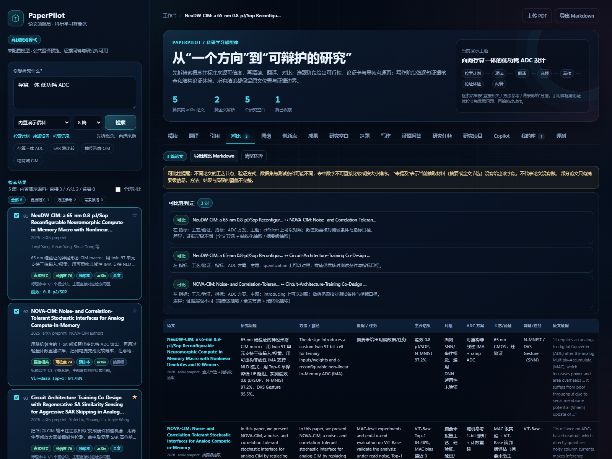

### 8.3 场景三：把论文变成课程案例

- 打开“成果”页；
- 查看“课程案例”卡片：适合哪门课、先修知识、讲解结构；
- 复制代码骨架，作为课堂演示或作业起点；
- 用 Quiz 检查学生是否理解“电压相近不等于前缀相同”。

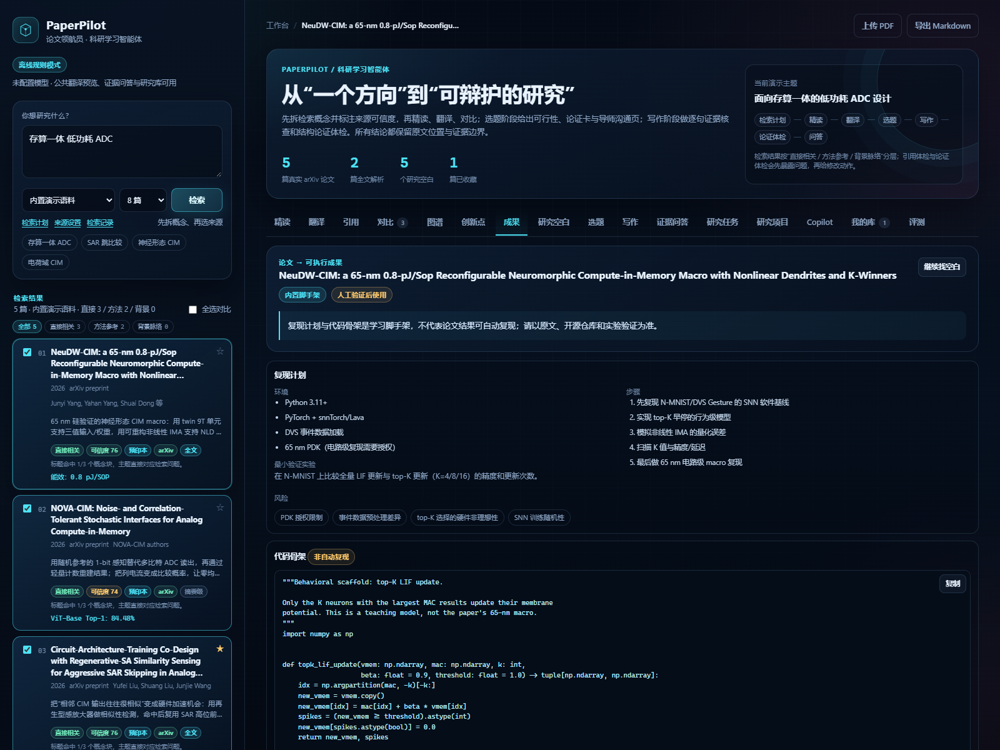

### 8.4 场景四：把阅读沉淀为研究库

- 在结果卡片或论文页收藏 4 篇论文；
- 在“我的库”标记待读/在读/已读；
- 添加标签“ADC / SAR / 读出”“SNN / Top-K / 65nm”；
- 写下“待核对 SA 检测器能耗占比”等笔记；
- 导出 Markdown，进入组会或周报。

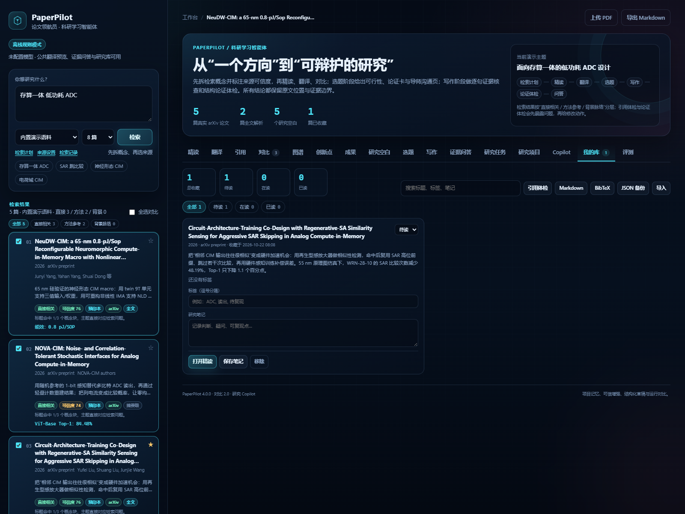

### 8.5 场景五：从选题到导师沟通

- 在“选题”里生成方法簇与候选问题；
- 展开四维可行性，判断数据/方法/时间/证据哪一项需要收窄；
- 展开论证卡，检查缺口、最小实验、成功判据与失败模式是否闭环；
- 在导师沟通页复制一页纸，选择“带选项的提问”，并提前准备导师可能追问的证据与数据来源。


### 8.6 场景六：写作前先做论证体检

- 把摘要/引言/相关工作粘贴到“草稿体检”；
- 先做“论证体检”，看问题、缺口、方法、证据、讨论、局限、结论是否齐全；
- 查看章节论证映射、引用标记、证据线索与未支撑句；
- 按“优先修改动作”补引用、补讨论或缩小断言，再做逐句数值核查。


### 8.7 场景七：研究库引用体检

- 在“我的库”点“引用体检”；
- 查看平均题录分、可引用数、待补项与重复组；
- 按建议补作者、年份、来源、DOI、链接；
- 需要时点“核验 DOI（联网）”，确认题名是否与 Crossref 一致；核验结果只作提示，不自动修改记录。


### 8.8 场景八：配置自定义论文来源

- 在左侧点“来源设置”，选择 Semantic Scholar/CORE/通用 JSON API；
- 填写 API 地址、结果路径与字段映射；如需账号/token，填写后保存；
- 点“测试”查看返回条数、耗时与标题；
- 回到检索来源下拉，选择该来源检索；结果与内置来源一样进入分层、可信度、收藏和精读。


### 8.9 场景九：扩展术语库

- 在翻译工作台的术语表里点“管理词库”；
- 下载机器之心 AI 术语库，或导入本地 JSON/CSV/TSV/Markdown；
- 查看来源、许可与归属，按需停用/更新/删除；
- 返回术语浏览或翻译时，扩展词自动参与命中，内置术语重名优先。


### 8.10 场景十：导出检索留痕

- 点左侧“检索记录”，查看每次查询的来源、结果数和分层；
- 导出 Markdown/CSV，写入检索日志或组会记录；
- 需要重新开始时清空留痕；留痕不代表结果质量。


## 9. 评测

### 9.1 回归集

`data/eval_set.json` 包含 41 条用例，覆盖：

- 检索排序（4 条）
- 字段抽取（5 条）
- 证据链（2 条）
- 对比告警（2 条）
- 术语翻译（2 条）
- 成果转化（3 条）
- 研究空白（2 条）
- 证据问答（9 条）
- Crossref（1 条）
- PDF 抽取（2 条）
- 研究库（3 条）
- 选题（1 条）
- 写作（2 条）
- 主张核查（3 条）

运行：

```bash
python scripts/evaluate.py
```

当前结果：**41/41 通过，100%**。这验证的是“链路按预期工作”，不是“模型质量达到人类专家水平”。

另有 **671 条**专项单元/API 测试（翻译、术语、来源解析、引用网络、检索计划/分层、引用体检、选题论证卡、论证体检、精读缓存、自定义来源、术语包、检索留痕，v1.0 状态/迁移、Planner/Critic、动态动作、证据账本、三档 worker、API 与报告回退，v2.0 项目状态与生命周期、记忆提升幂等、运行归属与互斥、v1.0 任务归档、7 种控制指令状态矩阵、SSE 快照与降级、运行对比、草稿模型与乐观锁、引用键校验、版本恢复、`write`/`review`、多格式导出、XSS 转义，v3.0 Copilot/接地/网关/语义核查/前端契约，v4.x 概念图谱/缓存边界/安全头/真实论文运行质量，v5.0 三档判定/claims/矛盾/内容指标/引用样式/稿件/preflight/DOCX/订阅/增量索引/模型治理，v5.1 PDF/矛盾复核/订阅并发/金标集工作台/同领域硬负例，v5.2 跨进程锁/4×6 语料/多主题构造集/线上 PDF，v6.0 投稿档案/投稿包/盲审/审稿视角/RIS-EndNote，v6.1 ORCID/通讯作者/盲审去致谢/审稿映射，v6.2 自定义大模型/密钥隔离/地址安全/分用途路由，v6.2.1 真实模型兼容与空回复重试，v6.2.2 输入快捷键守卫，v6.3 跨部件一致性审计/样式互同步，v6.3.1 4xx 原因分类，v6.3.2 真实模型路径审计/推理额度重试/题录重建/Copilot 边界引用，v6.3.3 交付树清理、未使用代码清理与全功能复验，v7.0 档案格式、导出/校验/导入、运行 ID 重映射与 ZIP 安全边界，v7.1 本地 PDF 来源、损坏/扫描件拒绝、规则结果过滤、在线精读/翻译审计与上传元数据恢复，v7.2 本地 OCR、扫描件上传、OCR 状态与镜像依赖，v7.3 多页 OCR、截断警告与标题提取，v7.4 本地 PDF 页面渲染、阅读页/证据跳页与 `pdf_pages` 特性位，v8.0 引句定位 API、页面高亮层与 `pdf_evidence` 特性位，v8.1 内联引用保存/保留引用、在线比较、离线证据回退与结构化字段清洗，v8.1.1 成功缓存、引用编号顺序、`citations` 三态语义、运行账本接地与字段清洗回归，v8.1.2 运行预算逐条记账、缓存不重复扣费与精读降级回归）**671/671 通过**：

```bash
python -m unittest discover -s tests -p 'test_*.py'
```

覆盖章节目录、公式/URL/引用占位保护、分段长度、公共通道截断与缓存、额度错误、模型完整翻译、源文本变化失效、翻译工作台 payload、API 错误映射、311 条分类术语、Europe PMC/DOAJ/HAL 解析、OpenCitations 引用网络、多源并发去重与冷却、检索概念扩展/分层/可信度、引用体检缺项/重复/DOI 核验、四维可行性/论证卡/导师问题、结构论证体检与精读缓存。

性能基准：

```bash
python scripts/bench_v07.py
```

当前结果：检索计划 0.06 ms、演示检索 + 分层 0.41 ms、论证体检 4.2 ms、引用体检 0.33 ms；多源聚合正常冷启动约 0.9 秒；外部慢源超时时 8.0 秒内返回可用结果；缓存/冷却后复跑 0.5–153 ms。

### 9.2 目标指标与人工评测计划

| 维度 | 指标 | 目标 |
|---|---|---|
| 检索 | Recall@5 | ≥ 0.80 |
| 字段抽取 | 字段准确率 | ≥ 0.85 |
| 对比 | 关键单元格准确率 | ≥ 0.85 |
| 翻译 | 术语准确率 | ≥ 0.95 |
| 翻译 | 整篇完成率 / 数字保留率 | ≥ 0.90 / ≥ 0.95 |
| 翻译 | 公式与引用占位符保留率 | ≥ 0.98 |
| 引用 | 带 DOI 论文的引用网络可用率 | ≥ 0.80 |
| 引用 | Crossref 题录补全率 | ≥ 0.85 |
| 引用体检 | 缺项/重复检出率 | ≥ 0.90 |
| 检索计划 | 概念块/检索式可解释率 | 100% |
| 选题 | 四维可行性/论证卡字段完整率 | 100% |
| 论证体检 | 结构缺失检出率 | ≥ 0.85 |
| 术语 | 分类覆盖与释义完整率 | 100% |
| 证据 | 无证据断言率 | < 5% |
| 证据问答 | 引用命中率 | ≥ 0.90 |
| 研究库 | 读写/检索成功率 | 100% |
| 效率 | 5 篇综述耗时 | 4 小时 → 40 分钟 |

人工评测计划：

- 20–30 篇论文、3 个主题，人工标注 10–12 个字段；
- 2 位评审独立标注，计算一致性；
- 对比“手工 + 通用聊天模型”与 PaperPilot 的任务耗时；
- 统计“无证据断言率”“条件误配率”和“问答引用命中率”。

详见 [`评测方案.md`](评测方案.md)。

### 9.3 真机能力检查

在 5 篇真实开放获取 arXiv 论文（FlashAttention、LLM.int8、GPTQ、SmoothQuant、AWQ）上完成端到端检查：在线检索、真实 PDF 上传、跨语言证据问答、选题、写作草稿、主张核查、越界拒答与并发请求。

- 自动检查：**10/10**（检索相关命中 4/4，PDF 结构 5/5）
- 同一查询复跑：约 **2–3 ms**（24 小时查询缓存）
- 6 请求并发问答：0 失败，总耗时约 **28 ms**
- 回归集：**41/41**
- 全量测试（翻译/术语/来源/引用/检索计划/引用体检/选题论证/论证体检/缓存/自定义来源/术语包/留痕 + v1.0 状态/规划/动作/worker/API + v2.0 项目/记忆/控制/SSE/对比/草稿/核查/导出 + v3.0 Copilot/接地/网关/语义核查/前端契约 + v4.x 图谱/安全头/真实 Agent 运行质量 + v5.0 判定/稿件/DOCX/订阅/治理 + v5.1 PDF/矛盾复核/订阅并发/金标集 + v5.2 跨进程锁/多主题语料/线上 PDF + v6.0 投稿/审稿/文献互操作 + v6.1 作者元数据/审稿映射）：**532/532**
- Copilot 专项（`scripts/eval_assistant.py`）：**13/13**，覆盖意图、证据引用、无证据拒答、建议确认、语义四态、mock 在线合法/越界回退/注入/预算降级
- v1.0 浏览器：检索改选、选题确认、两次追问、报告下载；`hybrid` 检索与 **6/6** 条引用核验；390px 宽横向溢出 0；0 个 console error
- v2.0 浏览器（Edge 1600×1200 与 390×844）：项目列表/概览、实时运行与控制栏、草稿工作台与核查、运行对比全部走通；SSE 显示“实时连接”；390px 项目页与草稿页横向溢出均为 **0**；**0 个 console error**
- v3.0 浏览器：Copilot 提问、引用卡片、无证据拒答、语义核查全部走通；**0 个 console error**；390px 项目页/助手页/草稿页横向溢出均为 **0**
- Agent 场景：auto 12 动作/16 证据/15,138 字符；checkpoint 11 动作/14 证据/13,176 字符；预算收缩 3 动作/3,742 字符
- 工作区场景（`scripts/eval_workspace.py`）：首轮 16 动作/16 证据，次轮播种 14 条项目证据/11 动作，草稿写入 3 块，核查 13 条高危，对比共有证据 15 条，耗时约 0.7 秒
- 真实浏览器（v0.7）：检索计划、分层筛选、引用体检（DOI 1/1）、选题四维/论证卡/导师沟通、论证体检、精读笔记与论证 Markdown 下载全部通过，0 个 console error
- 多源聚合：正常冷启动约 0.9 秒；外部慢源超时时 8.0 秒内返回可用结果；缓存/冷却后复跑 0.5–153 ms
- 引用网络：11 参考/19 被引，完成收藏与导出

运行 `python scripts/real_world_check.py --pdf-dir <包含 5 篇 PDF 的目录>` 可复测；完整数据、浏览器实机记录与剩余限制见 [`真机能力报告.md`](真机能力报告.md)。

## 10. 亮点

1. **从“单篇问答”到“跨论文结构化对比”**：统一 schema + 可比性守卫。
2. **从“总结”到“可执行产出”**：复现计划、代码骨架、实验清单、组会 Slides、课程案例。
3. **证据优先的 Agent 设计**：section + page + quote；三栏分离；抽取层级可见。
4. **可核查的证据问答**：引用编号、章节页码、覆盖提示、无证据拒答。
5. **从证据缺口到可辩护选题**：四维可行性、论证卡、阅读路径、实验计划、导师沟通页。
6. **从草稿到两层体检**：先看结构/引用/论证缺口，再做逐句支持度与数值校验。
7. **可积累的研究库**：收藏、状态、标签、笔记、引用体检与导出，形成个人研究记忆。
8. **多源检索与引用追踪**：五个免密钥来源、结果分层/题录可信度、OpenCitations 参考/被引网络与 Crossref 题录补全。
9. **可信术语库**：311 条内置术语 + 在线/本地扩展包，翻译提示与浏览检索共用同一套合并释义，并保留来源与许可。
10. **检索可解释**：检索前先拆概念块并生成各来源检索式；分层与可信度只作筛选提示。
11. **慢源可降级**：多源聚合并发执行，设置响应上限与冷却，外部 API 不稳定时不拖垮主流程。
12. **能力保留**：导师沟通先给带选项的问题与追问准备，论证体检先暴露缺口与修改动作，不替用户重写全文。
13. **来源可配置**：Semantic Scholar/CORE/通用 JSON API，账号/token 隔离存储，字段映射可测试；检索结果与内置来源共用后续流程。
14. **检索可复现**：自动留痕查询、来源、结果数与分层，支持 Markdown/CSV 导出。
15. **离线可演示 + 在线可增强**：没有 key 也能完整演示；有 key 时增强 PDF 抽取、翻译、问答综合与研究简报润色。
16. **自适应 Agent**：Planner–Critic 按证据与预算决定下一步；核查不足会追问或扩展检索，预算耗尽会收束。
17. **任务可恢复**：动作、证据、开放问题与决策持久化；检查点可改选/停止，重启后可恢复，简报可单独下载。
17. **引用先核验**：引用 quote 回到证据块做原文匹配，失败标记为待核对，不把模型输出当作新证据。

## 11. 局限与迭代计划

### 当前局限

- 离线模式的结构化字段为人工校订的演示语料，不等于对任意论文的自动抽取；
- 上传 PDF 的图表/数值/局限为规则抽取，版式复杂时可能漏提；配置 LLM 可增强；
- 检索源以 arXiv / Crossref / Europe PMC / DOAJ / HAL 与用户配置的 API 为主，IEEE/ACM 全文需开放获取或用户上传；
- 证据问答的候选召回仍是词法检索（BM25 + 章节/字段意图）；混合检索只在 BM25 候选集上重排，不引入候选集之外的新证据；embedding 默认关闭，需要模型 key 与 `PAPERPILOT_EMBEDDINGS=1`；
- 自适应 Planner/Critic 默认是规则策略，不是专家级研究判断；它能暴露开放问题与预算边界，但选题价值仍需人工确认；
- 检索分层、题录可信度、选题可行性与论证体检均为规则/元数据启发式，只用于筛选与讨论，不是最终裁决；
- 多源聚合设置 8 秒响应上限，超时来源会冷却 180 秒；可能暂时少返回某个慢源结果；
- 自定义来源的字段映射、限额与返回结构由第三方 API 决定；Semantic Scholar 匿名请求可能 429，CORE 需要 token；
- 自定义来源 token/password 以当前实例的本地文件保存，未做多用户隔离；不要把不可信用户接入同一实例；
- 在线术语包的许可、准确性与更新由原项目决定；机器之心术语库为 CC BY-NC-SA 4.0；
- 检索留痕只记录本实例的检索，不包含外部数据库端的检索历史；
- 引用体检的 DOI 核验需要联网，只比较题名相似度；缺失题录不会被自动编造；
- 研究库与任务状态是单实例 JSON 文件，未实现账号体系与实时同步；任务 worker 为单进程单线程，不适合多用户并发或分布式执行；
- 选题问题与写作草稿由规则模板生成，必须人工改写；主张核查与论证体检不是事实真伪判定；
- 评测集规模较小，尚未做多评审一致性。

### 迭代计划

| 阶段 | 目标 |
|---|---|
| V0.9 | 已交付：研究任务闭环、混合检索重排、引用核验、LLM 客户端增强、上传恢复 |
| V1.0 | 已交付：自适应 Planner/Critic、证据账本与开放问题、三档自主程度、四类预算、v0.9 迁移 |
| V1.1 | 候选集外的向量召回/增量索引、研究库多用户同步、引用导出格式扩展 |
| V1.2 | 论文-代码对齐、Docker 沙箱复现、图表数字化 |
| V1.3 | 教师端课程包、班级协作、权限与审计 |

